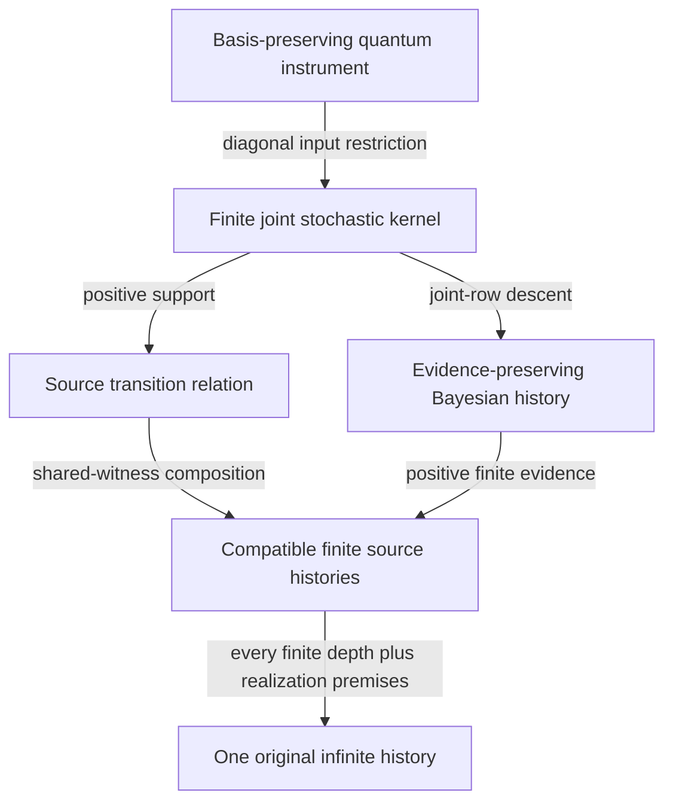

# Observational SUCC: Cambrian research campaign

Research base: PR #48 at `5eb09e7cba36ec01b8f9d6834b78b5766fd93935`.
Main stays at `52d2c02b85b246aec67160260ac06bb1da33645e` as observed at
campaign start. This is a non-main, draft integration campaign.

## A. Baseline inventory

The fresh checkout fetched current remote refs and recovered the stack
main → #40 → #41 → #42 → #43 → #44 → #46 → #47 → #48.
These are dependent snapshots, not independent research witnesses. PR #45
branches independently from #43; its EOS claims and Lean 4.19 environment
were compared separately, not merged into the 4.14 integration line.
Exact source tips and immediate parent SHAs are in
`research/2026-10-13/CAMBRIAN_BASELINE.json`.

Baseline local Python 3.12.14: **1,602 tests passed**. Required provenance,
observer-foundations and ordinal probes passed. The 72 imported provenance
entries (17 byte-identical dossiers, 55 mechanical namespace translations)
remain unchanged. All eight inherited Lean modules compiled in Lean 4.14.
GitHub's three workflows at the original #48 SHA were separately inspected
and all completed successfully. Ancestor success is not final-head success.

An isolated checkout of PR #45 passed its 59 evolving-module tests and
three receipt tests here. Its Lean 4.19 proofs were not locally recompiled
or imported; the recorded upstream evidence is separate from this run.
The initial mistaken EOS test invocation used the integration directory
and failed to import EOS modules; it was corrected to the isolated EOS
working directory. That failed invocation is not counted as a mathematical
failure or a successful test.

No original checkout or uncommitted user work was modified. Explorers used
six isolated worktrees from the identical #48 base. Archive originals,
historical claim IDs O1–O638, licenses and defaults were protected.

## B. Swarm manifest

Six actual research agents own six assignments each: **36 mathematical
investigations**, not 36 independent agents. In-session hypotheses and first
verdicts were frozen before controlled cross-group synthesis. This was not
uniform Git preregistration before experimentation; the stochastic synthesis
was recorded after its derivation. Eight additional hostile audit
assignments are tracked separately. Native concurrency was seven slots
including the principal; work was staged within that limit.

The final machine-readable manifest records each assignment's actual
status, dossier, branch/worktree, evidence and remaining gap. An executed
investigation may end in a theorem, a countermodel, a conditional statement,
or an access gap; these are not interchangeable outcomes.

| Assignments | Actual worker | Dossier and main outcome |
|---|---|---|
| 01–06 | foundations | [A](../research/2026-10-13/CAMBRIAN_A_FOUNDATIONS.md): source histories, two relational lifting gates, destructive-policy quantifiers, information fusion |
| 07–12 | chaos | [B](../research/2026-10-13/CAMBRIAN_B_CHAOS.md): continuous transfer spectrum, advancing-target threshold, bounded-target counterexample, conditional acim comparison |
| 13–18 | geometry | [C](../research/2026-10-13/CAMBRIAN_C_GEOMETRY.md): changing-source realization, finite-branching Lean theorem, cover and shared-witness obstructions |
| 19–24 | computation | [D](../research/2026-10-13/CAMBRIAN_D_COMPUTATION.md): partial behavior, history-only learning under exact-teacher access, destructive design and realization limits |
| 25–30 | arithmetic | [E](../research/2026-10-13/CAMBRIAN_E_ARITHMETIC.md): bounded p-adic extension, finite arithmetic tomography, source/completion controls |
| 31–36 | physics_logic | [F](../research/2026-10-13/CAMBRIAN_F_PHYSICS_LOGIC.md): quantum backaction, effective memory, null-cone and fluid-closure counterexamples |

The [machine manifest](../research/2026-10-13/CAMBRIAN_SWARM_MANIFEST.json)
records all 44 assignments, original commits, worktree bases, evidence,
dependencies and remaining gaps. Worker SHAs and integration cherry-picks
are distinct provenance records. The original worker and audit commits are
preserved exactly in a [reproducible Git bundle](../provenance/cambrian/README.md).
Command-line push had no credentials; publication uses the connected GitHub
API with an identical content tree and separately recorded publication SHA.
The API publication commit does not pretend to have the original Git identity.

## C. Theorem ledger

The root stochastic dossier states ST1–ST7: all-prior joint-kernel
descent, evidence-preserving Bayesian transport, finite-history composition,
two strict weaker-contract countermodels, minimal one-step statistic repair,
and the sharp rare-receipt stability boundary. General finite reindexing
proofs are distinct from 400 finite rational law controls and a direct
event-path oracle. This is classical labelled-kernel lumpability with an
explicit new-to-SUCC changing-source interface, not scholarly novelty.

Cluster theorem dossiers and final audit verdicts are linked in the final
manifest. Surviving substantial statements receive controlled new ledger
IDs; historical IDs are preserved. Every claimed academic priority remains
unestablished unless independently sourced otherwise. The controlled ledger
extension is [O639–O679](CLAIM_LEDGER.md#cambrian-campaign-changing-sources-realization-and-access).
Subsidiary propositions retain their cluster identifiers in the dossiers.

The strongest positive additions are the changing-type finite-branching
realization theorem, all-prior joint-law Bayesian descent, the sharp
conditioning bound, exact continuous-target observation surplus criterion,
and finite source-coefficient tomography. The first four instantiate classical
families or direct consequences; the last is a proved finite interface whose
academic priority is unresolved. No novelty verdict follows from the absence
of an identical retrieved formulation.

## D. Obstruction atlas

The central independent gates are:

1. **Representation:** do source updates descend through this observation?
2. **Realization:** does one original source/history realize all compatible
   reports under explicit compactness or finite-branching hypotheses?
3. **Access:** are the required source law, probe, reset and resource bounds
   actually available and authenticated?

These gates cannot be collapsed into one certainty score. Full possibility
support does not supply joint probabilities. Equal marginal laws do not
supply correlations. Equal normalized posteriors do not preserve evidence.
Small joint errors do not imply small rare-event conditional errors.
An ideal profile is not automatically an original source. A finite proof's
size is not its witness-access cost. A formal infinity is not elapsed
infinite execution.

| Failed inference | Decisive obstruction | Weakest repair established here |
|---|---|---|
| Finite compatibility guarantees an original infinite history | Natural and compact reciprocal countdowns | Finite initial/branch menus, or compact closed constraints including the original preparation class |
| Coarse boundary labels can be wired as identical witnesses | Disjoint original middle witnesses | Preserve right behavior on each coarse fiber; the paired support report suffices |
| Pairwise separation gives one destructive policy | Mutually destructive two-bit probes | Verify one public-history policy with original/current pairs retained |
| Small joint error gives small conditional error | Rare receipt with conditional TV equal1 | Include positive evidence masses; use ε/max(α,β) |
| A zero-memory prefix certifies closure | Arbitrarily delayed nilpotent hidden chain | Supply a hidden-dimension bound and its Cayley–Hamilton horizon |
| Same POVM gives the same future | Lüders and reset instruments | Transport the full outcome/poststate instrument |
| Deck invariance gives descent on every cover | Nonregular S3 cover with trivial deck group | Constancy on original fibers; regularity makes deck orbits sufficient |
| Finite arithmetic constraints force completed positivity | Authentic-prefix-preserving auxiliary multipliers | Full completion/domain identification and a separate sign proof remain missing |

Two concrete audit changes are preserved. ST7's original valid
ε/min(α,β) estimate was sharpened to ε/max(α,β), with independent proofs
and sharp unequal-mass examples. E30's two-bump indefinite prime-form
argument required the missing hypothesis a>log(2)/2; for
0<a<=log(2)/2 its compressed operator is zero. The original worker commit,
auditor's a=1/4 counterexample, and separate integration correction remain
available. The conditional Parry/acim comparison was not promoted.

## E. Cross-domain discoveries

The principal bridge is law-level: the joint future-report/receipt kernel
provides a common test for coarse stochastic dynamics and finite selected
quantum-instrument examples. Quantum outcome effects alone do not determine
future backaction. No physical source identity is transported by this bridge.

The same failed projection square forces different lawful repairs in
different categories: a refined predictive statistic in finite automata,
a causal memory kernel plus hidden-initial forcing in block-linear dynamics,
and unresolved subgrid stress in filtered fluid dynamics. The exact maps,
assumptions and negative controls belong to the respective dossiers; these
are mathematical correspondences, not a universal physical law.

The following graph names actual maps and their hypotheses:

The support arrow forgets weights and has no canonical probability-preserving
inverse. The last arrow requires joint realizability at EVERY finite prefix
depth, together with either compact closed constraints or finite branching,
and the original source class and initial constraints described in C16.
A finite supported path is not a physical
measurement or a positive-probability infinite event.

One cross-cluster composition was independently executed by auditor B. For
basis projectors P_s and basis-preserving Kraus branches K_z, set
I(s;t,z)=(K_z P_s K_z†)_(t,t). Linearity shows that every diagonal density
prior has exactly the finite joint-kernel evidence and diagonal posterior.
The auditor compared direct matrix updates and source filtering in 72 exact
cases. Lüders rows (1,0,0,0),(0,0,0,1) and reset rows
(1,0,0,0),(0,1,0,0), ordered by (t,z), have the same receipt marginals
but different next-state/receipt laws. Consequently a current-POVM interface
cannot define this causal transport. This is a proved restricted bridge and
a surviving ablation, not arbitrary coherent-state factorization.

Raw individual results remain frozen separately from this post-transport
synthesis. Exact teacher removal, hidden-source action selection, omitted
hidden initial forcing, and source incompleteness all retain negative controls.

Auditor H also quantified a resource boundary: on a valid 65-state unary
source, the learner with `max_rounds=1` used one equivalence call but 66
membership queries totaling 2,145 sequential source ticks, with maximum word
length 65. The parameter bounds outer teacher rounds, not total observation
time, queries or memory. No complexity claim is inferred from that parameter
name or from certificate cardinality.

## F. Formal verification report

Inherited proofs use pinned Lean 4.14. A new changing-type, time-varying,
nondeterministic history theorem is checked in
`formal/EODCS_CambrianRealization.lean`: complete finite successor menus
and a finite initial menu plus arbitrarily long compatible prefixes yield
one coherent infinite history. There is no uniform finite state cap.
It is classical Kőnig mathematics; choosing the history need not be
computable. The general compact-product/closed-graph topology theorem
remains a paper proof, not a topology-library kernel theorem.

Local Lean's executable locator failed because it used `/proc/<own-pid>/exe`,
while this executor exposes `/proc/self/exe`. A tiny transparent libc shim
redirected only that own-process executable lookup to the supported alias.
It changes no proof checker, elaborator, axiom or theorem. Lean reported
4.14.0, compiler commit `410fab728470`. Independent GitHub CI uses the
official runtime without this shim. Positive and false-theorem controls
and actual axiom dependencies are recorded in the formal audit.

## G. Artifacts and verification

Research source, theorem dossiers, exact rational probes, frozen receipts,
first-pass records, hostile audit outputs, tests and isolated worker commits
are committed to this branch. Exact final local/full CI results, source
hashes, validation commands and replay counts are recorded separately after
integration. A recorded output is not claimed to be an independent empirical
measurement. A same-model peer audit is not an external scholarly referee.

| Audit | Worker | Independent target and outcome |
|---|---|---|
| [A](../research/2026-10-13/CAMBRIAN_AUDIT_A.md) | arithmetic | B/C/stochastic theorem executioner; scoped statements survive; sharper conditioning bound |
| [B](../research/2026-10-13/CAMBRIAN_AUDIT_B.md) | foundations | Atom/path probability, full-matrix memory and diagonal quantum oracles; exact comparisons survive |
| [C](../research/2026-10-13/CAMBRIAN_AUDIT_C.md) | physics_logic | Kernel statements, axioms, changing types and missing-hypothesis mutants |
| [D](../research/2026-10-13/CAMBRIAN_AUDIT_D.md) | arithmetic | Imports, source identity, original/integrated commits, first-pass and EOS provenance |
| [E](../research/2026-10-13/CAMBRIAN_AUDIT_E_LITERATURE.md) | computation | Primary literature/classical attribution; global acim hypotheses remain unpaid |
| [F](../research/2026-10-13/CAMBRIAN_AUDIT_F.md) | chaos | Independent arithmetic inversion and source mutants; prime-window scope correction |
| [G](../research/2026-10-13/CAMBRIAN_AUDIT_G.md) | geometry | Fresh learners, complete strategy trees, rational blocks and fluid modes; access ablations retained |
| [H](../research/2026-10-13/CAMBRIAN_AUDIT_H.md) | physics_logic | Integration, complexity, duplicated mathematics and typed synthesis boundaries |

The aggregate verifier reruns all seven cluster/root receipts plus executable
audits A/B/F/G. Only declared runtime versions, current checkout IDs and
absolute path relocation are normalized; mathematical fields and implementation
hashes remain exact. Original receipts are never rewritten by verification.
The separately reviewed E30 paper correction is bound to both its original
and corrected file hashes by `CAMBRIAN_REVIEWED_CORRECTIONS.json`; every
other audit field remains an exact comparison input.
Lean audit C and provenance audit D retain separate authority and commands.
Auditor D additionally exposed a hash-coverage gap: an inert source mutation
could leave the geometry's mathematical receipt unchanged. Direct stored-hash
checks for the A/C source, tests, formal file and dossier contracts now close
that gap; identical numerical output does not authenticate identical code.

The [integration validation receipt](../research/2026-10-13/CAMBRIAN_VALIDATION.json)
records **1,716 full-suite tests passed** on Python 3.12.14, all required
provenance/foundations/ordinal probes, four byte-identical inherited
EODCS/Voyager receipt replays, and the complete Cambrian/audit replay. The
portable formal gate accepts nine production modules and the independent
appendix, prints the dependencies of all 65 production theorems, and rejects
four false or missing-hypothesis controls with actual Lean error diagnostics.
Final pushed-head workflow status is recorded in the draft PR; the local
receipt deliberately does not manufacture a future CI result.

## H. Scientific verdict

The campaign tests the mathematics of source-dependent knowledge construction
and repair. It does not establish unrestricted invention, a new physical
law, a cognition mechanism, a Navier–Stokes solution, arithmetic Weil
positivity, RH, or academic priority. Final surviving statements and
corrections are listed after hostile review, with paper, executable and
kernel-checked scopes kept separate.

Moonshot A advances to a general paper closed-constraint theorem and a
kernel-checked finite-branching specialization. Moonshot B reaches declared
obstruction-driven constructors and an exact-teacher learner, with existing
EOS refinement mathematics attributed; it does not invent its own metagrammar.
Moonshot C yields source-specific sharp debt/resource laws, without a universal
scalar debt law. Moonshot D reaches finite source-to-Archimedean coefficient
transport, without infinite completion or Weil positivity. These are four
different levels of progress.

## I. Next frontier

The final ranked frontier is chosen from the surviving holes after audit,
favoring discriminating power and a concrete dependency edge over a broad
metaphor. A conditional citation-backed claim stays conditional until every
hypothesis and original-source correspondence is verified.

| Rank | Exact next target and discriminating test | Significance / productive prospect / cost |
|---|---|---|
| 1 | Extend joint-kernel descent to arbitrary quantum instruments through a specified channel, proving factorization or a coherent-input obstruction. Start with noncommuting qubit branches and process-matrix equality. | High: tests the diagonal bridge's first noncommutative extension. Medium prospect and cost. |
| 2 | Replace D20's exact equivalence teacher with a weaker history protocol. Prove a guarantee under explicit mixing/state bounds, or an indistinguishable delayed-source lower bound. | High: separates implementable learning from oracle access. High prospect for a sharp boundary, medium cost. |
| 3 | Formalize C16's compact closed-constraint theorem and original-class gate in pinned mathlib; separately characterize effective branch selection with effective pruning assumptions. | High verification value; topology proof tractable, selector subtler. Medium/high cost. |
| 4 | Construct certified natural-acim branch-statistic enclosures for the exact band-merging source, or discharge every Misiurewicz component/support/periodic-orbit premise for the Parry comparison. | High source discrimination; medium prospect, high cost. A single periodic multiplier is insufficient. |
| 5 | Extend finite arithmetic tomography to a specified infinite class with explicit tail control, authentic completion terms and a norm-stable inverse. Test matched prefixes with hostile tails before any sign inference. | High potential significance; low/medium prospect, high cost. Prefixes and symmetry do not determine positivity. |

The ranking uses qualitative scientific judgment, not invented success
probabilities. Each target has an experiment or lemma capable of changing the
current verdict.
