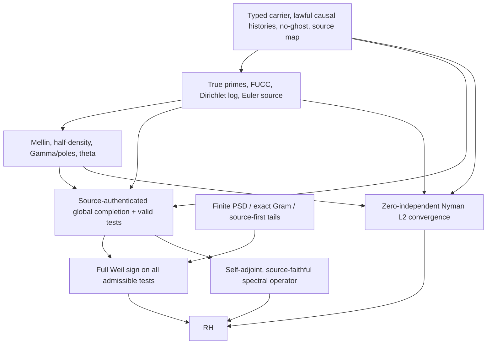

# SUCC proof-property graph bootstrap — full program map

**Snapshot:** 2026-10-13, America/New_York. **Branch:** `research/property-proof-graph-bootstrap-2026-10-13` based on zero-centered PR #59 at `b7fbba74fedd6e6734b1d2b129a72bdff4dd9843`; `main` baseline `6e0d88f1b235b85188393bbcd64ac0436cb71a70`. **RH PROVED: no.**

The JSON [proof-property DAG](../research/2026-10-13/SUCC_PROPERTY_PROOF_GRAPH.json) declares 83 typed nodes across eight layers: 16 carrier, 12 arithmetic, 12 archimedean, 11 operator, 13 positivity, 6 approximation, 8 certification, 5 exits. At bootstrap: 32 nodes PROVED_LOCAL in limited scopes; 6 CLASSICAL; **45 UNVERIFIED**. These are engineering classifications against pinned repository evidence, not a statement that 38 independent universal theorems were proven or that every proposed edge is logically necessary.

## Current sources and changes (do not confuse them)

- `main` 6e0d88f includes 48+12 many-worlds swarm, source-indexed carrier and no-ghost results, finite positive-realization/field-of-definition obstructions, Voyager, Cambrian and CEGIS. Canonical audit: `docs/MANY_WORLDS_SWARM_AUDIT_2026-10-13.md`. Its 2,132-test audit was **reported at that commit**; not re-run at this bootstrap.
- **PR #59**, based on that main, contains zero-centered reciprocal-cell residue observers, Mellin transport, pure-isometry no-go, and exact finite countermodels. Our bootstrap is stacked on it. Do not claim #59 merged into main.
- **PRs #57 and #58** are distinct, still-open recent branches: TLICA/GENIE source-map gauge, and empirical carriers/Higgs field examples. They may suggest *independent* source calibration and physical/model countertests, but they are **not** included in this bootstrap's ancestry. Compare before cherry-picking; don't import unverified physical interpretations as theorems.
- RH is a **downstream test**, not the purpose or definition of Observational SUCC. `docs/RH_HANDOFF.md` governs outbound results. No completed Weil-positive identity or Nyman global convergence is presently established.

## Dependency graph, compressed



**The arrows are declared research prerequisites, NOT already proved implications.** The bottom three arrows are ALTERNATIVE proof exits. In particular, a spectral model must prove that *all and only* the relevant nontrivial zeta zeros belong to its spectrum and that its self-adjointness actually excludes off-line zeros. A generic self-adjoint operator is not enough. A completed explicit-formula identity is not by itself a positivity proof. Finite pointwise interpolation is not L2 convergence.

## What properties SUCC must eventually supply

1. **Source and logical provenance:** physical/source claims vs mathematical models; genuine primes vs composite mutations; no hidden oracle; available and unavailable interventions; observability and identity.
2. **Rigidity and faithfulness:** unique recovery up to declared gauge; distinguish same-output different-source models; exact comparison functors; certified source maps.
3. **Causal/category coherence:** succession, partial orders, noncommuting instruments, functorial pullback, cube/cartesian gluing, sheaf descent, joint laws rather than merely equal marginals.
4. **Algebraic arithmetic:** true Euler multiplicativity, Dirichlet log, von Mangoldt prime-power jets, p-adic valuations, additive/multiplicative reciprocity, conductor and phase, source-specific negative controls.
5. **Analytic realization:** local-to-global and finite-to-Archimedean transport, domains, Mellin/Fourier/Poisson, Gamma poles/residues, functional equation, correct normalizations and boundary terms.
6. **Operator structure:** norm control, adjoints, closability, self-adjointness and deficiency, spectral mapping, trace/determinants, no ghost eigenvectors, generalized vs normalizable states.
7. **Positivity and geometry:** finite Gram positivity vs *genuine* completed Weil sign, matrix tail enclosures, Hodge/index/Arakelov polarization candidate, density/closure and rigorous all-window estimates.
8. **Proof closure:** compactness, continuity, uniform bounds, source-identifying holdouts, no implicit omega rule, honest quantifiers, distinct code/derivation/source-family audits, optional Lean refinement.

The machine-readable graph gives each concrete property a stable ID, scope, status, prerequisites and next probe; it can be changed only with a mathematical receipt and a regression test.

## Critical gaps ranked by downstream leverage

1. **A08/A09/H03/H10/P03:** actually recover the genuine arithmetic-to-completed-Weil source, surviving wrong-`6`, wrong phase, half-density, conductor, Gamma and matched non-Euler controls.
2. **P05/P06/P07:** construct a valid positive object whose quadratic form is proved *identical* to completed Weil; prove all-support positivity (or prove a domain-correct passage from all finite kernels).
3. **N05:** a zero-independent source-derived `L2` approximation sequence with a rigorous norm bound going to zero. Perfect finite SUCC fitting (N01/N02) is known and insufficient.
4. **S02-S09:** a genuine closed/self-adjoint spectral model and two-way determinant/zero identification. PR #59 already demonstrates why unit-modulus Mellin modes are not automatically normalizable eigenvectors.
5. **C08/C10/C12:** deeper rigidity, source-map identification and finite-to-global transport. These are useful SUCC results independently of RH.
6. **P08/P09/P10/P13:** geometric polarization, Riemann–Roch and Hodge positivity: potentially powerful, currently missing construction/identification, not earned by analogy.

Source/provenance, causal gluing, positive realization, and exact finite certificates already have substantial validated subcases. Do NOT have a swarm duplicate those as if there were no prior implementation.

## Bootstrap obstruction result

`research/2026-10-13/PROPERTY_GRAPH_FINITE_POSITIVITY_OBSTRUCTION.md` proves two complementary elementary facts.

1. For any finite observation horizon K, operators `I` and `I-2P_M`, with M>K, agree on all K-dimensional Gram probes although the latter has one negative eigenvalue. Exact, bounded and self-adjoint, source-blind countermodel.
2. If a **fixed bounded self-adjoint** operator has PSD *every* compatible finite compression on a strong-dense exhaustion, then it is PSD globally. This follows by continuity; it is not contradicted by (1).

The difficult proof obligation is therefore **all horizons + correct global identification + justified domain topology**, not simply another finite positive example. The code in `observational_succ/property_obstruction_controls.py` provides exact arithmetic negative controls.

## Work discipline and reproducibility

```sh
python scripts/verify_succ_property_graph.py
python -m unittest discover -s tests -p 'test_succ_property_graph.py'
python -m unittest discover -s tests -p 'test_property_obstruction_controls.py'
python scripts/verify_provenance.py
python -m unittest discover -s tests -p 'test_*.py'
python scripts/observer_foundations_probe.py
python scripts/ordinal_succ_report_probe.py
```

Run mandatory repo-provided Lean lanes only with their pinned toolchains. Record actual exit codes, exact head SHA and environment. No passing tests/Lean builds are asserted here before they run. A CLI lint is **not** a proof of any mathematical conjecture.

Potential research frontiers live on separate worktrees and draft PRs. Preserve frozen originals; never merge into main or publish/release without explicit authorization. The prepared operating instructions for an external coding swarm are in `handoffs/DEEPSEEK_SUCC_PROPERTY_SWARM_BOOTSTRAP.md`.

## Primary mathematical context (not priority claim)

- Báez-Duarte, strong Nyman–Beurling criterion: https://arxiv.org/abs/math/0202141
- Suzuki, zeta screw function and RH criteria: https://arxiv.org/abs/2206.03682
- Connes–Consani, archimedean Weil positivity: https://arxiv.org/abs/2006.13771
- DLMF Gamma and zeta normalizations: https://dlmf.nist.gov/5.2 and https://dlmf.nist.gov/25.4
