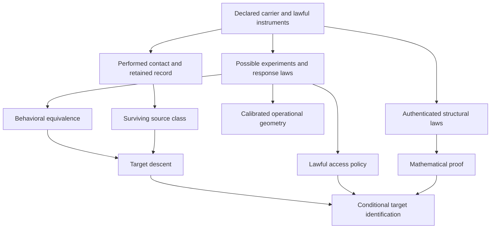

# Principia Observatoris

## De Causis, Observatione et Cognitione

**First foundational milestone, 2026-11-13. Research manuscript; draft integration.**

This is a working mathematical kernel for source-relative observation, not a
claim to have completed a new foundation of mathematics or a theory of physical
ontology. Its ambient foundations are ordinary set theory and, where explicitly
introduced, finite-dimensional linear algebra, probability and quantum
instruments. The observer is inside a modeled interaction process. The model's
application to the intended source remains a separate obligation.

The founding proposal is Leah's nine-section
[causal-relevance note](../../research/2026-11-13/causal_relevance_proximity/RESEARCH_NOTE.md)
in draft [PR #618](https://github.com/femboy2112/SUCC/pull/618), pinned at
`ab31057590a59b2bfbd5dbcd7126b2aefc7a2b55`. Its base/main is
`db9fb4b84672050efa79b13377f1e73364598a14`. This continuation preserves that
note and all archival sources. The source audit, exact experiments, failed
conjectures and validation are in the
[round dossier](../../research/2026-11-13/principia_observatoris/README.md).

## The earned central statement

Let a nonempty class of possible sources survive the observer's **actual**
record. A target is determined by that record precisely when it is constant
on this surviving class. Determination from every theoretically permitted
experiment, determination by one lawful executable policy, and adequacy of
the model to the intended source are separate obligations. None follows merely
from a large number of agreeing observations.

This statement is SUCC's existing target-descent theorem, not a new discovery.
The present manuscript connects it to quantitative prediction error, minimal
predictive refinement, sharp finite discrimination, operational geometry,
quantum instrument quotients and source-specific arithmetic countermodels.

For a particularly useful exact specialization, let \(P:V\twoheadrightarrow W\)
be a linear observer on a finite-dimensional Hilbert carrier, and let
\(F:V\to Z\) be a linear target into a normed space. Then

\[
\boxed{\inf_{g:W\to Z}\sup_{\|x\|\le1}\|Fx-g(Px)\|
       =\|F|_{\ker P}\|.}
\]

Even a nonlinear predictor cannot defeat the unresolved symmetric hidden fiber.
The error is exactly attainable by the linear predictor \(FP^\dagger\).
For dynamics, \(F=PA\); exact prediction is possible precisely when
\(A\ker P\subseteq\ker P\). The smallest linear refinement is generated by
the rows of \(PA_w\) over lawful action words; its row space stabilizes in at
most \(\dim V-\operatorname{rank}P\) refinement stages. This constructs the
required mathematical representation, but does not manufacture an instrument
that acquires its hidden coordinates.

For total homogeneous linear actions, exact passive readouts, this full-ball
prior, a fixed initial linear target and state-independent action costs, Book II
also resolves deterministic adaptive acquisition: its optimal worst-case error
equals the best fixed schedule's hidden-fiber error. The all-zero execution
provides the matching lower bound. A seven-state symmetric nonconvex prior
breaks the conclusion: adaptive error is zero, while the best fixed schedule
has error one quarter. Exact real readouts are an oracle assumption, not a
finite-bit sensor claim.

These are complete elementary proofs in Book II, with classical
optimal-recovery and control-theory antecedents. Their reusable SUCC interface
is the result of this round; scholarly novelty is not claimed.

**What precision buys in a concrete source.** For the original BBP forcing,
a stationary linear rival of dimension at most \(d\) can match \(2d\)
consecutive values, but never \(2d+1\). More strongly, let \(H\) be the
\((d+1)\)-square source Hankel matrix of those \(2d+1\) values and put
\(s=(1,-1,\ldots,(-1)^d)^T\). The **smallest attainable worst error over all
those readouts** is \((s^T H^{-1}s)^{-1}\). A rational rival attains it by
alternating its errors. Thus the observer can name the precision threshold
at which every such rival is excluded, and exhibit a rival at the boundary.
The [proof and attaining construction](../../research/2026-11-13/principia_observatoris/sharp_rival_radius.md)
concern discrimination of the forcing law. They give no estimate for the
zero-seeded orbit's signed Fourier average.

## Read the six books

| Book | Content actually delivered | Added premises |
|---|---|---|
| [I — De Fonte et Observatore](01_source_observer.md) | Typed interactions, possible versus actual records, observer/controller role, exact action quotient and countermodels | Sets and relations; deterministic specialization where used |
| [II — De Causis et Propinquitate](02_causality_geometry.md) | Hidden-response obstruction, optimal prediction error, smallest linear refinement, adaptive acquisition theorem, signed defect composition, three operational geometries | Linear/Hilbert structure, calibrated probes or composable costs as declared |
| [III — De Cognitione et Demonstratione](03_knowledge_proof.md) | Target descent, policy-leaf criterion, stochastic sample obstruction, record monotonicity, multi-observer joins, finite proof support | Nonempty surviving model class; lawful policy or proof premises separately |
| [IV — De Limitibus et Defectibus](04_horizons_completion.md) | Sharp finite-state/linear horizons, effective stability, hidden witnesses, completion and noncommuting counterexamples | Authenticated state-complexity bound; continuity and moduli where used |
| [V — De Geometria Emergente](05_effective_classicality.md) | Exact commuting-algebra instrument quotient, adaptive transcript error, finite calibration certificate, target nondisturbance, no-signaling | Outcome-wise closure, or a proved all-state error bound |
| [VI — De Applicationibus](06_succ_applications.md) | Existing SUCC interfaces, source/provenance map, sharp authentic-BBP finite-rank discrimination and detection-precision bounds, open signed frontier | Original source laws and original zero seed; no replacement ensemble |

The six files are a single first vertical slice, not six completed treatises.
For notation, dependency edges, claim authority and unresolved obligations see
the [reference register](REFERENCE.md).

## The proposed chain is a branching structure

Arrows denote dependencies, not automatic implications. In particular,
the record needs an external/performed-event receipt, a geometry needs its own
calibration/composition assumptions, and proof uses valid inference from
premises. Neither geometry nor repeated observation automatically produces proof.

## Answers to the founding questions

| Question | Earned answer and boundary |
|---|---|
| What is an observer? | A declared interaction/readout role on a carrier; a sequential finite observer adds a finite controller and retained or bounded memory. A target is needed to discuss knowledge, not to define interaction. There is no intrinsic “observer substance” axiom. |
| What is closeness? | A target-relative relevance preorder is immediate from a calibrated score. Distinguishability yields a pseudometric; lawful composable costs yield directed distance. Signed response latency need not satisfy a triangle inequality. |
| What is observation? | A typed interaction and outcome, interpreted through a declared source map. Projection preserves actual paths forward but can invent quotient paths; exact descent restores lawful lifting under its stated premises. |
| What is knowledge? | Target agreement on a nonempty surviving source class, relative to the source model and actual evidence. Access by one executable policy and source adequacy are additional requirements. |
| What is computational locality? | A declared dependency graph plus a finite-propagation or support theorem. For nonnegative linear networks, earliest response equals graph distance; cancellation destroys this converse for signed networks. |
| What is classical appearance? | A restricted operational classical realization of the allowed instrument calculus. Outcome-wise invariance of a commutative algebra gives one exact sufficient certificate, without deciding microscopic ontology. |
| What is a hidden horizon? | Source influence can reach a target before any available policy detects the distinction. Effect time, access time, precision and resource budgets are distinct typed quantities. |
| Finite failure versus completion? | A late witness is a finite counterexample. A nonzero sequence tending to zero is a limit statement. Bounded realization gives finite discrimination; unrestricted computable sources do not have a computable description-length horizon bound. |
| What can observers prove? | Structural laws and valid finite proof certificates can support universal conclusions. A finite prefix alone cannot authenticate its continuation; exact laws, model-class bounds and completion hypotheses must be paid explicitly. |
| What new mathematics was obtained? | A coherent SUCC synthesis and executable certificate layer: optimal hidden-fiber error, minimal refinement, sharp detection bounds, quantum branch calibration and authentic-BBP finite-rank discrimination. Classical antecedents and existing SUCC results remain attributed. No scholarly priority or normality proof is claimed. |

## Next theorem with the greatest leverage

**Executable predictive completion.** Given a finite authenticated instrument
family, a target and a symmetric source uncertainty class, characterize the
smallest *jointly acquirable* predictive sufficient statistic, including
disturbance, reset availability, cost and a certified error tolerance. Return
either a lawful policy attaining it or a finite obstruction certificate.

Book II gives the minimal formal linear coordinates, fixed-schedule acquisition
criterion and a complete deterministic noiseless full-ball minimax reduction
to fixed schedules (CG11); Book III proves why
pairwise available experiments need not be jointly executable. Closing that
gap would turn an exact representation theorem into a resource-aware theory
of what one finite embodied observer can actually obtain with finite precision.
Existing finite-state
exact policy planners are antecedents, not a solution of the continuous-state,
noisy and disturbance-constrained synthesis problem. For arithmetic,
the separate verdict-changing obligation remains a new original-zero-seed
signed cancellation estimate; no theorem here supplies it.
