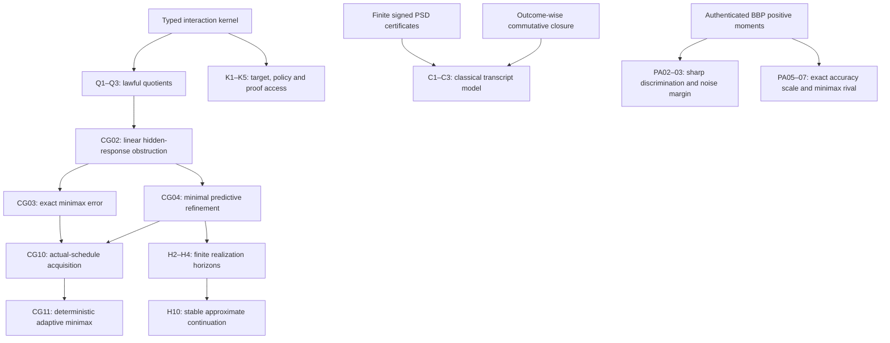

# Principia reference register

## Notation and type boundaries

| Symbol | Type / convention |
|---|---|
| \(\mathcal C=(X,A,O,R)\) | Possibility-level carrier; \(R\subseteq X\times A\times O\times X\) |
| \(h\) | Finite action/outcome transcript; possible, simulated or externally realized status is supplied separately |
| \(M,m_0,\pi,\delta,\eta\) | Controller memory, initial memory, action policy, memory update and report |
| \(q:X\to Y\), \(E\) | Observation/representation map and a bank of experiments; always restrict factors to the actual image |
| \(K_h\) | Surviving possible-source class consistent with a fixed actual history and its model |
| \(P:X\to Z\) in Book III | Target function; not the linear observation matrix used in Book II |
| \(P:V\twoheadrightarrow W\) in Book II | Linear present-readout map, with hidden space \(N=\ker P\) |
| \(A_w=A_{a_k}\cdots A_{a_1}\) | Chronological word \(w=a_1\cdots a_k\); latest action acts on the left |
| \(K_A=(PA)|_N\) | Hidden-response obstruction; it is a linear map, not a truth score |
| \(E_i=P_iA_i-B_iP_{i-1}\) | Typed model/source defect; no curvature claim |
| \(P^\dagger,\Pi_N\) | Hilbert minimum-norm right inverse and orthogonal hidden projection |
| \(Q,\mathcal V_\infty\) | Basis of the smallest action-invariant row space containing the present readout |
| \(B,C,L_a\) in Book IV | Preparation, readout and linear source updates; \(CL_wB\) is a response law |
| \(b,r\) in Book IV | Initial preparation rank and reachable-space dimension |
| \(D=\operatorname{span}\{e_i\}\) | Finite unital commutative observable algebra with nonzero orthogonal minimal projections |
| \(\Phi_{a,o},K_{a,o}\) | Quantum branch map and classical joint outcome/transition kernel, respectively |
| \(r(n),U_n,T_n\) in Book VI | Authentic BBP forcing, raw zero-seeded recurrence and selected tail |
| \(H_d(N)\) | \((d+1)\)-square authentic forcing Hankel matrix; indexing begins at zero within the block |

Symbols are local to their books where noted. In particular a quantum density
state, a classical stochastic law, a possibility relation and an actual record
are not interchangeable. A source label or hash authenticates a declared file,
not its application to a physical system.

## Theorem dependency map

The arrow from refinement to horizons is the dual span-stabilization method;
the proofs in Book IV are self-contained. Neither the quantum nor the arithmetic
application is an axiom of the kernel. Metric completion requires a separate
continuity/modulus premise (H9). Causal graph latency requires nonnegative
weights or a separately proved no-cancellation condition (CG09).

## Claim register and proof authority

**PROVED PAPER** means a complete mathematical derivation in the linked book,
conditional on its stated hypotheses. Exact finite tests exercise an implementation
and countermodels; they do not establish its universal theorem by enumeration.
Review was by separate same-model agents plus the root, not external peer review.
No new Lean kernel certification is claimed. Existing Lean results keep their
original receipts and have not been silently extended to these new statements.

| IDs | Scope and status | Provenance / hostile control |
|---|---|---|
| PO-D1/D2, PO-E1 | DEFINITIONS: carrier, observer/controller and realized-record convention | Existing typed observation architecture; simulated possibility is not actual contact |
| PO-Q1/Q2 | CLASSICAL / REUSED: partial-action descent, behavioral quotient | `FutureSafeForgetting.lean`, BPGS-09; invented path and differing availability/cost |
| PO-Q3 | CLASSICAL / REUSED: joint original/current stochastic-law descent | Existing `carrier_indexed.py`; nonempty original label type, hidden posterior and probability retained |
| PO-K1 | CLASSICAL / REUSED: target constancy iff factorization | Carrier-relative targets §1; empty fiber is incoherent |
| PO-K2/K2s | PROVED PAPER: terminal policy fibers; no certain finite discrimination under common transcript support | Destructive three-state probe; Bernoulli 1/3 versus 2/3 |
| PO-K3/K4/K5 | CLASSICAL / REUSED or SYNTHESIS: record monotonicity, joint-image agreement, finite proof support | Current-state movement, shared provenance, incompatible parity triple, infinite-rule substitution |
| CG01/02 | CLASSICAL / REUSED: sensitivity chain rule and linear kernel descent | Nondifferentiable threshold; hidden coordinate escapes to readout |
| CG03/04 | CLASSICAL CONSEQUENCES / PROVED PAPER: optimal hidden-fiber error and minimal invariant linear refinement | Nonorthogonal section is not optimal; one-coordinate-at-a-time sharp closure chain |
| CG05/06/07 | PROVED PAPER: signed defect telescope, coordinate covariance and nonlinear fiber criterion | Step errors cancel; unchanged Euclidean units; disconnected fibers and zero derivative at one point |
| CG08/09 | CLASSICAL / PROVED PAPER: behavior pseudometric; graph latency with nonnegative weights | Empty bank convention, scale nonuniqueness, signed diamond violates triangle inequality |
| CG10 | CLASSICAL CONSEQUENCE / PROVED PAPER: actual-schedule linear target acquisition | Initial versus present target differ after destructive evolution; hypothetical word bank is not one history |
| CG11 | PROVED PAPER / CLASSICAL OPTIMAL-RECOVERY LINEAGE: deterministic adaptive minimax equals the best fixed schedule for a full Hilbert ball, linear initial target, total linear actions and fixed positive costs | All-zero execution proof; symmetric nonconvex seven-state prior gives adaptive error 0 versus fixed error 1/4; nonlinear actions and state-dependent costs also break the conclusion; randomized expected loss is a different objective |
| PO-H1–H4 | CLASSICAL / REUSED and PROVED PAPER: finite machines, switched linear systems and recurrence closure | O582 already gives the Moore refinement bound; sharp signed Vandermonde pair; global dimension promise essential |
| PO-H5–H8 | REUSED COUNTEREXAMPLES / CLASSICAL REDUCTION: finite-rank spoof, hidden horizon, query cost and unbounded program horizon | O379–380 already record the delayed-rank obstruction; invisible bit, all-zero query adversary, halting reduction |
| PO-H9/H10 | CLASSICAL / PROVED PAPER: continuous completion and stable approximate future response | Discontinuous or moving observation; unbounded semigroup and ill-conditioned basis |
| PO-C1/C2/C2a | CLASSICAL STRUCTURES / PROVED PAPER: exact classical instrument realization, Nε error and signed PSD calibration | Averaged closure misses outcome information; reset-X false ε=1/3 certificate |
| PO-C3/C4 | CLASSICAL / REUSED: target nondisturbance and local-channel no-signaling | Conditioning and communication are different operations; coherence hidden from Z-only bank |
| PA01 | REUSED: authentic forcing has all-rank strict Hankel positivity | Existing source-genesis/positive-moment proofs; single-atom rival fails strict positivity |
| PA02/03 | PROVED PAPER / NEW-TO-ROUND ASSEMBLY: sharp 2d+1 consecutive readouts and exact rational error margin | Rational dimension-d prefix fit, compulsory determinant-ratio residual; no temporal cancellation conclusion |
| PA04 | CLASSICAL / REUSED OBSTRUCTION: finitely many Fourier modes do not identify the full law | Odd cyclic grid and Haar match the finite bank |
| PA05 | PROVED PAPER / SOURCE-SPECIFIC SYNTHESIS: explicit two-sided beta-norm bounds on the compulsory residual, of order N^(-2d-2) for fixed d | Existing beta density bounds plus monic minimization and elementary Rodrigues norm; exact bound/reversed-bound controls |
| PA06/07 | PROVED PAPER / SOURCE-SPECIFIC SYNTHESIS: fixed-dimension residual constants and exact uniform minimax radius against all dimension-at-most-d stationary rivals | Positive moment Gram matrix, classical Christoffel function and componentwise regularity radius; a Hankel-preserving alternating perturbation is realized by a rational stationary rival |
| Universal geometry/classical ontology from weak kernel | REFUTED as an unrestricted implication | Classical shortcut, quantum commuting toolkit, signed cancellation, metric rescaling |
| π normality, R0, RH, Goldbach, physical collapse/geometry | OPEN / NOT ESTABLISHED | No transfer from reconstruction language to a missing arithmetic or physical estimate |

No row asserts academic originality. PA02/03/05–07 provide a useful original-source
inequality and finite discrimination instrument; their ingredients are classical
and their qualitative infinite-rank ancestor was already in SUCC.

## Assumption audit

Book I's table distinguishes structural definitions, optional computational
premises, observational record premises and physical source adequacy. Concrete
finite deterministic, stochastic and quantum models establish relative consistency
of the instantiated kernels. Countermodels establish the following non-implications:

- Relational typing does not imply determinism, total action availability,
  persistent memory, repeatability, nondisturbance or a metric.
- Exact present target descent does not imply future predictive closure.
- All-experiment target identifiability does not imply a single-copy policy.
- The adaptive minimax reduction does not cover arbitrary symmetric priors,
  nonlinear actions, state-dependent costs, finite-bit/noisy access or a
  randomized expected-loss objective.
- Finite computation or a finite observed Hankel rank does not imply a bounded
  global realization or a computable universal witness horizon.
- Source topology does not choose metric normalization or physical distance.
- Commutative output effects or averaged channel closure do not imply branch-wise
  predictive closure.
- Pointwise convergence of each observation does not justify diagonal limits of
  an expanding instrument bank.

These are scoped independence receipts, not an assertion that every listed
optional premise is logically independent of every other combination. The
kernel is deliberately weak. Stronger linear, probabilistic and quantum kernels
remain declared specializations, not rival ontologies silently identified.
