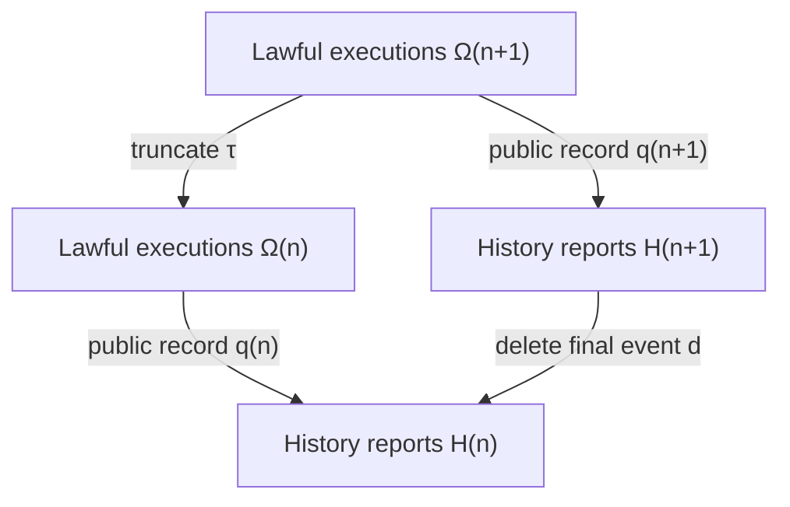

# Cambrian cluster A — typed history, two-sided lifting, and proof support

Base: `5eb09e7cba36ec01b8f9d6834b78b5766fd93935`. Worktree:
`a_foundations`. Assignments 01–06 were investigated by **one** cluster researcher;
six independent explorers are not claimed. The first conclusions were frozen in
`CAMBRIAN_A_FIRST_PASS.json` before receiving other clusters' conclusions.
No archival/imported module was edited. Protected shared documents were untouched.

**Verdict:** one useful unified *classical* source-changing transport theorem,
with exact directional countermodels and a separate weighted repair; precise
answers to all six assignments. This does not establish academic novelty,
empirical observer physics, general proof-theoretic completeness, or RH.
New Python checks are finite rational certificates, not Lean kernel verification.

## Baseline and hole contract

Read `AGENTS.md`, the foundations/method/architecture/roadmap, both prior swarm
audits, the relevant O294/O307/O405–427/O481/O587–608/O614–638 frontier, and the
import manifest. Its source commit is
`ba075348b7bcc66d938b3e0ca96c26e95bba340a` in `FuckingRH`.
The frozen originals remain byte-identical. Relevant recent source interfaces:
`causal_nerode_succ.py`, `eodcs_relational_choice.py`,
`noncommuting_proof_transport.py`, `field_relative_closure.py`,
`covariant_proof_descent.py`, `dual_boundary_observers.py`,
`probe_coherence.py`, and `cycle_support_budget.py`.

Existing O600 already proves observed-support descent, O602 its coarsest
paired-report repair, O607 refutes inference of likelihoods from supports,
and the prior finite Beck–Chevalley object concerns a static cospan.
The selected missing edge is **complete old-evidence transport into a changed
post-source**, followed by a precise condition for retaining its conditional law.
This is weaker than a universal observational-realization theorem: all sources,
relations, epochs, and observation maps here are independently declared.

* Positive hypothesis: two relational lifting gates and one independent weighted
  condition classify exact transport at these scopes.
* Competitive rival: a commuting observation square or one-step support descent
  transports all old evidence, truths, and probabilities.
* Cheapest falsifier: two old states, two post-states, identity intervention,
  distinct old reports and one collapsed new report; then a four-positive-entry
  rational joint law with correlated rows.
* Leverage: prevents false source completion, identifies the weakest set-level
  repair, and supplies a precise source-map/probability diagnostic for observers.
* Boundary: original proof authority, causal execution feasibility, source
  authentication, completion realizability, and effective computability remain
  separate premises.
* Novelty tax: elementary powerset/conditional-independence mathematics;
  **new-to-SUCC organization and executable extension**, not a new theorem of
  mathematics. A priority search has not established any independently novel result.

## 01 — A source-typed observational state (CA01)

Let a declared intervention system have carrier sets `X_i`, admissible
action/outcome relations, and specified source epochs and bases. Let `Ω_n` be
the set of lawful length-n executions, including hidden starting and intermediate
states. There are distinct maps

\[
 X_0\xleftarrow{r_n}\Omega_n\xrightarrow{c_n}X_n,
 \qquad q_n:\Omega_n\longrightarrow H_n=\operatorname{im}(q_n).
\]

Here `r_n` is original-source address, `c_n` current carrier address, and `q_n`
the **public action/outcome/epoch record**. Hidden simulator addresses are not
observer evidence. Its epistemic state is the nonempty candidate source set
`K(h)=r_n[q_n^{-1}{h}]`. A probability on it requires a separately declared law.
Proof authority consists of a specified sound proof system/decoder plus source
premises; it is not another coordinate which a label magically authenticates.
The ideal inverse limit of `H_n` is a completion object, not an actual execution.
Realizing every compatible ideal profile needs the separate closure/compactness
hypotheses addressed by VOYAGER.

For lawful truncation `τ:Ω_{n+1}→Ω_n` and deleting the last public event
`d:H_{n+1}→H_n`, the **actual square** is



It commutes because `q_n τ = d q_{n+1}` event by event. Also `r_n τ=r_{n+1}`.
**Current-state projection does not satisfy this same identity:** truncating a
path returns its earlier carrier, not the new carrier. Nor is `τ` necessarily
surjective if some executions dead-end.

**Universal property with exact quantifiers.** For any set `Z` and function
`F:Ω_n→Z`, a unique `Fbar:H_n→Z` with `F=Fbar q_n` exists iff
`q_n(e)=q_n(e') ⇒ F(e)=F(e')` for every pair of lawful executions.
Necessity follows by substitution; sufficiency defines `Fbar(h)=F(e)` for a
representative; surjectivity onto the image gives uniqueness. This proves a
universal **report quotient**, not a universal object containing all ontology.
For original-source target `T`, substitute `F=T r_n`.

Functorial transport requires specified execution maps preserving action labels,
source identity, and public reports. Such maps compose because their equalities
compose. Epistemic direct images are functorial on declared sets, but identifying
their images with *complete* target-report fibers needs CA02 below. Proof-system
transport needs a sound rule translation; no generic automatic functor is claimed.

**Receipt and rival:** `public_history_square` constructs the square on actual
existing `FiniteCarrier.run` histories. A bit-reporting reset maps both original
bits to current state zero while their retained histories separate the roots.
Mutating the reset outcome to a constant leaves roots `{0,1}` in one public fiber.
The single-current-state rival is REFUTED by this exact two-state pair.
Next falsifier: a source-changing history translation which drops intervention
identity but claims to preserve an original-source decoder.

## 02 — Source-changing relational base change (CA02a–c)

Let `R⊆X×Y` be a complete declared intervention relation and let surjective
reports `q:X→A`, `p:Y→B` refer to their respective epochs. Define
`Rbar={(q(x),p(y)):xRy}`. Relational image and inverse image are existential.

**CA02a, theorem (arbitrary sets, no probability).** The following are equivalent:

1. For every `V⊆B`,
   `R^{-1}[p^{-1}V]=q^{-1}[Rbar^{-1}V]`.
2. For every `x,x'` with `q(x)=q(x')`,
   `{p(y):xRy}={p(y):x'Ry}`.

Proof: one inclusion holds by definition. The reverse holds exactly when every
abstract next report reached by *some* old-state representative can be reached
by *each* representative. Singleton `V={b}` tests necessity. This is precisely
the existing O600 criterion, reused rather than counted as a new discovery.

**CA02b, theorem (the complementary missing gate).** The following are equivalent:

1. For every `U⊆A`, `R[q^{-1}U]=p^{-1}[Rbar[U]]`.
2. For every `a∈A`, the reached set `R[q^{-1}{a}]` is p-saturated.
3. For every `a∈A,y∈Y`, if some `xRy'` has `q(x)=a` and `p(y')=p(y)`,
   then some `x'Ry` has `q(x')=a`.

Proof: (1) implies (2) using singleton `U`; (2) implies (1) because a union of
saturated sets is saturated and the abstract image is exactly the saturation
of the actual image. Conditions (2) and (3) are the element-wise definition of
saturation. This classifies complete post-source fibers after old evidence.
Each existential equality has a universal counterpart by Boolean complementation
of the corresponding relation image. This includes reverse universal
predecessor quantification; it does **not** relabel a nondeterministic successor
as a necessary realized outcome.

**Independence, exact small controls.** Let `X=Y={0,1}` and `R` the diagonal.

| q | p | CA02a | CA02b |
|---|---|---|---|
| identity | constant | yes | no: old report 0 reaches only y=0, completed fiber adds y=1 |
| constant | identity | no | yes |
| constant | constant | yes | yes |

The first case has a commuting deterministic observation square: its lower
map is constant. Commutativity therefore does not imply exact post-source
evidence completion. With globally reachable target states, a nontrivial
countermodel needs at least two post-states and two old states. If unreachable
post-states are admitted into the declared target chart, one old state reaching
only one of two equally reported target states already refutes CA02b.
The final row satisfies both gates with only diagonal source links, so full
rectangle saturation `R=(q×p)^{-1}Rbar` is sufficient but unnecessarily strong.

**Weakest repair for the deterministic first countermodel:** retain the old report
with the new one, or restrict the post-source domain to the source-supported
fiber appropriate to that old evidence. For general relations, changing p alone
or q alone need not simultaneously repair both gates; identity reports do, at the
cost of exposing the full source, which might be physically unavailable.
Report-level post-properties `p^{-1}V` need no CA02b gate: completion adds states
of the same reported value. CA02b is needed for arbitrary hidden post-predicates
or exact post-source reconstruction, and is stronger than target-specific safety.

**CA02c, weighted theorem.** Let `J(x,y)` be a specified normalized joint law
supported exactly on R, set `A=q(X)` and `B=p(Y)`, and never normalize a null
conditioning event. For every old-report evidence event `U⊆A`, every `b∈B`,
and every `F⊆Y` with `P(A∈U,B=b)>0`,

\[
P(Y\in F\mid A\in U,B=b)=P(Y\in F\mid B=b)
\]

holds **iff** `A` and `Y` are conditionally independent given `B`, equivalently

\[
J_{A,Y}(a,y)J_B(b)=J_{A,B}(a,b)J_Y(y),\quad p(y)=b.
\]

Proof: singleton old events and singleton post-events force the displayed
cross-product identity whenever their masses are positive; a zero mass makes
both sides zero. Conversely divide the identity on nonnull `(a,b)` to obtain the
same conditional Y law in every old-report fiber. Summing over `a∈U` gives the
same conditional law for every event U and every post-predicate F.
The criterion is about **one declared joint law**. It neither says old evidence
has unchanged probability nor proves all-prior stochastic intervention descent.

All-positive `J=[[1/4,1/4],[1/4,1/4]]`, q identity, p constant, is positive control.
Keep exactly the same source supports but mutate to
`J=[[1/8,3/8],[3/8,1/8]]`. Both set gates remain true, while the `(a0,y0)`
cross-products are `1/8` and `1/4`, so the weighted claim fails. An observation
supported everywhere may still carry source-specific correlation.

**Proof-support gate.** A source-evidence support denotes a nonempty candidate
set C and a sound local proof of `C⊆T`. A post-source claim `T'` transports exactly
when `R[C]⊆T'` is separately established. Pointwise truth preservation along
every allowed R-link is a sufficient stronger hypothesis. If C is q-measurable,
CA02b makes replacing its true image by abstract post-report completion exact.
Merely transporting report labels never constructs a sound proof translation.

Independent predicate enumeration checks **21,952** complete three-state serial
relations with binary old/new report tables, including universal-precondition
controls. A distinct normalized conditional-law oracle checks **2,352**
denominator-eight joint/report tables. Mutation controls reject incomplete
source coverage, unknown old reports, floating weights, support mismatches, and
null normalization. The symbolic proofs supply the universal quantifiers;
enumeration alone does not.

## 03 — Knowledge lattice and destructive actions (CA03)

On a fixed source/path domain Ω, a report q defines a partition `ker(q)` and the
Boolean algebra `B_q={q^{-1}U:U⊆im(q)}`. More information means finer kernels:
`ker(q')⊆ker(q)`, equivalently `B_q⊆B_q'`. A joint report has kernel intersection.
The source-to-report image/inverse-image operations satisfy the Galois adjunction
`q[C]⊆U iff C⊆q^{-1}U`; source saturation `q^{-1}q[C]` is an extensive, monotone,
idempotent closure operator. Its fixed points are exactly q-measurable subsets.

**Retention theorem:** every Boolean old-report claim remains decidable from a
retained report r iff `ker(r)⊆ker(q)`. Proof: kernel inclusion gives a decoder of
q and hence every old Boolean fact; conversely if `r(x)=r(y)` but `q(x)≠q(y)`,
the old fact `q=q(x)` is a counterexample. Tested on all **256** pairs of binary
four-source report maps against every old-measurable Boolean claim.

For a genuine intervention `f:X→Y`, compare `p f:X→B` with q on the original
domain, not p and q on different carrier sets. A retained report `(q,p f)` always
preserves q. Current-state-only `p f` may lose it: the two-bit-value reset gives
q=(0,1), p f=(0,0). The old recorded claim remains about the old source; it need
not still be true of the current carrier. A source-changing predicate must have
its own truth-preservation square.

Nondeterministic executions use Ω and retained paths, not an invented deterministic
root-to-history function. The cumulative histories form a filtration on a fixed
space of executions; bare current-carrier reports need not. Sigma-algebra and
sufficient-statistic extensions require measurability and specified measures;
finite exact results do not supply them automatically. Next probe: genuinely
stochastic destructive instruments with retained noise/history and missing
outcomes, checked separately from positive support transport.

## 04 — Minimal proof support and four resource contracts (CA04)

Let X be a finite complete source table with actual `x`, target T, and static
read-only probes `p_i`. Receipt set S certifies the actual target iff every
target-disagreeing rival `y` differs on at least one selected probe. Thus
inclusion-minimal support is exactly a minimal hitting set of the rival sets
`D_y={i:p_i(x)≠p_i(y)}`. Proof: a nonhit rival shares every receipt but has another
target; hitting all rivals makes T constant in the actual evidence fiber.
No evidence fiber is empty because x itself realizes its receipts.
This pointwise certificate differs from a global decoder sufficient for *every*
source; `FiniteField.factor` remains the existing global interface.

**Sharp AND_n family:** independent n bits with target their AND. At all-one
source, every probe is necessary: changing any unqueried bit supplies a rival;
all n suffice. At any zero source, each individual known-zero receipt suffices;
no empty support suffices over the full source cube. Exact checks cover n=1…6
and every source, matching these separately derived certificates.

Physical observation cost, support cardinality, communication length, and number
of macro-updates are distinct:

* An opaque bit-probe decision policy has worst-case n queries for AND_n; the
  all-one path adversary proves the bound, and querying all bits attains it.
* With per-query declared cost M, that same certificate costs nM. Arbitrary M
  disproves any cost upper bound based only on support cardinality.
* A source-correct authorized sender can transmit the target in one bit; a
  receiver who must validate individual bit receipts has another proof-authority
  contract. Receipt count does not equal encoded bit length or trusted testimony.
* A declared parallel/batch instrument can produce n receipts in one macro-update;
  a serial instrument needs n. The action grammar determines which is available.

Destructive static supports can remain unexecutable (the existing parity
countermodel). Proof DAG sharing similarly changes representation length without
changing the leaf dependencies. There is no justified universal scalar law
relating these metrics without action costs, communication interfaces, and
proof rules. Next falsifier: a proposed resource bound must survive cost rescaling,
batching, source-law restriction, and a change of authorized proof authority.

## 05 — Toolkit-relative darkness and a policy quantifier trap (CA05)

For a complete finite deterministic Mealy source, enabled menus are public.
Two states are future-equivalent iff they have matching enabled status, matching
action outcomes, and equivalent successors for every enabled action. The greatest
such equivalence is exactly equality of all finite public action traces: induction
proves sufficiency; a first mismatching trace proves necessity. Existing
`finite_future_equivalence` computes it by pruning; `finite_separator` gives
a shortest pair-state BFS witness. The wrapper compares those two routes.

The classification must retain separate evidence:

| Surface | Exact criterion or witness |
|---|---|
| Pathway gap | A legal separator exists, but the current chosen route has not reached it |
| Probe/access gap | No separator in the admitted grammar, but a separately declared extension supplies one |
| Unfaithful semantic map | A physical separating report exists but the proposed representation collapses it |
| Tool-relative pair darkness | A closed greatest-equivalence witness aliases this pair under every legal word |
| Uniform-policy failure | Every attempted first action retains some target-different rival; possibly different rivals per action |

A two-state constant-output identity action certifies pair darkness; adding a
read action supplies its lamp. A three-state source needs `tick,read`, so a
one-probe failure is only a route gap. Constant semantic readout kills an
otherwise present separator, so darkness of that readout does not prove darkness
of the physical probe class.

**Important quantifier countermodel:** all target-disagreeing pairs can each have
a legal separator while there is no single sound adaptive one-carrier policy.
For original `(a,b)`, action A reports a then overwrites b with zero; action B
reports b then overwrites a with zero. Every opposite-parity pair differs in
some bit, so a pair-specific first read separates it. But whichever action a
uniform policy chooses first, opposite-parity sources share that receipt and the
same post-state, hence every future action also aliases them. Thus
`∀pair ∃word` does **not** imply `∃policy ∀source` under destructive actions.
This is a sharpened interpretation of existing destructive-policy results, not
a new impossibility theorem. The complete action grammar and observable menus
are load-bearing. Infinite computably presented grammars remain subject to the
existing halting reduction; finite tests do not classify them.

## 06 — Many observers: common information versus fusion (CA06)

Let finitely many observers report `q_i:X→A_i` on one complete original source
class, after any legitimate lag/basis transport into that **same** source domain.

**Theorem:** fused information is the report `Q=(q_1,…,q_k)` with
`ker Q=intersection_i ker(q_i)`. The maximal deterministic common factor C
has kernel the equivalence closure of `union_i ker(q_i)`.
Proof: any common target must be constant on each observer fiber, hence on all
chains generated by those fibers; conversely the chain-component label is
constant on each observer fiber, so every observer can decode it. Any target
which every observer individually decodes factors uniquely through C. Joint
targets factor through Q by the same fiber criterion.

Three independent bit observers are each incomplete and have trivial common
factor, but their fusion reconstructs all eight source states. An independent
Boolean-algebra oracle checks all **4,096** triples of binary report maps on
four sources and every Boolean target, without using component union-find.
The prior dual Gács–Körner common-part result is recovered when k=2. Probability
zero source points require restriction to law support for an almost-sure version.

The uniform even-parity source `{000,011,101,110}` gives pairwise independent
coordinate reports but not joint independence. Triple report 111 is not source
realizable despite every pair being realizable. More generally, for every odd
k≥3, the even-parity k-bit source admits each k−1 all-one local record but not
the all-one global record. Proof: k−1 is even while k is odd. Checks k=3,5,7 are
receipts for the general parity proof, not its universal justification.
Distributed proof fusion therefore needs a nonempty joint source fiber and
lawful source/basis/epoch alignment; pairwise overlap or trivial deterministic
common information alone decides neither. Missing lag/basis maps are an access
or transport gap, not a licence to infer unconditional independence.

## Literature and relation to existing results

* J.J.M.M. Rutten, *Universal coalgebra: a theory of systems*, TCS 249 (2000),
  3–80, especially system morphisms and bisimulation. [Full published paper](https://www.cs.cornell.edu/courses/cs6861/2024sp/Handouts/Rutten.pdf);
  [author-institution report record](https://ir.cwi.nl/pub/4802). The published
  full text was retrieved. Its preservation/reflection laws are direct classical
  relatives of CA02, and its coinductive equivalence laws cover CA05's framework.
* *Dialectica logical principles: not only rules*, Journal of Logic and
  Computation 32(8), 1855ff. [Publisher article](https://academic.oup.com/logcom/article/32/8/1855/6795172).
  Search retrieval exposes its existential/universal Beck–Chevalley doctrine
  definition; full-page retrieval failed. It is a literature lead, not an assumed
  theorem needed for our element-wise proof.
* P. Gács and J. Körner, *Common information is far less than mutual information*,
  Problems of Control and Information Theory 2 (1973), 149–162.
  [Institutional publication record](https://iris.uniroma1.it/handle/11573/16907).
  Metadata was retrieved; a guessed author-hosted PDF path failed. The original
  paper was **not** read here. Finite common-factor attribution agrees with the
  already-audited dual-observer dossier; CA06's elementary proof is self-contained.
* David Blackwell, *Equivalent comparisons of experiments*, Ann. Math. Statist.
  24(2), 265–272 (1953), [publisher DOI](https://doi.org/10.1214/aoms/1177729032).
  Publisher retrieval exposed no usable full text. Comparison/garbling is a
  related classical framework, not a novelty certificate or a used premise.

No imported theorem is silently strengthened. The substantive addition is the
two-sided source-changing gate and its explicitly separate fixed-law Bayesian
criterion. CA01/03/04/05/06 organize and extend tests of already classical or
already-repository mathematics. No academic priority is asserted.

## Validation, integration, and next lamp

Code and tests are namespaced `cambrian_a_*`. The raw first pass and the final
machine-readable per-assignment report are separate artifacts. Replay command:

```sh
python -m unittest discover -s tests -p 'test_cambrian_a_foundations.py' -v
python scripts/cambrian_a_foundations_probe.py
python scripts/verify_provenance.py
python -m unittest discover -s tests -p 'test_*.py'
python scripts/observer_foundations_probe.py
python scripts/ordinal_succ_report_probe.py
```

Actual validation outputs and tool/code hashes are stored in
`CAMBRIAN_A_VALIDATION.json`; results are not inferred from another SHA's CI.
No new Lean proof is claimed. An independent external-to-this-cluster hostile
audit must precede integration/status promotion by the principal agent.

Highest-value next lamp: replace a set-valued relation by a genuinely stochastic
source-changing instrument with a public receipt, verify its **joint** output/
receipt law and all-prior descent, and distinguish evidence-probability transport
from posterior-only equality. This addresses an actual unresolved source typing
edge rather than installing a new scalar "truth" score.
