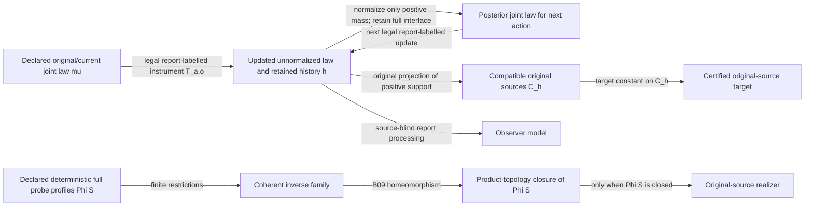
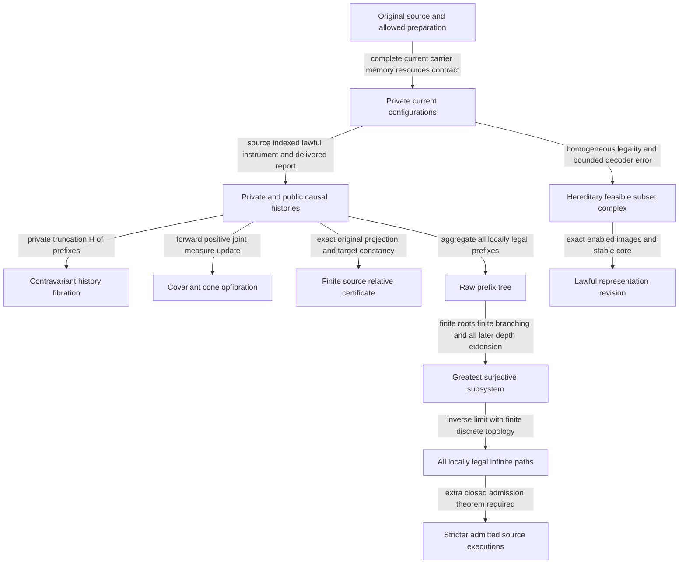

# SUCC MATHEMATICAL ATLAS

**Completed atlas: 48 first-generation missions and 12 cross-domain syntheses, with scoped survivors independently reviewed.** Exactly59 distinct native child agents were genuinely spawned, excluding the principal and foreign swarms. X09–X12 used four already existing, unrelated investigators in separate worktrees after the native lifetime thread quota was reached; those new assignments did not increase agent count. All60 assignments completed,0 assignments blocked; unproved subclaims remain labelled. The [registry](registry.json) records actual assignments, agents, exact parent/child commits, reviews and integration decisions. Draft [PR49](https://github.com/femboy2112/SUCC/pull/49) extends verified VOYAGER `5eb09e7cba36ec01b8f9d6834b78b5766fd93935`; EOS `b2774ca` remains a separately audited sibling with Lean 4.19. This branch uses Lean 4.14. Archives and main remain intact.

## Acquisition, certification and completion

The top arrows require a stipulated complete instrument law, retained preparation/memory and actual legal public history; a source class alone supplies no probabilities. Instrument composition acts on the joint law while the original label stays fixed. A zero-mass branch has no posterior. Model processing cannot split a source-law equivalence class (F44). Target constancy certifies a source-relative conclusion and does not authenticate the stipulated outside source. The bottom diagram applies to deterministic discrete probe profiles; its ideal arrows are mathematical constructions, not performed infinite observation. F48 phase2 now supplies the causal-prefix adapter for all locally legal executions under finite preparation/branching. A stricter source-admission class needs a separate closedness theorem.

## Navigable mathematical map

| Structure and actual arrow | Domain and validity conditions | Surviving invariant / evidence |
|---|---|---|
| Original/current/history support `(s,q,h)` | Declared source contract; legal instruments and actually retained outcomes | Original targets decode only when constant on retained support fibers; current carrier alone can erase them |
| Source-indexed predicates and receipt families | Commuting finite source square, comparison `W→X×_Z Y` | [A01](A01.md): predicate base change iff comparison surjective; witness-family base change iff bijective |
| Restricted probes `C→Set^(Pop)` | Finite free acyclic path category; precursors actually available | [A02](A02.md): arrow faithfulness iff probes reach sources of distinct parallel paths; object separation alone fails |
| Connected gain-graph chart descent | Complete exact cover, integral additive increments | [A03](A03.md): overlap period subgroup equals source periods; primitive iff zero; finite modular menus hide LCM periods |
| Fiber transport and holonomy `π1(G)→Sym(X)` | Complete connected graph, bijective transports, nonempty finite fiber | [A04](A04.md): sections upstairs are stabilizer fixed points; minimum connected degree min orbit size; regular degree min stabilizer-core index |
| Observation-language migration `Lan_K ⊣ K* ⊣ Ran_K` | Finite source-tagged diagram categories `FinSet/P` | [A05](A05.md): actual comma colimits/limits and adjunctions; full-faithful migration recovers original objects, empty products create candidates without receipts |
| Repair `E↦⋂w U_w*E` | Fixed total actions, seed equivalence contained in report kernel | [A06](A06.md): coreflector under relation inclusion, reflector under reversed information order; source pullback commutes only for lawful homomorphisms |
| Instrument histories and comparisons `P;Q`, `α⊙β` | Complete finite interfaces, rational normalized weighted spans, record words, exact apex pushforward | [A07](A07.md): bicategory coherence and full joint record kernel functor; report equality alone cannot continue lawfully |
| Resource hom `inf c(history)` | Identity0, composition-subadditive costs and legal continuation at the same complete endpoint | [A08](A08.md): directed enriched category and contracting functors; representative-switch quotient fails triangle |
| Full trace `Φ:S→O^W`, all-finite family `lim_F im(Φ|F)` | Discrete report topology; actual finite-stage source images and restriction maps | [B09](B09.md): completion is homeomorphic to closure Φ(S); original realization iff Φ(S) closed; native pinned Lean kernel proof |
| Compact/profinite observational completion | Continuous finite-alphabet probes; original compact source for actualization | B09 kernel: compact Hausdorff totally disconnected inverse family; bonding continuity and action transport; no infinite physical execution |
| Cost-constrained source realization | Hausdorff original source, continuous finite probes, finite-valued cost with compact sublevels | [B10](B10.md): minimum global cost equals supremum finite-shadow infima; finite supremum attained; Polish/local compact/Baire alone fail |
| Effective refutation certificates | Complete computable finite original carrier, exhaustive contexts and semidecidable mismatch | [B11](B11.md): partial extractor halts on precisely unrealizable profiles with at most one context per source; arbitrary computable targets admit no total uniform witness bound |
| Partial-record order `r⊆r'` | Nonempty original profile class over finite discrete alphabet | [B12](B12.md): source-realizable dcpo iff original image closed; ideal completion otherwise adds unsupported partial information |
| Proof-tower union `colim C_n` | Nested compatible syntax/evidence/actual rules, finite proofs and finite-premise nodes | [B13](B13.md): every proof has a finite support stage; effective consistent arithmetic union cannot obtain self-consistency by union alone |
| Residual quotient `s↦(v↦q(U_v s))` | Fixed complete pointed deterministic source and legal word grammar | [B16](B16.md): exact minimal realizer index, sharp primitive lasso/prefix counts, marker-gap bounds; observer storage is separate |
| Finite decision and recognition `S→2 / Sierpinski` | Declared source subspace, cylinder topology; effectiveness separately requires c.e. families | [B14](B14.md): clopen/open criteria, compact uniform horizon, exact Borel classes and noncompact parity obstruction |
| Final deterministic trace `X→O^(A*)` | Fixed total deterministic action functor; Set branching semantics separately typed | [B15](B15.md): unique final map and quotient-to-image; relational/probabilistic trace equality is weaker than branching bisimulation |
| Stochastic update `μ↦T_(a,o)μ` | Full rational joint law on original/current state, public-history policies, common source | [C17](C17.md): pushforward commutes for all priors iff complete joint kernel square commutes; normalization requires positive mass |
| Markov separator gluing `G(u,v)=uv/s` | Finite probability tables with compatible separator and stated conditional independence | [C18](C18.md): Bayes/gluing commute iff each supported likelihood fiber has rank ≤1; reused separator likelihood is counted once |
| Finite robust policy and max-plus budget lift | Stationary original/current relations, safe menus, nonnegative finite hidden costs and retained public history | [C21](C21.md): exact winning rank and attained finite-policy cost; private-cost correlation needs enriched cumulative support |
| Causal occurrence trace quotient | Source-domain/enabling/report squares; stochastic per-report kernels and actual causal edges retained | [C22](C22.md): lawful independent reordering; equal endpoints or summed kernels are insufficient |
| Blackwell readout triangle `F=EK` | Common original source, rational stochastic maps, source-blind decoder | [C20](C20.md): universal finite decision/reward simulation; identical initial readouts do not simulate destructive histories |
| Bounded logistic cell-window report `qf=Gq` | Boundary-free complete three-cell source or parameter-4 full binary source | [D25](D25.md): maximal autonomous finite factor is phase/constant in the period-two graph, constant in full binary language; boundary requires unbounded sink predicate |
| Koopman observable pullback `Jg=g∘q` | Full measurable algebra/Borel target, or compact continuous quotient; bounded nonsingular L² version separately | [D27](D27.md): algebra invariance iff factor; Hilbert result a.e.; correct PF adjoint square differs from PF pullback invariance |
| Prime jet / valuation / diagonal maps | Verified positive integer arithmetic, full exponent words versus fixed residue truncations | [E34](E34.md): jet gap valuation, source-faithful square/factor transport; fixed-depth exact successor valuation impossible |
| Affine history `(a,b)(c,d)=(ac,ad+b)` | Natural-number carrier, genuine named maps; finite-support algebra | [E33](E33.md): faithful normal form and operator representation; modular quotient retains coefficient congruence; relations do not authenticate prime/Euler origin |
| Unitriangular source `R³→R²` | `R=Z/nZ`, n≥2, specified A/B instruments and z readout | [F41](F41.md): faithful order n³ action on n² behavioral states; regular holonomy killing and behavioral minimization are different objectives |
| Typed quotient genes `read/pre/meet` | Fixed complete finite source contract and supplied constructors; unstable action obligations retained | [F42](F42.md): source-surjection/projection heredity, strict witness refinement and terminal exact action maps; unsupported constructors remain unavailable |
| Holonomy-invariant laws and orbit filter `R,J` | Finite rational cones including zero, fixed reports, chronological/frame-transported instruments | [X02](X02.md): exact orbit filtering iff update commutes with Π=JR; covariance suffices; invariant laws cannot supply fixed-point-free atomic selectors |
| Graph-period / future-trace comparison | Complete legal finite-word source realization, uniformly bounded cylinder reports | [X04](X04.md): finite autonomous factors are injected phase cycles; exact-future finiteness is weaker current phase dependence |
| Typed gluing repair constructors | Original integer graph labels, congruence-only modular contacts or explicitly bounded/integral source access | [X03](X03.md): adaptive LCM no-go; generator bound controls exact repair; inherited-witness CEGIS terminates in the stated finite complete grammar |
| Supported receipts `E=Σ_s A_s`, labels `λ:E→L` | Discrete labels and reports; original source fibers may be empty | [X01](X01.md): retained inverse limit is E; image inverse limit is closure of `(Ψ,λ)(E)`; interchange iff that supported labelled image is closed |

Independent principal reviews are in [reviews](reviews/); X01 also has a [separate native A05 review](reviews/X01_A05_REVIEW.md) and independently written enumeration. Paper proofs are not promoted to kernel proofs by test counts. A01, B09, C19 and X07's explicitly named Lean statements receive kernel status here; C19/X07 cone and quantum instantiations remain paper-only; F48 now has a kernel-checked predicate interface-join core, while its incidence sheaf and phase2 pruning/Kraus theorems are paper-only; witness-family bijectivity remains paper-only. Cold GitHub [run38365807103](https://github.com/femboy2112/SUCC/actions/runs/38365807103) independently replayed pinned bootstrap and kernel checks; exact artifact receipts are retained. Classical results are identified as classical even when newly connected inside SUCC.

| Structure and actual arrow | Domain and validity conditions | Surviving invariant / evidence |
|---|---|---|
| Fixed positive history effect pullback `E_n=T_n*(I)` | One fixed word, same original finite-dimensional density domain; retained memory included | [C19](C19.md): nested kernels stabilize; one original supports all finite prefixes; no stabilization deadline or positive infinite-event probability |
| Conditional evidence wealth `M_t=product e_t` | Calibrated conditional null laws, public adapted interventions and positive normalization | [C23](C23.md): Ville/optional-stopping bound; duplicate evidence breaks calibration; source law remains a premise |
| Erasure and reversible auxiliary `s→(F(s,z),z,G(s,z))` | Finite rational law, deterministic retained report and complete accessible side information | [C24](C24.md): conditional entropy loss and maximum-fiber memory bound; thermal cost needs a separate physical model |
| Finite-time report error `e_(n+1)≤L_n e_n+eta_n` | Certified Lipschitz tube and report metric; necessary lower estimate needs monotone/co-Lipschitz branches | [D28](D28.md): product-sum horizon budget, sharp for linear expansion; constant reports/folding defeat universal debt |
| Mahler extension `g→sum Δ^j g(0) binom(x,j)` | Entire source data with coefficients tending p-adically to0; no finite-prefix certification | [E35](E35.md): unique continuous extension; equal-depth clock naturality means1-Lipschitz, not analyticity |
| Causal garbling `P T_(a,z)^D=T'_(a,z) P` | Original/current joint Dirac square, source-blind decoder, matching safe menus/public history/cost | [X05](X05.md): transports adaptive finite proof policies and dominated public budgets; marginal squares fail |

| Structure and actual arrow | Domain and validity conditions | Surviving invariant / evidence |
|---|---|---|
| Realized return itinerary `I_R`, finite buffer `Q_(m+n)` | Actual boundary-free source, constant two-step return clock; abstract full shift kept separate | [D26](D26_SYMBOLIC_RETURN_FRONTIERS.md): lawful buffered depth square; all finite B-words but excluded B-infinity |
| Nonlinear projected derivative `PF=G P` | Entire finite source vector space, linear P and quadratic vector field; smooth torus instance separately | [D30](D30_PDE_CLOSURE.md): exact hidden/cross coefficient criterion; hidden divergence-free stress gives resolved acceleration |
| Fair mandatory cost `h→sum c_e` | Nonnegative cost-preserving lawful events, exhaustive fair legal continuation; all original obligations retained | [F45](F45_PROOF_COST_SCHEDULING.md): order-independent total, summable debt tails and divergent lower-bound no-go |

| Structure and actual arrow | Domain and validity conditions | Surviving invariant / evidence |
|---|---|---|
| Allowed experiment signature `s→(L_s(a^n,·))` | Complete causal word laws, source-blind policy/random tape/processing and declared safe instruments | [F44](F44.md): adaptive/computational no-go and original-target fiber gate; local quantum marginal equality needs autonomous local dynamics |

| Structure and actual arrow | Domain and validity conditions | Surviving invariant / evidence |
|---|---|---|
| Opaque action-law signature `U_word(s)` | Complete declared finite tables; bounded primitive-variable grammar, bijective label changes | [F43](F43/DOSSIER.md): sound signatures/conjugacy invariance, classical LRB recovery, once-only holdout transfers and preserved mismatched-family failures |
| Formal Dirichlet logarithm `a→log_*a` | Normalized arithmetic functions over a Q-algebra, exact coefficientwise truncations | [E36](../E36_DIRICHLET_LOG_MULTIPLICATIVITY.md): prime-power support iff multiplicativity; mixed defects preserved only by full log, analytic completion separate |

| Structure and actual arrow | Domain and validity conditions | Surviving invariant / evidence |
|---|---|---|
| Positive causal-ideal diagram `I→K_I`, zero face `Z_I` | Total common positive maps, faithful mass (or contraction), all finite ideals directed, finite-height original faces | [X07](X07.md): finite attained bottleneck ideal realizes common compatibility even without countable cofinal history; quantum copying remains unavailable |

## Acquisition, representation revision and lawful new instruments

An instrument begins with an original state s and current carrier q, produces a report o, and changes q. Retain the actual history h. A deterministic original target t is certified exactly when all alternatives compatible with that retained history agree on t. A stochastic claim instead needs the full original/current conditional law: support, separate outcome marginals, or identical endpoints cannot replace it. C17 supplies exact unnormalized transport; zero-probability branches have no posterior. Formal zero-measure fibers are algebraic objects, not performed events.

A representation is lawful when its fibers are action-stable and all intended claims factor through it. A06 supplies the greatest stable subrelation of a declared seed. Changing the source requires an action-commuting map; report preservation alone gives a minimal two-to-three-state failure. Changing the language uses A05's actual Kan constructions, but their universal candidates need source receipts before becoming supported knowledge. A02 distinguishes adequate arrow probes from a suggestive object sample. F41's added coordinate swap exposes a hidden x-coordinate and forces a richer quotient; more computation inside the old A/B grammar cannot substitute for that new instrument.

Local gluing needs the original overlap maps. A03 shows why finite modular shadows can accept a source whose integral period is nonzero. A04 shows why existence of a section on a cover is weaker than descent: full fiber-pair equality is necessary, while deck invariance suffices only on regular covers. Its S3 three-sheet cover has a section and trivial deck group yet no descending section.

## Completion does not actualize unsupported knowledge

B09 gives the actual all-finite inverse-limit topology, not only an algebraic metaphor. B10 adds a source-relative resource discriminator: finite shadows must have a uniform cost cap for each complete target, under compact sublevel and continuity hypotheses. An arbitrarily expensive chosen sequence is not evidence of minimum-cost escape. A discrete Polish source with escaping threshold witnesses realizes every finite all-zero prefix and no full all-zero profile.

X01 strengthens this to proof support. A compact original source can contain the limit state while its receipt fiber is empty. Then original actualization succeeds but proof-supported actualization fails. The common comparison object is the supported receipt total space E, with its report profile and label. Preserving receipt identity makes the inverse limit exactly E; forgetting identities first can introduce unsupported limit profiles. Source compactness cannot be substituted for compactness/coercivity of E. Continuous discrete identity labels on a compact space have finite image, so topology cannot be silently inherited after a relabeling.

B09, B10, B12 and X01 converge because finite observations generate cylinder neighborhoods: inverse coherence retains all finite restrictions, which is exactly topological closure. The convergence has a shared classical cause, rather than four independent empirical confirmations. B12 adds a necessary distinction: finite alphabet compactness turns finitely consistent *partial* records into full profiles; over an infinite discrete alphabet, a closed total-profile image can still lack directed partial-record joins. X01 changes the carrier from original states to supported receipts, so the correct closed image changes with it. The maps are finite restriction, ideal union and the supported report/label evaluation, with their hypotheses stated in the table.

The [completed flagship](../F48/F48_PHASE2_ARCHITECTURE.md) hosts predicate fibers, private histories, witness families, finite rational measure cones and topological supported completions using separate typed attachments. Forward law updates are covariant and private-history truncation contravariant. Their morphisms preserve different invariants; the coherent architecture is this indexed host, rather than one unqualified sheaf or adjunction. Its [60-slot validation matrix](../F48/F48_VALIDATION_MATRIX.md) records actual input types and preserved obstructions, without claiming to reprove every theorem.

## Sharp failures and smallest next discriminators

| Refuted shortcut | Minimal or sharp receipt | Smallest next theorem/experiment |
|---|---|---|
| Commuting square implies proof transport | Missing pair; duplicated pair preserves truth but loses witnesses | Mechanize canonical witness-family base change |
| Current state retains every original claim | Two bits erased to one carrier | Prove target constancy on actually retained history fibers |
| Object-separated probes are faithful | Parallel arrows not reached by available probes | General nonfree precomposition separation criterion |
| Fixed finite modular language detects all integral gluing | Two vertices/two darts, labels 1 and 1+LCM | Proved period bound or genuinely new coefficient probe |
| Deck-invariant upstairs section always descends | Nonregular S3 three-sheet cover with trivial deck group | Actual fiber-pair descent checker |
| Report-preserving source change preserves minimal repair | Two-to-three-state noncommuting map | Partial/history-dependent lawful homomorphism theory |
| Polish or locally compact source suffices for realization | Discrete threshold carrier with cost escaping as h+1 | Continuous compact-sublevel source or supported-receipt certificate |
| Finite classical witness gives total effective extractor | Bounded halting target on singleton source | Explicit promised partial search / finite target-machine bound |
| Equal support or marginals imply equal Bayesian transport | Same support, posterior 3/4 versus 1/4 | Full joint law square from original-source provenance |
| Bayesian gluing tolerates duplicated evidence | Correct 3/4 versus reused 9/10 | Actual event identity and rank-one likelihood gate |
| Affine relations identify prime/Euler source | Composite 6 and prime 11 agree modulo 5 | Source-derived arithmetic invariant with matched non-Euler control |
| Compact original source certifies every limiting proof | Limit original state with empty receipt fiber | Closed labelled supported image / bounded minimum receipt cost |

## Priority and claim limits

A01–A06, B09–B11, C17–C18, E33 and F41 specialize established category, topology, automata, probability and affine-action mathematics. X01's supported-receipt comparison is a proved local synthesis; academic originality remains unverified. Each dossier links primary literature and exact source commits. Independent agents share model/provider and project source lineage; reasoning independence is not independent empirical provenance. No accepted result provides completed source-derived Weil positivity, RH progress, physical source authentication, or human psychological validation. Unperformed alternatives and ideal limits remain mathematical alternatives.

## Parallel research reconciliation

The user requested both continued independent missions and theorem-by-theorem comparison. [Scoped audit](comparisons/PARALLEL_AUDIT.md) freezes PR49 at9bcb939, [PR50](https://github.com/femboy2112/SUCC/pull/50) at759c30c, and [PR51](https://github.com/femboy2112/SUCC/pull/51) atbdb1fcf. Their shared ancestor is VOYAGER5eb09e7. This initial audit covers eight named subjects and two corrected synthesis claims. Its second-wave extension adds six subjects; the final [full reconciliation](comparisons/FULL_RECONCILIATION.md) pairs all60 PR49/PR50 slots and the relevant PR51 constructions at fixed snapshots. The full table records inspected candidate/proof contacts and explicit comparison maps; it does not recompile foreign Lean or rerun foreign experiments. Identical SWM identifiers and paths can denote different theorems; every foreign claim remains branch-qualified. No sibling file or global ledger is merged wholesale. [PR52](https://github.com/femboy2112/SUCC/pull/52) isolates our F41 EOS/VOYAGER finite-action audit for review.

One strongest comparison barrier has two states: live l can continue to l or dead d; d has no successor. Raw causal stage1 contains ld, but stage2 has no extension of it. B09 source-image stages instead restrict already declared complete traces and have surjective restriction maps. F48 phase2 repairs this mismatch by retaining exactly the prefixes extendable to every later depth. Its greatest surjective subsystem is the actual restriction image of all locally legal complete paths. Cambrian's changing-type finite-branching theorem and B09 complete-profile topology remain distinct contracts; the adapter states their exact intersection and retains nonclosed admission as a countermodel. Both Mathlib topology lines pin4.14/4bbdccd; EOS4.19 stays separate.

The new C21 result adds robust private-cost attainment and max-plus source/current budget bookkeeping; PR50's finite-horizon expected-cost Bellman result remains a distinct source/optimization contract. Forward measure updates and backward original-support presheaves have different variance. Support truncation has no probability-preserving inverse. These comparisons preserve source law, feasible menus, target factorization and actual causal receipts as separate gates.

C19 supplies a third actualization mechanism distinct from compact closed-source realization: finite-height kernels stabilize the *positive-support* obstruction for one history, even for nonclosed/nonconvex original classes. Its compact infinite-dimensional pure-tail countermodel explains why compactness cannot substitute for finite height: positive-likelihood sets are open. Countable-mixture closure gives another actualization mechanism, but only if mixtures belong to the original source class. A fixed-dimensional source is not a fixed-memory autonomous apparatus: external schedules can postpone the last rank drop arbitrarily.

The [second-wave parallel comparison](comparisons/SECOND_WAVE_COMPARISON.md) calculates the actual X05 intersection by substituting a Dirac carrier kernel into PR50’s stochastic intertwiner. Source law, safe availability and original target agree there; expected and worst-supported public costs remain separately typed. Identically numbered C19 claims address distinct questions: composable CP instruments versus finite-height positive-history source realization. No foreign code was imported by that comparison.

## Geometry, delay and analytic gates

D29 supplies proper full-flow pullback of isolating neighborhoods; a cylinder over a sink loses its Conley index under projection. D32 supplies exact original/current linear delay reconstruction and sharp n-report stabilization; backaction changes the inter-read map to f∘B. D31 transports causal diamonds and actual ancestry, and normalized discrete histories through H_L(q_i,y_i)=(T_Lq_i,R_Ly_i). Its continuous singleton shortcut is refuted. Geometry alone supplies neither a delivered event nor a source decoder.

E37 supplies classical Mellin-to-Gamma convergence and fixed-positive-line Schwartz test convergence; zero-free Gamma is needed for quotient convergence. Completed arithmetic form identification remains separate. Initial F48 supplies a fixed-run incidence sheaf over edge-covering subcomplexes and a backward private-prefix discrete fibration. Universal exact relational gluing requires injection of the whole source/carrier/memory interface; existential public projection can fail to be a sheaf. Phase2 attaches finite/discrete rational laws, public-labelled CP updates, policy/cost squares and ideal completion through their declared maps. It proves a Kraus-atom representation no-go rather than inventing canonical hidden quantum trajectories. Continuous measurable kernels still need their own theorem.

## Quantitative representation and coordination

E40 joins delayed linear probes O_d with resolvent response: regular response vanishes in every first d channel exactly on the T-stable unobservable source subspace. The nilpotent minimal realization proves sharpness. A change of observation target can change scalar zeros; an invertible transported source/basis map preserves them. Finite observed Hankel rank supplies a dimension lower bound, not an unknown-source upper bound.

F46 adds an exact L∞ target-error radius to source fibers and identifies tolerance repair with conflict-graph coloring. Its three-state obstruction shows why exact universal repair can coexist with noncanonical tolerant repair. F47 uses calibrated affine maps H_n and atomic pair matrices P_e, with D_(n+1)U_(e,n)=P_eD_n, to preserve the decoded mean. Agreement of raw clocks does not identify either calibration or source time. These arrows require declared target units, encoder access, common event epochs and actual lawful update contracts.

## Final-generation comparison objects

X08 connects source-certified arithmetic itineraries to affine local-field balls. Slopes transport depth; every prefix contributes to the max-plus precision demand. Ball transport descends through groupoid inverse cancellation, while observed-itinerary debt does not. Retaining reports supplies the richer object demanded by that failure.

X09 connects supported receipts E to Hol(Ω) and ordinary complex Taylor coordinates. On each compact cost cap the analytic image and labelled jet image are homeomorphic. A uniform cost bound over both order and precision realizes one supported source; unrestricted formal jets or analytic limits can remain unsupported. Gamma-only observations still alias different arithmetic tapes, and no Weil form norm bound follows.

X10 separates a full observable algebra A from its linear dictionary W. Two delays can recover four source points while the product mode ab is orthogonal to span(1,a,b). Joint histories build the missing product; separate one-time marginals do not. Future-only closure gives U*-invariant complements, while reducing closure requires actual inverse-time invariance. This is why source-point reconstruction, probability-law discrimination and linear spectral completeness need different arrows.

## Strongest surviving results and proof status

| Result | Exact conclusion and indispensable hypothesis | Status / reviewer |
|---|---|---|
| B09 observational completion | The all-finite coherent family of actual discrete source-profile images is homeomorphic to the product-topology closure of the full image; source actualization holds iff that image is closed. Compact continuous finite-alphabet sources give a positive control. | **LEAN-KERNEL PROVED** for named inverse-family/topological statements, Lean4.14/Mathlib pinned; classical topology specialized to SUCC |
| A01 source base change | For a commuting source square, universal predicate base change holds iff the canonical comparison onto the pullback is surjective. Witness-family base change needs bijectivity. | Predicate/target core **LEAN-KERNEL PROVED**; witness-family characterization **PAPER** |
| C19/X07 common original support | Complete selected-branch maps on one original finite-height positive cone give an attained dead-support face and one original supporting every finite history/causal ideal, whenever each stage has some original. | Abstract bounded-rank prefix/directed lemmas **LEAN-KERNEL PROVED**; positive-cone, CP and causal-ideal instantiations **PAPER**, fresh independent reviews |
| F48 extendable history completion | Finite prepared roots and finite branching: E_n consists exactly of prefixes extendable to every later depth, is the greatest onto-bonding subsystem, and lim E is the compact space of all infinite locally legal paths. | **PROVED LOCAL, PAPER**; fresh A03 reconstruction and separate exact controls; no global admission/selection/physical limit claim |
| C17/X05 causal experiment simulation | Original/current joint Dirac-row intertwining is equivalent to all-prior unnormalized selected-report transport; safe availability, preparation, target and accounting squares lift finite adaptive proof policies. | **PROVED LOCAL, PAPER**; support and separate marginals insufficient |
| X09 supported analytic realization | On compact cost sublevels in supported receipt space, analytic and labelled Taylor topologies agree. The supremum of minimum costs over every finite order and arbitrary positive precision equals the attained full realization cost when finite. | **CLASSICAL / PROVED LOCAL, PAPER**; connected analytic domain, continuous labels/cost caps; no Weil error estimate |
| X11 sharp promised deadline | An admitted qubit branch word generated by a closed no-input deterministic N-state generator stabilizes compatible originals by μ+λ≤N, sharply. The general unpromised bound is μ+2λ≤2N. | **PROVED LOCAL, PAPER**; fresh B11 derivation and root review; no arbitrary report-driven apparatus deadline |
| X12 lawful tolerant revision | The complete hereditary feasible-subset complex has a greatest action-stable core under homogeneous enabled menus and exact source-preserving images; it is natural under the declared reflected-domain/report/target squares. | **PROVED LOCAL, PAPER**; finite complete action presentation/oracle needed for effective pruning; no canonical partition/center |

The [kernel scope receipts](receipts/F48_interface_join_kernel.json) cover six authored Lean files, not six completely formalized research domains. Standard logical axioms are recorded; authored `sorry`, `admit` and custom axioms are rejected. The initially failed F48 elaboration and earlier resource-limit failures remain preserved. Required local validation passed provenance72, all1602 tests, foundations and ordinal probes at the named source checkpoint; final remote checks bind their exact committed source separately. Exact finite probes test declared models. Numerical/physical interpretations do not inherit their proof status.

## The completed lawful-history host

Every public report is an actual retained occurrence; a possible private lift is an alternative under a stipulated law. Source-indexed relations may instead be absorbed into a complete original/current interface, including apparatus memory, contract epoch and budget. Incomplete endpoints cannot compose instruments. A model update may revise its representation, but its original-source target still needs the fiber gate. A finite terminal proof remains a separate valid object even if no infinite execution exists. Selected-outcome private-prefix maps need not be onto even when aggregated depth maps are onto.

Classical nonnegative finite joint tables compose without cancellation. Quantum CP instruments act on positive operators with public report labels; there is no universal private fiber indexed by unobserved Kraus atoms. One CP identity can have one or two positive indexed Kraus branches, forcing different path cardinalities. Observable targets pull back while states push forward. On diagonal algebras the classical embedding is lawful; on full matrix algebras the same naive map dephases and fails identity preservation.

A new instrument must change the actual permitted experiment family, with its source, safe domain, report law, target and cost maps. Computation or genetic proliferation inside an old law-equivalence class cannot acquire a missing source distinction. F42's typed constructors and inherited counterexamples make refinements meaningful; F43's sealed opaque-table holdout shows both classical structure recovery and failure outside the supplied family. Its eleven frozen hashes remain intact and the once-only holdout was not replayed.

## Negative results that forced better representations

| Failure | Smallest useful witness | Representation or condition that survives |
|---|---|---|
| Raw causal prefixes equal complete-source stages | Live state may choose a dead state; the dead prefix has no successor. | F48 extendable-prefix subsystem, with global admission kept separate |
| All finite source witnesses imply one infinite source | Natural countdowns with varying starts; or local binary paths with admission infinitely-many1, whose all-zero limit is forbidden. | Finite-height common original cone, or compact closed-image/admitted-path theorem, under different hypotheses |
| Quantum private atoms are canonical | Identity Kraus indexed families `(I)` and `(I/√2,I/√2)`. | Public record labels and channel-relative CP effects/cones |
| Perfect point reconstruction recovers a linear observable dictionary | Four binary states, swap dynamics, two delays recover both bits but span(1,a,b) misses ab. | Full generated algebra/joint histories; inverse-time access separately typed |
| A current-support selector identifies the actual original | Reset both preparations to P0; either is continuation-safe but both originals remain possible. | Original-compatible singleton identification gate; current support order only under the promised toolkit |
| A stationary finite apparatus yields a stabilization deadline | One-state complete instrument with an idle branch and a killing branch; postpone the latter arbitrarily. | Closed no-input finite word generator, admitted-word promise and complete interface |
| A facet container is a lawful updated state set | Exact singleton lies in two facets; one adds an original source, the other an unreachable carrier. | Complete feasible complex and exact images, rather than forced partition completion |
| Arithmetic holonomy or positive features authenticate the source | A modulo5 walk cannot repeat its norm20 lift; sign-blind composite tapes give the same cheap positive features but different completed forms. | Full certified prime itinerary/domain; signed completed source pairing and independently bounded form errors |
| Forgetting provenance commutes with every right Kan extension | Two singleton witnesses of different tags: tagged product empty, untagged product singleton; empty diagram terminal is P over P, not singleton. | Nonempty connected limit diagrams force a common tag; left colimits are created by the forgetful map |

No contradiction is concealed by silently changing a source class, action order, law, topology or target. The repaired theorem is stated at the new scope; the failed broad claim and receipt remain accessible. Full parallel comparison source hashes and maps live in their own namespace and do not merge foreign proof files.

## Ranked unresolved obstructions

| Rank | Obstruction class | Smallest next result capable of changing the verdict |
|---|---|---|
| 1 | Proof strength: F48 pruning paper theorem lacks a new kernel proof | Formalize exact stage image and greatest onto-bonding subsystem, then the lawful prepared-policy path map. |
| 2 | Source/transport: continuous instruments exceed finite table attachment | Prove measurable joint-kernel pushforward/reindexing with equality on all measurable events and safe domains; singleton equality is refuted. |
| 3 | Topology/admission: locally legal completion may exceed true source | Supply one concrete closed admitted-history class or a source-image certificate; retain the Büchi/countdown controls. |
| 4 | Effective selection: existence does not give a total observer procedure | Extend X11 from exact qubits/closed no-input generators to a specified higher-dimensional finite generator with a sharp admitted-word bound. |
| 5 | Language: tolerant repair lacks a canonical partition | Construct a typed accessible new feature/instrument making two incompatible facets jointly distinguishable, or certify impossibility in that toolkit. |
| 6 | Analytic source identification: positive Weil bridge still missing | Derive the actual signed completed source form on the correct test domain plus a uniform Sobolev/form-error estimate, retaining the fake composite/phase controls. |
| 7 | External source correctness/physical access | An authenticated experiment with its actual preparation, calibration, accessible memory, causal record and thermodynamic assumptions; simulator laws alone cannot supply it. |

These are unresolved subclaims after completed research assignments. Classical prior art accounts for Yoneda/density, adjunctions, sheaf/holonomy descent, trace minimization, compact inverse limits, Mahler interpolation, Blackwell order, positive-cone rank and observability. The connected-limit provenance clause is already formalized in [Mathlib's official over-category documentation](https://leanprover-community.github.io/mathlib4_docs/Mathlib/CategoryTheory/Limits/Constructions/Over/Connected.html); its presence here is a lawful local adapter, not a new general theorem. F48 pruning, X07 causal-ideal support, X08 itinerary precision, X09 supported analytic costs and X11/X12 intersections are useful repository-level syntheses. **Academic originality of every potentially original formulation remains UNVERIFIED** pending broader prior-art and independent scholarly review.

The RH-facing work supplies legitimate affine, arithmetic-log, Gamma and signed-form identities and hostile source controls. None constructs the missing positive completed source-derived Weil identification. No nontrivial zero positions were construction inputs; no RH advance is claimed. Abstract F46/F47 model mathematics validates no human psychology, neuroscience, music perception or physical synchronization.

## All sixty assignments

Each link leads to the original question, primary mathematical context, exact types/hypotheses/quantifiers, proof attempt, countermodels, verdict, remaining obstruction, actual cross-domain maps and deliverable/command provenance. The registry and branch map bind original author and reviewed integration commits. Acceptance below applies only to scoped surviving statements; preserved conjectures, refutations and blocked subclaims retain their own status.

| ID | Mathematical assignment | Dossier | Assignment / integration |
|---|---|---|---|
| A01 | Source-indexed categories and Grothendieck fibrations | [dossier](A01.md) | COMPLETED / ACCEPTED |
| A02 | Restricted Yoneda and observer adequacy | [dossier](A02.md) | COMPLETED / ACCEPTED |
| A03 | Sheafification and observational gluing | [dossier](A03.md) | COMPLETED / ACCEPTED |
| A04 | Nonabelian holonomy and obstruction classes | [dossier](A04.md) | COMPLETED / ACCEPTED |
| A05 | Kan extensions and representation migration | [dossier](A05.md) | COMPLETED / ACCEPTED |
| A06 | Universal minimal repair | [dossier](A06.md) | COMPLETED / ACCEPTED |
| A07 | Bicategories of instrument histories | [dossier](A07.md) | COMPLETED / ACCEPTED |
| A08 | Lawvere-enriched observation geometry | [dossier](A08.md) | COMPLETED / ACCEPTED |
| B09 | VOYAGER profinite formalization | [dossier](B09.md) | COMPLETED / ACCEPTED |
| B10 | Source actualization beyond compactness | [dossier](B10.md) | COMPLETED / ACCEPTED |
| B11 | Effective finite refutation | [dossier](B11.md) | COMPLETED / ACCEPTED |
| B12 | Domain theory and partial observation | [dossier](B12.md) | COMPLETED / ACCEPTED |
| B13 | Godel reflection and omega+1 | [dossier](B13.md) | COMPLETED / ACCEPTED |
| B14 | Descriptive-set observer complexity | [dossier](B14.md) | COMPLETED / ACCEPTED |
| B15 | Final coalgebras and behavioral equivalence | [dossier](B15.md) | COMPLETED / ACCEPTED |
| B16 | Generalized memory debt | [dossier](B16.md) | COMPLETED / ACCEPTED |
| C17 | Stochastic source-changing fibrations | [dossier](C17.md) | COMPLETED / ACCEPTED |
| C18 | Bayesian gluing and commuting updates | [dossier](C18.md) | COMPLETED / ACCEPTED |
| C19 | Quantum instrument histories | [dossier](C19.md) | COMPLETED / ACCEPTED |
| C20 | Blackwell experimental sufficiency | [dossier](C20.md) | COMPLETED / ACCEPTED |
| C21 | Adaptive destructive observation policies | [dossier](C21.md) | COMPLETED / ACCEPTED |
| C22 | Concurrent causal receipts | [dossier](C22.md) | COMPLETED / ACCEPTED |
| C23 | Martingales and evidence wealth | [dossier](C23.md) | COMPLETED / ACCEPTED |
| C24 | Information erasure and physical cost | [dossier](C24.md) | COMPLETED / ACCEPTED |
| D25 | Logistic observational chaos | [dossier](D25.md) | COMPLETED / ACCEPTED |
| D26 | Renormalization and symbolic dynamics | [dossier](D26_SYMBOLIC_RETURN_FRONTIERS.md) | COMPLETED / ACCEPTED |
| D27 | Koopman and Perron-Frobenius factors | [dossier](D27.md) | COMPLETED / ACCEPTED |
| D28 | Lyapunov epistemic resolution debt | [dossier](D28.md) | COMPLETED / ACCEPTED |
| D29 | Attractors and self-update events | [dossier](D29_ATTRACTORS_CONLEY_SELF_UPDATE.md) | COMPLETED / ACCEPTED |
| D30 | PDE filtering and closure | [dossier](D30_PDE_CLOSURE.md) | COMPLETED / ACCEPTED |
| D31 | Covariant observers and causal cones | [dossier](D31_COVARIANT_CAUSAL_OBSERVERS.md) | COMPLETED / ACCEPTED |
| D32 | Delay-coordinate embeddings | [dossier](D32_DELAY_COORDINATES.md) | COMPLETED / ACCEPTED |
| E33 | Affine SUCC/FUCC algebra | [dossier](E33.md) | COMPLETED / ACCEPTED |
| E34 | Prime jets and valuation geometry | [dossier](E34.md) | COMPLETED / ACCEPTED |
| E35 | Prime clocks and p-adic interpolation | [dossier](E35.md) | COMPLETED / ACCEPTED |
| E36 | Dirichlet logarithms and multiplicativity | [dossier](../E36_DIRICHLET_LOG_MULTIPLICATIVITY.md) | COMPLETED / ACCEPTED |
| E37 | Archimedean Gamma boundary | [dossier](../E37_ARCHIMEDEAN_GAMMA_BOUNDARY.md) | COMPLETED / ACCEPTED |
| E38 | Arithmetic polarization and Weil/Suzuki | [dossier](../SWM_E38_ARITHMETIC_POLARIZATION/DOSSIER.md) | COMPLETED / ACCEPTED |
| E39 | Gaussian primes and arithmetic holonomy | [dossier](../E39_GAUSSIAN_ARITHMETIC_CUT_AND_TRANSPORT.md) | COMPLETED / ACCEPTED |
| E40 | Spectral dynamics and virtual zeros | [dossier](E40/DOSSIER.md) | COMPLETED / ACCEPTED |
| F41 | Parallel-branch mathematical triangulation | [dossier](F41.md) | COMPLETED / ACCEPTED |
| F42 | Grammar-expanding genetic mathematics | [dossier](F42.md) | COMPLETED / ACCEPTED |
| F43 | Unknown-target invariant discovery | [dossier](F43/DOSSIER.md) | COMPLETED / ACCEPTED |
| F44 | Identifiability frontiers | [dossier](F44.md) | COMPLETED / ACCEPTED |
| F45 | Proof debt Zeno and schedulers | [dossier](F45_PROOF_COST_SCHEDULING.md) | COMPLETED / ACCEPTED |
| F46 | Mathematical phenomenology and TLICA | [dossier](F46_MATHEMATICAL_PHENOMENOLOGY.md) | COMPLETED / ACCEPTED |
| F47 | Collective phase and coordinated observers | [dossier](F47_COLLECTIVE_PHASE.md) | COMPLETED / ACCEPTED |
| F48 | Fibration of lawful causal histories | [dossier](../F48/F48_PHASE2_ARCHITECTURE.md) | COMPLETED / ACCEPTED |
| X01 | Source-indexed witness fibrations x observational inverse limits | [dossier](X01.md) | COMPLETED / ACCEPTED |
| X02 | Nonabelian holonomy x stochastic proof transport | [dossier](X02.md) | COMPLETED / ACCEPTED |
| X03 | Sheaf gluing x counterexample-guided repair | [dossier](X03.md) | COMPLETED / ACCEPTED |
| X04 | Myhill-Nerode quotients x chaotic symbolic dynamics | [dossier](X04.md) | COMPLETED / ACCEPTED |
| X05 | Adaptive proof policies x Blackwell sufficiency | [dossier](X05.md) | COMPLETED / ACCEPTED |
| X06 | Lawvere resource geometry x finite memory debt | [dossier](X06.md) | COMPLETED / ACCEPTED |
| X07 | Markov histories x causal partial orders | [dossier](X07.md) | COMPLETED / ACCEPTED |
| X08 | Prime valuation groupoids x noncommuting source actions | [dossier](X08.md) | COMPLETED / ACCEPTED |
| X09 | Archimedean completion x source actualization topology | [dossier](X09.md) | COMPLETED / ACCEPTED |
| X10 | Koopman operators x hidden observational chaos | [dossier](X10/DOSSIER.md) | COMPLETED / ACCEPTED |
| X11 | Domain/Kripke semantics x omega+1 report barriers | [dossier](X11.md) | COMPLETED / ACCEPTED |
| X12 | Mathematical phenomenology x source-dependent self-updates | [dossier](X12.md) | COMPLETED / ACCEPTED |
