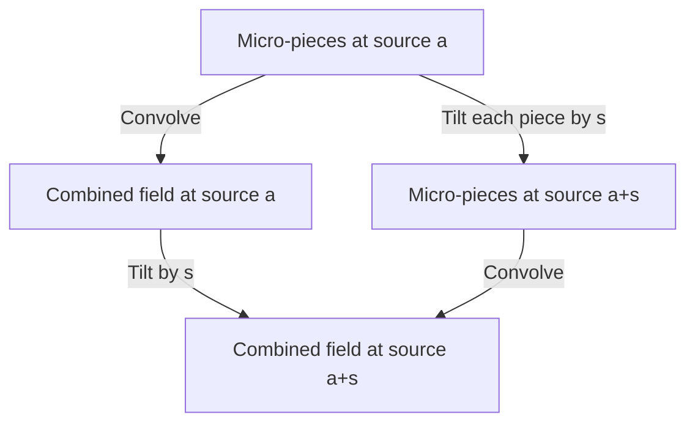

# Recursive carrier triangles — exact BBP atoms, nonlinear composition and a coherent microstate sheet

**2026-10-29 · Research branch, not a main merge.**
Starting source: Main XIV at `ec2fbe321a29a220f3d67ff5fbd749e64d4d3efc`.
The original BBP forcing and `U_0=0` remain unchanged.

**Outcome:** a constructive, source-specific positive carrier with arbitrarily
fine convolution subdivision; exact interactions of every order; a lawful
triangle composition equation; and a stronger signed representation bound.
The selected-path-to-density feedback map and the signed cancellation theorem
remain unproved. Pi normality and RH remain **OPEN**.

## 1. What the author's proposal becomes

The author proposed that an actualized path updates the field supporting its
future; that subpaths have interactions beyond simple addition; and that a
triangular sheet should constrain the relation between a full path and its
microstates. The proposed Gamma/Oily differential and gluon analogy motivated
the questions, without supplying a physical law or an arithmetic proof.

| Proposed feature | Exact mathematical realization | Earned scope |
|---|---|---|
| The next subpath sees the changed field | `Z_a(s+t)=Z_a(s) Z_(a+s)(t)` | exact original-source normalization |
| Subpaths do not simply add | `I_a(s,t)=Delta_s Delta_t log R(a)>0` | shared-carrier/reset interaction |
| More than pair interactions | every finite mixed increment has a strict alternating sign | all orders, not a fitted pair model |
| A microstate sheet can be subdivided coherently | `mu_(a,t)*mu_(a,u)=mu_(a,t+u)` and tilting commutes with subdivision | explicit Gamma plus compound-Poisson construction |
| The apex summarizes the pieces | the sum is sufficient for the source-tilt parameter `a` | exact likelihood, affinity and KL preservation; not all history |
| Order changes the field | posterior kernel composition and count-lattice odds curvature | separate declared models; no derived non-Abelian BBP law |
| Gamma weights a field differential | mean, variance and KL are the derived differential/dual; harmonic regularization yields the inherited Gamma finite part | affine Oily/Gamma centering cannot alter mixed interactions |

Read the [hole contract](HOLE_CONTRACT.md) for hypotheses, competing frames,
holdouts and the exact failure boundary. Complete proofs are in
[the atomic source dossier](ATOMIC_SOURCE_AND_INTERACTIONS.md),
[dual geometry and Gamma](DUAL_GEOMETRY_AND_GAMMA.md), and
[order curvature and hostile controls](ORDER_CURVATURE_AND_SOURCE_CONTROLS.md).
The [local claims](CLAIMS.md) distinguish proofs, inherited facts, controls,
finite observations, and unproved identifications.

## 2. The authentic source has elementary positive atoms

Use the original four signed poles, with `a_n=8n-7`:

$$
R(a)=\frac4a-\frac2{a+3}-\frac1{a+4}-\frac1{a+5},\qquad
r(n)=R(a_n).
$$

The already established positive carrier is

$$
\mu_a(dx)=\frac{e^{-ax}Q(x)}{R(a)}dx,\qquad
Q(x)=4-2e^{-3x}-e^{-4x}-e^{-5x}>0\quad(x>0).
$$

The new factorization is

$$
R(a)=\frac{15(a+\alpha)(a+\beta)}{a(a+3)(a+4)(a+5)},\quad
\alpha=\frac{121-\sqrt{241}}{30}\in(3,4),\quad
\beta=\frac{121+\sqrt{241}}{30}\in(4,5).
$$

It proves the exact distributional identity

$$
X_a\overset d=E_a+E_{a+5}+B_\alpha E_{a+3}+B_\beta E_{a+4},
$$

where all variables are independent, `E_c` is exponential with rate `c`, and

$$
P(B_\alpha=1)=\frac{\alpha-3}{a+\alpha},\qquad
P(B_\beta=1)=\frac{\beta-4}{a+\beta}.
$$

This is a positive atomic realization of the actual source density. It is
not the assertion that the original signed four-pole summands were independent
random variables, or that the digits of pi are sampled independently.

## 3. The sheet and its constraints

An explicit construction supplies `mu_(a,t)` for every real `a>0,t>=0`, with

$$
\int e^{-sx}\mu_{a,t}(dx)=\left[\frac{R(a+s)}{R(a)}\right]^t.
$$

The following square commutes, including its normalization:



For fixed known `t_i>=0`, let `t=sum_i t_i`. Comparing source parameters
`a,b>0`, the likelihood ratio of the micro-vector is

$$
\frac{d\bigotimes_i\mu_{a,t_i}}{d\bigotimes_i\mu_{b,t_i}}(x_1,\ldots,x_k)
=e^{(b-a)\sum_i x_i}\left[\frac{R(b)}{R(a)}\right]^t.
$$

It depends only on the sum. Thus the proposed apex can retain **all information
about this source parameter**, even while forgetting how the sum was divided.
In particular,

$$
H_t(a,b)=H(a,b)^t,\qquad
D(\mu_{a,t}\Vert\mu_{b,t})=tD(\mu_a\Vert\mu_b).
$$

No analogous losslessness for an arbitrary ordered history or the selected
BBP phase has been proved. The authentic positive source occupies `t=1`;
the subdivision variable `t` is not the arithmetic time `n`.

The exact pair interaction is

$$
I_a(s,t)=\log\frac{R(a+s+t)R(a)}{R(a+s)R(a+t)}>0
\quad(a,s,t>0),
$$

and its triangle consistency law is

$$
I_a(s,t)+I_a(s+t,u)=I_a(t,u)+I_a(s,t+u).
$$

These corrections arise because both segments refer to a shared carrier.
The source tilts themselves commute. The independent order-curvature dossier
handles the distinct question of what happens when exchanging events changes
their path weights.

On the authentic clock, the cubic interaction is already a decisive exact
receipt against a pairwise-only log model:

$$
\exp(\Delta_8^3\log R(1))
=\frac{61527533661959200}{322441778977512831}<1.
$$

That model would predict one. The proof establishes nonzero connected
interactions at every finite order, with no numerical extrapolation.

## 4. One exact state carrying both the selected path and the positive field

The following synthesis keeps the selected phase rather than replacing it
with a virtual average. For `n>=1`, `h in Z`, `x>0`, define

$$
f_a(x)=\sqrt{\frac{e^{-ax}Q(x)}{R(a)}},\qquad
\Psi_n(h,x)=e^{2\pi i hU_n}f_{8n-7}(x).
$$

Let `Z_n=r(n+1)/r(n)`. The authentic recurrence gives the exact update

$$
\boxed{\Psi_{n+1}(h,x)=
e^{2\pi i h r(n+1)}\frac{e^{-4x}}{\sqrt{Z_n}}
\Psi_n(16h,x).}
$$

**Proof:** `f_(a+8)/f_a=e^(-4x)/sqrt(R(a+8)/R(a))`, and
`h U_(n+1)=16h U_n+h r(n+1)`. Multiply these two identities.
Initialize at `n=1`, where `U_1=r(1)=47/15` and `a_1=1`. The density is
not defined at the formal index `a_0=-7`. This construction combines the
inherited source tilt and Fourier frequency ladder; it is an exact synthesis,
not a new claim of mixing or a unitary operator on an unspecified frequency
space.

The positive density `|Psi_n|^2` still depends only on the source clock.
Changing the seed changes the phase while leaving this density unchanged.
Consequently this does **not** derive the author's stronger proposed
actual-path-to-positive-density feedback. It identifies where the selected
path is retained and where such an additional law would have to act.

## 5. Quantitative improvement: cubic windows

The source interlacing proves, for every `a>0`,

$$
\frac1{a^2}+\frac1{(a+5)^2}
<\operatorname{Var}_{\mu_a}X
<\frac1{a^2}+\frac1{(a+3)^2}<\frac2{a^2}.
$$

For the authentic overlap

$$
H(a,b)=\frac{R((a+b)/2)}{\sqrt{R(a)R(b)}},
$$

this yields the exact all-parameter bound

$$
0\le1-H(a,b)\le\left(\frac{a-b}{a+b}\right)^2
\le\frac14\log^2(b/a).
$$

Partition all times `1..N` into `B_j={1+j^3,...,min((j+1)^3,N)}`.
With `J=floor cbrt(N-1)`, there are `J+1` blocks. For every `|z_n|<=1`,

$$
\left|\frac1N\sum_{n=1}^N z_n-
\frac1N\sum_j\sum_{n\in B_j}z_n H(a_n,a_{1+j^3})\right|
\le\frac{27J}{4N}=O(N^{-2/3}).
$$

The new schedule uses `O(N^(1/3))` source anchors. The predecessor used
`O(N^(2/3))` anchors with an `O(N^(-1/3))` bound and discarded an initial
prefix. The improved exponent comes from the adaptive partition and summing
local errors, not merely the sharper variance constant.

The finite instrument computes a smaller **block endpoint budget**, by
weighting each block's length with its largest rational deficit. This is still
an upper bound, not the exact observed discrepancy. Reproducible examples:

| N | Previous anchors | New anchors | Previous proved budget | New endpoint budget |
|---:|---:|---:|---:|---:|
| 512 | 57 | 8 | 0.1353437 | 0.0789205 |
| 4096 | 241 | 16 | 0.0657127 | 0.0228609 |
| 1000000 | 9901 | 100 | 0.0100970 | 0.0006600 |

Decimals are displays of exact rational certificates in
`receipts/production_probe.json`. They are errors in normalized signed
**representation**, not bounds for the magnitude of a Weyl sum. The theorem
also holds for `z_n=1`; in that case the original average is exactly one and
the weighted average tends to one. No cancellation has been hidden in the
compression.

## 6. Gamma and the surviving obstruction

The derived dual is the classical Gibbs identity on the same source:

$$
-\log\frac{R(a+s)}{R(a)}
=\inf_\nu\left[s\,E_\nu X+D(\nu\Vert\mu_a)\right],
\qquad\nu_{\rm minimizer}=\mu_{a+s}.
$$

Adding an affine term `c*a+d` to `log R(a)` cannot change any second or
higher interaction, midpoint overlap, or KL/Bregman difference. Thus an
Oily coefficient `phi^(-1)-gamma` inserted only as linear centering is
invisible to these relational observables. A non-affine coupling would be a
new mathematical assumption and would need source authentication.

The genuine source-relative Gamma boundary from earlier work remains:

$$
\log\frac{r(1)}{r(N)}-2H_{N-1}
\longrightarrow\log\frac{3008}{225}-2\gamma.
$$

Gamma is therefore present in a specified harmonic-versus-logarithmic finite
part. It has not become an intrinsic selected-phase cancellation mechanism.

Two strong controls delimit the result:

- The same original forcing with seed `V_0=-pi/16` gives `V_n=-T_n->0`.
  It shares every positive field and every interaction above, while its
  normalized Fourier sums tend to one. The zero seed must do essential work.
- Nonlinear exponential reinforcement has nonzero sheet curvature and zero
  ensemble phase mean at every time, but its all-left and all-right infinite
  paths have combined probability at least `2/5`. Feedback and curvature
  alone cannot force cancellation along the selected path.

## 7. Reproduction and next work

```sh
python -m unittest discover -s tests -p 'test_recursive_carrier_triangle.py'
python scripts/recursive_carrier_triangle_probe.py --numerical --output /tmp/triangle-probe.json
python scripts/recursive_carrier_triangle_oracle.py --output /tmp/triangle-oracle.json
```

The implementation and unit tests use the standard library and native source
modules. The independent oracle needs the repository's declared SymPy test
dependency. Optional numerical diagnostics use its declared mpmath dependency
and are labelled observations, not interval certificates.

See [validation](VALIDATION.md) for actual executions and limitations. The
next [execution handoff](NEXT.md) preserves the exact missing signed estimate
and the source/seed controls. This package establishes the local construction
and the transport improvement; it does not promote pi normality or RH.
