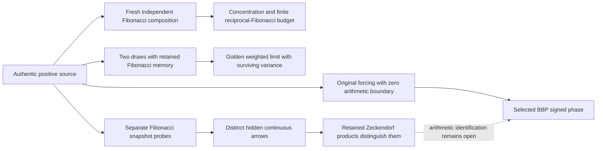

# Fibonacci extrusion of the harmonic/golden/Euler triangle

Draft research child of [PR408](https://github.com/femboy2112/SUCC/pull/408),
exact parent `7b5a2b4534aa5e71865046ca8d3f723d8002b9fe`.
Leah/femboy2112 retains authorship of the original triangle and
Oily–Macaroni, Omega=lambda-gamma. All changes are additive research.
The four signed BBP poles, zero boundary, historical contracts and main
are unchanged. Fibonacci clocks are declared where used.

**Main result:** Fibonacci constants describe several precise extrusion
arrows, but different arrows can share the same snapshots. We prove new
composition bounds, exact identifiability failures with authentic source
marginals, a constructive observation repair, and an arithmetic obstruction
to treating the Fibonacci clock as the native radix16 clock.

## Constants with an actual mathematical role

Let mu_a(dx)=exp(-ax)[4-2exp(-3x)-exp(-4x)-exp(-5x)]dx/R(a),
R(a)=4/a-2/(a+3)-1/(a+4)-1/(a+5), a>0. It is the original positive
source law, with R(8n-7)=r(n). Put lambda=(sqrt5-1)/2, phi=1/lambda,
F0=0,F1=F2=1.

| Quantity | Proved role in the declared extrusion |
|---|---|
| Reciprocal Fibonacci constant C_F=sum_(n>=1)1/F_n | Exact total expected squared averaging error equals Var_mu(X) C_F. Its tail gives an all-future probability bound. Its convergence also permits invisible continuous-source arrows. |
| lambda², lambda | The retained-memory recursion W_(n+1)=W_n+W_(n-1), initialized by two source draws, converges after division by F_n to lambda²X+lambdaY. These are surviving memory weights. |
| 5-2sqrt5 | Retained normalized variance equals (5-2sqrt5)Var_mu(X); fresh independent composition has variance tending to0. |
| gamma and Omega=lambda-gamma | Absolute log/Oily anchors. Fresh averaging and retained memory have different finite parts despite the same starting anchor. |
| C_prod=product_(n>=1)[1-(-lambda²)^n] | Classical fibonorial constant; supplies the finite offset in the accumulated harmonic/Pascal readout. The negative conjugate root is essential. |
| log phi, log5/2 | Growth and Binet normalization of the declared time extrusion. The prior Fibonacci information-clock work is credited. |
| 239=16²-16-1 | Exact obstruction to a nonzero rational linear Fibonacci-to-radix16 intertwiner; local resonance only at prime239, broken by the authentic forcing. |

These roles are established within stated mathematical models, not a proof
that they encode a universal physical category.

## Strongest source-composition advance

For independent source draws S_k=X1+...+Xk define

    K_k(a)=Elog S_k-Elog X1-[H_(2k-1)-1].

The parent proved a fixed-rank asymptotic. This round proves the uniform bound

    |a²K_k(a)-(1379/900)(k-1)/(2k+1)| <=1627/(45a)

for **every k>=1 and a>=5**. It justifies growing-rank limits, including

    F_n² K_(F_n)(8F_n-7) ->1379/115200.

The new bound is a statement about original-source composition; it is not
an independent-digit assumption. The same dossier proves a strict all-a
Jensen gap between fresh and reused memory, gives its Gamma-boundary closed
form, and classifies a source-clock commutation law: endpoint exponential
tilting can be represented by a single common input-age shift **iff all
active reuse weights are equal**. Unequal Fibonacci weights cannot be
repaired by choosing another scalar source clock.

Read [composition proofs](composition/FIBONACCI_COMPOSITION.md).

## What snapshots conceal, and what repairs them

Even every translated Fibonacci/Lucas readout added to the harmonic/golden
triangle leaves a hidden positive native grade arrow: the finite witness
has24 cycle coordinates and only23 constraints, with full endpoint
posteriors preserved.

More strongly, for every a>0 there are two positive couplings with **exactly
the authentic mu_a marginals**, agreeing on all Fibonacci mixed Laplace
moments, yet differing in their mixed fourth moment. The proof constructs
an infinite orthogonal residual and supplies a positive rational lower
bound for its norm. Finite experiments validate its components; they do
not replace the infinite proof.

Keeping composed observables repairs the missing information. Already
4=3+1 distinguishes this pair; all canonical Zeckendorf products recover
every ordinary moment and hence the joint measure. This is a real
distinction between separate snapshot values and retained composition.

The discrete realization has different behavior: a joint grade PGF sampled
at lambda^(F_n) is exactly identifiable by analytic continuation, but has
no uniform inverse stability under absolute sample error on unbounded
supports. The realization map matters.

Read [arrow proofs](arrows/FIBONACCI_ARROWS.md).

## The extruded Oily finite part

For the inherited golden Pascal readout A_m=E H_(Binomial(m,lambda²)),
define b_m=Omega-Omega_m>0 and B_F=sum_(n>=2)b_(F_n). With q=-lambda²,

    sum_(n=2)^N A_(F_n)
      -(N-1)(N-2)log(phi)/2-(N-1)(gamma-log5/2)
      -> log[(q;q)_infinity/(1-q)]+B_F.

The limit is rigorously enclosed near1.544905887502954720860513.
Every omitted infinite tail is bounded analytically. The triangular
coefficient, Euler term, Fibonacci product and total Oily loss have
different roles in this one exact identity. See
[clock constants](clock_constants/CLOCK_CONSTANTS.md).

## What this says about the selected BBP path

The Fibonacci matrix M admits LM=16L over Q only for L=0. Modulo m,
all solutions are L=(16t,t),239t=0. A nonzero mod239 solution has no
primitive lift at239² with radix16 fixed. The golden eigenvalue does
Hensel-lift, but changes that clock. The actual source introduces a
nonzero forcing defect already at n0; its first239-conductor birth is n60
with239U60=119 mod239. These are exact scoped arithmetic constraints.

Fresh complete-phase probes on29 Fibonacci windows have3744 slips in4142
frequency-time observations at distance1/20, each exceeding half. A separate
rational Machin/Green oracle verifies every count. The coherent same-forcing
seed has none in those windows. **These are finite observations.**

There is also a decisive countermodel: density-zero edits preserve normality
while making every Fibonacci snapshot asymptotically coherent. Thus even
all those snapshots do not characterize all-horizon dispersion. Fibonacci
interval assembly needs signed estimates on covered macroscopic translated
blocks, not just isolated samples.

Read [arithmetic proofs and probes](arithmetic/FIBONACCI_ARITHMETIC.md),
[claim/route ledger](CLAIMS_AND_ROUTES.md), [remaining obligation and handoff](NEXT_HANDOFF.md),
[review](ROOT_REVIEW.md), [validation](VALIDATION.md), and [manifest](SOURCE_MANIFEST.json).
No new authentic fixed-frequency asymptotic saving is proved.
Pi normality, SC-06 and RH remain **OPEN**.
