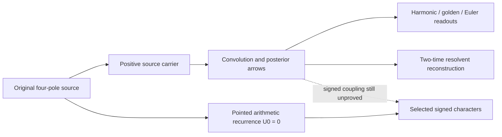

# Triangle fabric: constants, hidden arrows, and the arithmetic selector

Draft research child of [PR405](https://github.com/femboy2112/SUCC/pull/405),
exact parent `6cf5050ff2cfd92e7a0c8876da5233be6ff117f5`.
The author's Harmonic / Golden / Euler–Mascheroni triangle and
**Oily–Macaroni, Ω_OM=φ^(-1)−γ**, retain Leah / femboy2112 provenance.

**Main finding:** composition reveals source information erased by a snapshot,
and the triangle supplies some real composition-sensitive observables. It is
not a complete encoding of the internal arrows or of the selected arithmetic
boundary. This round proves both sides, with constructive repairs and controls.
No universal physical category, exhaustive mathematical fabric classification,
positive-density authentic fixed-frequency estimate, π normality or RH proof
is asserted.

## Results that survived

**An actual harmonic/golden inequality.** For independent X,Y from the original
positive BBP source μ_a(dx)=exp(-ax)Q(x)dx/R(a), a>0, put
λ=(sqrt5−1)/2, ℓ=R(a(1+λ))/R(a), and

    D_a(2)=Elog(aX)−ℓ,   D_a(4)=Elog(a(X+Y))−ℓ².

With σ²=1379/900, the new all-a bound is

    D_a(4)−D_a(2) >= 5/6+λ³ +(ℓ−λ²)(λ−ℓ)
       + σ² [R'(a+10)²+R(a+10)R''(a+10)]/[50R(a)²].

Both correction terms are strictly positive. The harmonic increment5/6 and
golden complement identity are load-bearing. The limiting vertex D(2) is
Ω_OM; γ cancels from the relative composition increment. A companion strict
Beta-ratio inequality and its sharp second-order asymptotics are proved in
[constants and composition](constants/CONSTANTS_AND_COMPOSITION.md).
These are source-composition statements, not a stochastic law for π digits.

The harmonic result extends to every integer k>=2. For S_k=X_1+...+X_k,

    Elog S_k−Elog X_1−[H_(2k−1)−1]
       >= (1379/900) (k−1)/(2k+1) * a^4/(a+5)^6 >0.

This bound is asymptotically sharp at each fixed k, and the golden contrast
has a strictly positive correction at every such rank. Its proof uses the
native rate mixture and the Hessian of a log-sum-exp function, independently
of the two-copy conditional-density derivation.
Moreover λ is the **sharp minimum mark** making the Laplace correction
positive for every real a>0 and every integer k>=2. At each fixed k the
threshold is determined by the unique root of
sum_(j=k−1)^(2k−2) t^j=1. Sharpness uses the continuous extension to a↓0,
not only the native discrete clock a=8n−7.

**An exact answer to hidden arrows.** All one-time retained-posterior snapshots
at every horizon can agree while conditional history updates differ. Under
the native grade support, sampling d steps apart leaves exactly m(d−1)
unseen coupling dimensions at depth m; d=1 has no such ambiguity for its
pairwise Markov arrow. Even all two-time products of {1,H_j,λ^j} can agree
for different positive arrows. A sufficiently rich two-time Cauchy/resolvent
matrix recovers the full arrow, with an explicit precision cost. See
[categorical arrows](category/CATEGORICAL_ARROWS.md).

**The arithmetic invariant missed by finite geometry.** In the rational
finite-shift module r_F=F(E)r, the selected constant is

    α_F = F(16)π + rational.

The rational decaying-coboundary quotient is Q[E]/(E−16). For F(16)≠0 the
normality question is equivalent to π's, not solved. For F(16)=0 it is
rational. Positive zero-seed controls can match any prescribed initial
forcing prefix and any finite source jet while having a dyadic α_F and
characters tending to1 at every fixed frequency. The sharp minimal degree
for N matched moments and M endpoint conditions is N+M. See
[signed arithmetic](signed/SIGNED_FABRIC.md).

The distinction is operational: finite positive snapshots constrain F on
[0,1], while the arithmetic quotient reads F(16). The exact annihilators
satisfy ||F−1||_[0,1]<=15^(-N-M) but F(16)=0 instead of1. Evaluation at16
is therefore not uniformly stable on unrestricted polynomial degrees.
The real period α_F itself remains a continuous integral and approaches π;
the discontinuous classification concerns its rational-coboundary coordinate.

**A complementary same-π family.** Explicit positive source deformations
preserve the selected π period exactly while matching arbitrary finite
prefixes and source jets. Their signed Weyl sums differ from the authentic
ones by O_h(1). They are equivalent-normality controls, not nonnormal
counterexamples. See [period fibers](period_preserving/PERIOD_FIBERS.md).

## The typed map

The positive and arithmetic constructions use the same source but different
types of objects. Their missing signed comparison cannot be supplied by
renaming either construction a universal carrier. The constructive arrow
results clarify precisely what information needs to survive the comparison.

Read the [claim and route ledger](CLAIMS_AND_ROUTES.md),
[remaining selected obligation](SELECTED_OBLIGATION.md),
[validation](VALIDATION.md), [provenance](SOURCE_MANIFEST.json), and
[next handoff](NEXT_HANDOFF.md). Raw receipts, exact tests, computationally
separate oracles and shared-model reviews are retained. No external referee
or new Lean authority is implied.
