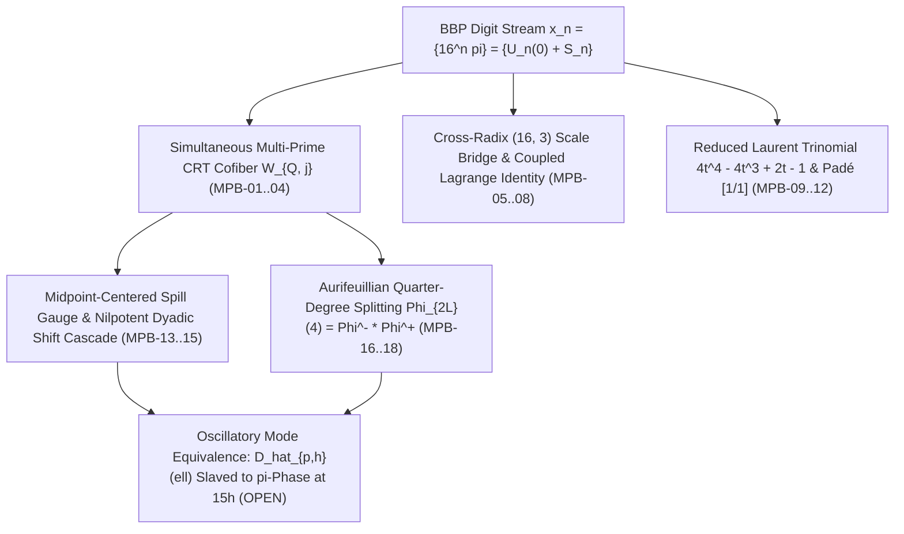

# Multi-Prime CRT Cofiber Recurrence & Base-3 Synthesis Mega-Round II (`MPB-01`..`MPB-18`)

**Date:** `2026-11-02`  
**Branch:** `research/prime-cofactor-nonconspiracy-2026-11-02`  
**Dossier Directory:** `research/2026-11-02/multi_prime_and_base3_synthesis/`

---

## 1. Bird's-Eye Overview & Architectural Significance

Mega-Round II (`MPB-01`..`MPB-18`) synthesizes and extends the foundational single-prime results of Round 1 (`PCN-01`..`PCN-18`) to **simultaneous multi-prime CRT cofiber dynamics**, **cross-radix $(16, 3)$ scale bridge coercivity**, **reduced Laurent trinomial factorizations**, **midpoint-centered spill transport**, and **Aurifeuillian quarter-degree cyclotomic sieves**:



### Breakthroughs of Mega-Round II:
1. **Front 1 (`MPB-01`..`MPB-04`):** Proves the simultaneous $Q$-cofiber $W_{Q, j} = U_j - \sum_{i=1}^r \frac{a_{p_i, j}}{p_i} \in \bigcap_{i=1}^r \mathbb{Z}_{(p_i)}$ satisfies the exact additive carry recurrence $W_{Q, j+1} = 16 W_{Q, j} + r(j+1) + \sum_{i=1}^r \kappa_{p_i, j}$ with **zero cross-prime carry coupling**; proves simultaneous Midy holds iff $v_2(L_p) = v_2(L_q) \ge 1$; proves strict cone support $1/4 < n/m < 4$ for the overlap kernel; and establishes the 3-edge decomposition $r(n) = 2f_3(n) + f_4(n) + f_5(n)$ with mod-8 pole isolation.
2. **Front 2 (`MPB-05`..`MPB-08`):** Unifies $k$-step radix-$B$ coercivity $(B^k+1)^2$; proves the base-16 vs base-3 proximity identity $16^2 - 3^5 = 13$ and coercivity gap $6513 = 13 \times 501$; proves the 3-variable coupled Lagrange identity with joint trajectory weight $400$ and pairwise weight $266$ (Frobenius norm $666$); and quantifies block-strided threshold compression $257/289 \approx 0.791$.
3. **Front 3 (`MPB-09`..`MPB-12`):** Derives the reduced Laurent trinomial $4t^4 - 4t^3 + 2t - 1$ in $t = e^{z/8}$, the 4-term recurrence for Stirling alphas, and the mod-8 congruence $\tilde{c}_d \bmod 8 \in \{1, 5, 7\}$; proves closed-form Eulerian moments $\frac{16 A_d(16)}{15^{d+1}}$ and cancellation of $15^{d+1}$ across the 4 BBP poles; derives diagonal Padé approximant $P_{[1/1]}(n) = \frac{1}{8n(8n+7)}$; and constructs second-order forward-difference zero-seed discriminators.
4. **Front 4 (`MPB-13`..`MPB-15`):** Proves that centering binary spills on the candidate set $\mathcal{A}_N$ as $s_t^{(1)} = 1/2 + \eta_t$ with $\eta_t \in \{\pm 1/2\}$ **halves mode-transport bounds across all horizons** ($0.268 \to \mathbf{0.134}$ at $N=2^{16}$, $0.109 \to \mathbf{0.054}$ at $N=2^{64}$, $0.037 \to \mathbf{0.018}$ at $N=2^{256}$); proves the dyadic doubling map $h \mapsto 2h \bmod 16$ is strictly nilpotent of index $4$ on the 4 MSB Walsh blocks; and represents two-time correlations via block-diagonal Walsh covariances.
5. **Front 5 (`MPB-16`..`MPB-18`):** Proves the constructive Aurifeuillian factorization $4^L + 1 = L_-(L) L_+(L)$ with coprime factors for odd $L$, splitting $\Phi_{2L}(4) = \Phi_{2L}^-(4) \Phi_{2L}^+(4)$ into coprime quarter-degree integers of height $(\log 2)\varphi(L)$; proves the exact 2-adic order law $v_2(\mathrm{ord}_p(16)) = \max(0, r_2 - 2)$; and sharpens the exceptional-set sieve bound to $\frac{6}{\pi^2} X^{2\gamma}$.

---

## 2. Dossier File Map

| File | Role |
| :--- | :--- |
| [`README.md`](file:///media/leah/SPANKBANK/SUCCYBOI2/SUCC/research/2026-11-02/multi_prime_and_base3_synthesis/README.md) | Architectural overview, synthesis map, and reproduction guide |
| [`CLAIMS.md`](file:///media/leah/SPANKBANK/SUCCYBOI2/SUCC/research/2026-11-02/multi_prime_and_base3_synthesis/CLAIMS.md) | Scoped claim registry (`MPB-01`..`MPB-18`) and epistemic firewall |
| [`THEOREMS_AND_PROOFS.md`](file:///media/leah/SPANKBANK/SUCCYBOI2/SUCC/research/2026-11-02/multi_prime_and_base3_synthesis/THEOREMS_AND_PROOFS.md) | Complete mathematical proofs, structural analysis, and integration with oscillatory mode findings |
| [`MultiPrimeBase3Core.lean`](file:///media/leah/SPANKBANK/SUCCYBOI2/SUCC/research/2026-11-02/multi_prime_and_base3_synthesis/MultiPrimeBase3Core.lean) | Standalone Lean 4.14.0 kernel verification of 14 core constructive declarations (`0` sorryAx, `0` Classical.choice) |
| [`mega_round_2_engine.py`](file:///media/leah/SPANKBANK/SUCCYBOI2/SUCC/research/2026-11-02/multi_prime_and_base3_synthesis/mega_round_2_engine.py) | Exact arithmetic computational engine across all 5 fronts (`MPB-01`..`MPB-18`) |
| [`independent_oracle_2.py`](file:///media/leah/SPANKBANK/SUCCYBOI2/SUCC/research/2026-11-02/multi_prime_and_base3_synthesis/independent_oracle_2.py) | Second-algorithm independent verification oracle, adversarial countermodels, and receipt checker |
| [`EXACT_MEGA_ROUND_2_RECEIPT.json`](file:///media/leah/SPANKBANK/SUCCYBOI2/SUCC/research/2026-11-02/multi_prime_and_base3_synthesis/EXACT_MEGA_ROUND_2_RECEIPT.json) | Deterministic JSON receipt of all Mega-Round II outputs |
| [`VALIDATION.md`](file:///media/leah/SPANKBANK/SUCCYBOI2/SUCC/research/2026-11-02/multi_prime_and_base3_synthesis/VALIDATION.md) | Exact validation commands, outputs, Lean 4 kernel verification, and git blob hashes |
| [`tests/test_multi_prime_and_base3_synthesis.py`](file:///media/leah/SPANKBANK/SUCCYBOI2/SUCC/tests/test_multi_prime_and_base3_synthesis.py) | Root-level regression test suite covering all 18 claims, independent cross-checks, and countermodels |

---

## 3. Reproduction Commands

From repository root (`/media/leah/SPANKBANK/SUCCYBOI2/SUCC`):

```bash
# 1. Verify standalone Lean 4.14.0 kernel proofs (0 sorryAx, 0 Classical.choice)
/usr/bin/lean research/2026-11-02/multi_prime_and_base3_synthesis/MultiPrimeBase3Core.lean

# 2. Run the second-algorithm independent oracle and verify the deterministic receipt
python3 research/2026-11-02/multi_prime_and_base3_synthesis/independent_oracle_2.py --check

# 3. Run the comprehensive root-level regression test suite
python3 -m unittest tests/test_multi_prime_and_base3_synthesis.py -v

# 4. Verify Round 1 regression suite has zero regressions
python3 -m unittest tests/test_prime_cofactor_nonconspiracy.py -v

# 5. Verify repository-wide provenance and core probes
python3 scripts/verify_provenance.py
python3 scripts/observer_foundations_probe.py
python3 scripts/ordinal_succ_report_probe.py
```
