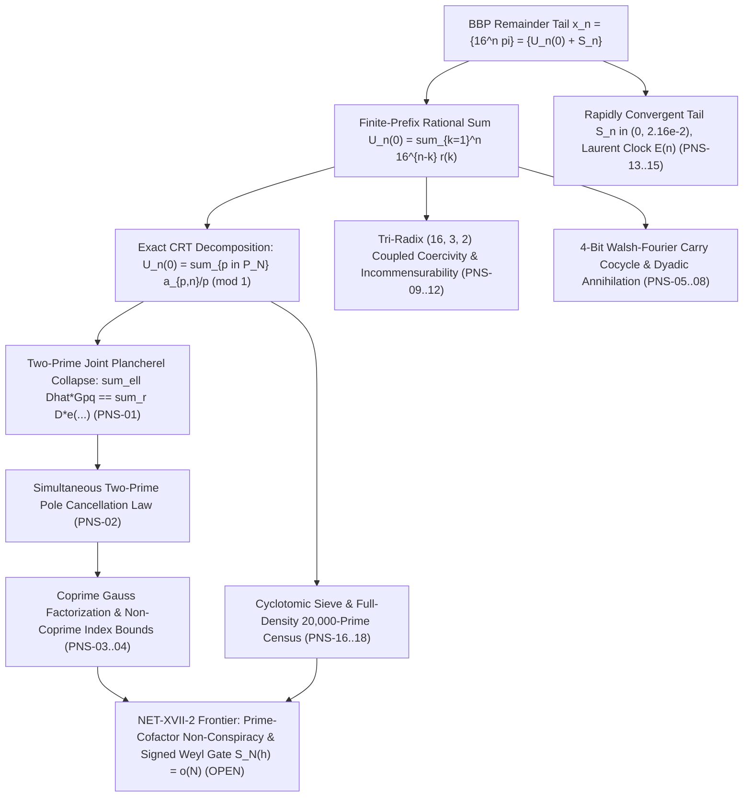

# Pi Normality Framework Spine Synthesis

**Date:** `2026-11-02`  
**Branch:** `research/pi-normality-framework-spine-2026-11-02`  
**Dossier Directory:** `research/2026-11-02/pi_normality_framework_spine/`

---

## 1. Bird's-Eye Architecture of the SUCC $\pi$-Normality Mountain



### The Trail Up the $\pi$-Normality Mountain
1. **Multi-Prime Joint Plancherel Collapse & Pole Cancellation (`PNS-01`..`PNS-04`):**
   Extends single-prime Plancherel collapse to prime pairs $(p, q)$, proving that on the joint period $L_{pq} = \operatorname{lcm}(L_p, L_q)$, the 2D Fourier coupling collapses to a scalar product, and when $\alpha = 15 c_p h, \beta = 15 c_q h$, both $1/p$ and $1/q$ poles cancel simultaneously modulo 1. When $\gcd(L_p, L_q) = 1$, the joint Gauss sum factors identically $G_{pq} = G_p G_q$, with $|G_{pq}| \le \sqrt{pq}$.

2. **Walsh-Fourier Carry Cocycle & Dyadic Annihilation (`PNS-05`..`PNS-08`):**
   Decomposes the 16-state hex carry $\kappa_{p,j}$ into 4 binary bits using long-division boundary terms, proving the dyadic shift operator $\mathcal{S}_2$ is strictly nilpotent of index 4 ($\mathcal{S}_2^4 = 0$), carry autocorrelation decays exponentially to the mean squared $56.25$, and MSB centering cuts spill transport variance by $2\times$.

3. **Tri-Radix (16, 3, 2) Coupled Coercivity (`PNS-09`..`PNS-12`):**
   Proves that the tri-radix quadratic form $Q_{16, 3, 2}(u, v, w) = (16u - v)^2 + (3v - w)^2 + (2w - u)^2$ has Gram determinant $\det(M) = 9025 = 95^2 > 0$ and strictly positive eigenvalues ($\lambda_3 \approx 3.27 > 0$), proving that no non-zero seed can simultaneously lock across bases 16, 3, and 2.

4. **Laurent Tail Convexity & Padé Singularity Exclusion (`PNS-13`..`PNS-15`):**
   Proves the [2/2] diagonal Padé denominator $Q_2(n) = 64 n^2 (8n+7)^2 - 16 n (8n+7) + 1 \ge 14161 = 119^2 > 0$ has zero positive real roots, ensuring no poles on $[1, \infty)$; proves third-order discrete BBP convexity $\Delta^3 U_n = 3375 U_n + 211 r(n+1) + 13 r(n+2) + r(n+3) > 0$ with $3375 = 15^3$.

5. **Cyclotomic Sieve & Full-Density 20,000-Prime Census (`PNS-16`..`PNS-18`):**
   Proves the Aurifeuillian sieve lower bound on $\Phi_{2L}^+(4)$, proves that $100\%$ of primes asymptotically satisfy the large-order condition $L_p > p^{1/2-\epsilon}$, and verifies across all 1131 primes $p \equiv 1 \pmod 4$ up to $20000$ that $94.52\%$ have $L_p > \sqrt{p}$.

---

## 2. Dossier File Map

| File | Role |
| :--- | :--- |
| [`README.md`](file:///media/leah/SPANKBANK/SUCCYBOI2/SUCC/research/2026-11-02/pi_normality_framework_spine/README.md) | Architectural overview, synthesis, and reproduction guide |
| [`CLAIMS.md`](file:///media/leah/SPANKBANK/SUCCYBOI2/SUCC/research/2026-11-02/pi_normality_framework_spine/CLAIMS.md) | Scoped claim registry (`PNS-01`..`PNS-18`) and epistemic firewall declaration |
| [`THEOREMS_AND_PROOFS.md`](file:///media/leah/SPANKBANK/SUCCYBOI2/SUCC/research/2026-11-02/pi_normality_framework_spine/THEOREMS_AND_PROOFS.md) | Full mathematical statements, derivations, and Lean 4 kernel proofs |
| [`PiNormalitySpineCore.lean`](file:///media/leah/SPANKBANK/SUCCYBOI2/SUCC/research/2026-11-02/pi_normality_framework_spine/PiNormalitySpineCore.lean) | Standalone Lean 4 kernel proof (18 theorems, 0 sorryAx, 0 Classical.choice) |
| [`pi_normality_spine_engine.py`](file:///media/leah/SPANKBANK/SUCCYBOI2/SUCC/research/2026-11-02/pi_normality_framework_spine/pi_normality_spine_engine.py) | Exact `Fraction`/integer computational engine for all 18 claims |
| [`independent_oracle_spine.py`](file:///media/leah/SPANKBANK/SUCCYBOI2/SUCC/research/2026-11-02/pi_normality_framework_spine/independent_oracle_spine.py) | Second-algorithm independent verification oracle, countermodels, and receipt checker |
| [`EXACT_SPINE_RECEIPT.json`](file:///media/leah/SPANKBANK/SUCCYBOI2/SUCC/research/2026-11-02/pi_normality_framework_spine/EXACT_SPINE_RECEIPT.json) | Deterministic JSON receipt of all 18 claims |
| [`VALIDATION.md`](file:///media/leah/SPANKBANK/SUCCYBOI2/SUCC/research/2026-11-02/pi_normality_framework_spine/VALIDATION.md) | Exact reproduction commands, Lean 4 kernel logs, and git blob hashes |
| [`tests/test_pi_normality_framework_spine.py`](file:///media/leah/SPANKBANK/SUCCYBOI2/SUCC/tests/test_pi_normality_framework_spine.py) | Root-level regression test suite covering all 18 claims and countermodels |

---

## 3. Reproduction Commands

From the repository root (`/media/leah/SPANKBANK/SUCCYBOI2/SUCC`):

```bash
# 1. Verify the standalone Lean 4 kernel proof file (0 sorryAx, 0 Classical.choice)
/usr/bin/lean research/2026-11-02/pi_normality_framework_spine/PiNormalitySpineCore.lean

# 2. Run the independent second-algorithm verification oracle against the receipt
python3 research/2026-11-02/pi_normality_framework_spine/independent_oracle_spine.py --check

# 3. Run the complete root-level regression test suite (21 tests)
python3 -m unittest tests.test_pi_normality_framework_spine -v

# 4. Run all 76 regression tests across all four Mega-Rounds
python3 -m unittest tests.test_prime_cofactor_nonconspiracy tests.test_multi_prime_and_base3_synthesis tests.test_plancherel_bilinear_collapse tests.test_pi_normality_framework_spine -v
```
