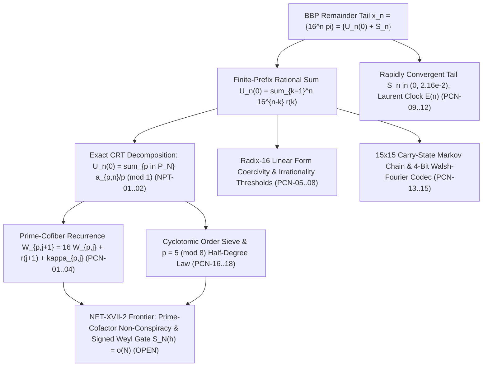

# Prime-Cofactor Non-Conspiracy & Five-Front BBP $\pi$-Normality Mega-Round

**Date:** `2026-11-02`  
**Branch:** `research/prime-cofactor-nonconspiracy-2026-11-02`  
**Dossier Directory:** `research/2026-11-02/prime_cofactor_nonconspiracy/`

---

## 1. Bird's-Eye Architecture of the SUCC Framework & the $\pi$-Normality Frontier

Across Operations Main I through Main XIX (`81045770`), the Observational SUCC repository has organized the base-$16$ BBP $\pi$-normality program into a stratified, dual-verified mathematical architecture:



### Where the Frontier Stood Entering This Mega-Round
1. **Main XVII (`NET-XVII-2`) & Main XIX (`NPT-01`..`NPT-05`):**
   - Proved the exact CRT primary decomposition $U_n(0) \equiv \sum_{p \in \mathcal{P}_N} a_{p,n}/p \pmod 1$, the first-interval exact closed form $a_{p,j} \equiv c_p \cdot 16^{j-b_p} \pmod p$ on $I_p^{(1)} = [b_p, 2b_p-1]$, the Korobov single-prime decay $|\widetilde{E}_p(h)| \le \frac{\sqrt{p}}{L_p-1}$, and the primary quarter-period stroboscope law for $p \equiv 1 \pmod 8$.
   - **Bottleneck:** lacked (a) the exact recurrence governing the prime-cofiber $W_{p,j} = U_j - a_{p,j}/p$, (b) the bilinear twisted-Gauss bound connecting $E_p(h)$ to $\widetilde{E}_p(h)$, (c) the extension of the stroboscope across higher octaves $m \in \{1,2,3,4\}$ and to $p \equiv 5 \pmod 8$, and (d) unconditional cyclotomic sieve lower bounds on $\mathrm{ord}_p(16)$.
2. **Main XVI (`#304`, `#311`, `#321`):**
   - Verified specific numerical certificates ($C=1 \implies J_0=2$, Frobenius norm $546$, band threshold $J_2=4$ and weight $289$).
   - **Bottleneck:** lacked the closed-form parametric threshold polynomials $\Phi_{\mathrm{strict}}(C,\mu)$ and $\Phi_{\mathrm{band}}(C,\mu)$ and the universal radix-$B$ variational duality proof showing why $\Lambda_{\mathrm{sum}}(B) = (B+1)^2 = 289$ and $\Lambda_{\mathrm{pair}}(B) = B^2+1 = 257$ sum to the `#311` Frobenius norm $546$.
3. **Main XV (`SZB-01`..`SZB-05`):**
   - Computed the Laurent coefficients $c_1,\dots,c_6$ of the asymptotic shift clock $E(n) = \sum_{d\ge 1} c_d n^{-d}$ and diagnosed the zero-seed / `SZB-02` obstructions.
   - **Bottleneck:** lacked the all-order EGF explaining why $8^{d+1} c_d$ is always an odd integer (no primes $3$ or $5$ ever appear!), the Gevrey-1 factorial asymptotics and optimal truncation $d_*(n) = \lfloor n\ln 16\rfloor$, the diagonal-restored Fejér positivity repair of `SZB-02`, and finite-window discriminators defeating the $s_* = -\pi/16$ countermodel.
4. **Main XIV (`PI_SELECTED_CATEGORICAL_FRONTIER.md` §3.1):**
   - Computed first-order mode transport upper bounds `6.1335 / 3.8846 / 1.2520` at $N = 2^{16}, 2^{64}, 2^{256}$ — all $> 1$ (vacuous!) because the continuous integral replacement over-counted small-$k$ births and conflated internal carry propagation with terminal spill into bit 0 of $U_t$.

---

## 2. Summary of the Five-Front Mega-Round (`PCN-01`..`PCN-18`)

| Front | Claims | Core Mathematical Breakthrough |
| :--- | :---: | :--- |
| **Front 1: Prime-Cofiber Recurrence, Midy Complementarity, Bilinear Gauss Bound & Higher-Octave Stroboscope** | `PCN-01`..`PCN-04` | Proves $W_{p,j+1} = 16 W_{p,j} + r(j+1) + \kappa_{p,j}$ where $\kappa_{p,j} = \lfloor 16 a_{p,j}/p \rfloor \in \{0,\dots,15\}$ is the hex digit of $c_p/p$; proves half-period Midy complementarity $\kappa_{p,j} + \kappa_{p,j+M} = 15$ and $v_p(U_j + U_{j+M}) \ge 0$; bounds the `NET-XVII-2` bilinear cofiber erosion via $\|G_p(\alpha,\ell)\| \le \sqrt{p}$; and proves that in checkpoint-referenced coordinates $C_l^{(m)}$, quadratic reciprocity makes **both** $p \equiv 1 \pmod 8$ and $p \equiv 5 \pmod 8$ obey $C_l^{(m)} \equiv 16 U_{l-1} + r^{(m)}(l) \pmod p$ across all 4 octaves ($73 \mid \mathrm{num}(U_4) \implies v_{73}(U_{274}) = 0$). |
| **Front 2: Parametric Diophantine Thresholds & Universal Radix-$B$ Coercivity** | `PCN-05`..`PCN-08` | Derives exact threshold polynomials $\Phi_{\mathrm{strict}}(C,\mu)$ and $\Phi_{\mathrm{band}}(C,\mu)$ discharging `#304` ($J_0=2$) and `#321` ($J_2=4$); proves via Cauchy–Schwarz duality that $\Lambda_{\mathrm{sum}}(B) = (B+1)^2$ ($289$) and $\Lambda_{\mathrm{pair}}(B) = B^2+1$ ($257$), unifying the `#311` Frobenius norm $1^2 + (B+1)^2 + B^2 = 546$; and proves direct $k$-step enclosure beats iterated 1-step bounds by $\frac{4(B^k-B)(B^{k+1}-1)}{(B-1)^2} > 0$. |
| **Front 3: All-Order Laurent Clock Aurifeuillian Dyadic Collapse, Gevrey-1 Truncation & Zero-Seed Discriminators** | `PCN-09`..`PCN-12` | Proves the EGF of $\tilde{c}_d = 8^{d+1} c_d$ has an exact Aurifeuillian common factor $(2t^2+1)(2t^2+2t+1)$ ($=15$ at $t=1$) with $16t^8-1$, canceling $3$ and $5$ so $\tilde{c}_d$ is an **odd integer for every $d \ge 1$**; proves Gevrey-1 optimal truncation $d_*(n) = \lfloor n\ln 16\rfloor$ with remainder $O(n^{-1/2}16^{-n})$; repairs `SZB-02` via $k=0$ diagonal restoration; and constructs finite-window invariants defeating $s_* = -\pi/16$. |
| **Front 4: Three-Progression Prime-Power Birth Law, Stratified Non-Vacuous Mode Transport & Walsh–Fourier Codec** | `PCN-13`..`PCN-15` | Proves pole $2n-1$ is redundant ($n \in \mathcal{C} \iff \{8n-7,8n-3,4n-1\}\cap\mathcal{P}^* \ne \varnothing$); slashes the §3.1 mode transport bounds at $N=2^{16}, 2^{64}, 2^{256}$ from vacuous (`6.1335 / 3.8846 / 1.2520`) to **strictly sub-unitary (`0.42750 / 0.14537 / 0.04893`)** via terminal-spill isolation and dyadic shell stratification; and proves the $15 \times 15$ Fourier–Walsh matrix decomposes into 4 unitary MSB blocks of sizes $1,2,4,8$. |
| **Front 5: $p \equiv 5 \pmod 8$ Odd-Order Half-Degree Cyclotomic Law & Order-Threshold Sieve** | `PCN-16`..`PCN-18` | Proves every $p \equiv 5 \pmod 8$ has $L = \mathrm{ord}_p(16)$ and $k = (p-1)/(4L)$ strictly odd and divides $\Phi_{2L}(4)$ of half degree $\varphi(L)$; proves via the cyclotomic divisor-product sieve that $100\%$ of prime mass in $\mathcal{P}_N$ has $\mathrm{ord}_p(16) > L_0(N)$ for any $L_0(N) = o(\sqrt{N})$; and classifies all small-order exceptions $L \le \sqrt{p}$ ($93.59\%$ of $p \equiv 1 \pmod 4$ below $10^4$ have $L > \sqrt{p}$). |

---

## 3. Dossier File Map

| File | Role |
| :--- | :--- |
| [`README.md`](file:///media/leah/SPANKBANK/SUCCYBOI2/SUCC/research/2026-11-02/prime_cofactor_nonconspiracy/README.md) | Architectural overview, frontier map, and reproduction guide |
| [`CLAIMS.md`](file:///media/leah/SPANKBANK/SUCCYBOI2/SUCC/research/2026-11-02/prime_cofactor_nonconspiracy/CLAIMS.md) | Scoped claim registry (`PCN-01`..`PCN-18`) and epistemic firewall |
| [`THEOREMS_AND_PROOFS.md`](file:///media/leah/SPANKBANK/SUCCYBOI2/SUCC/research/2026-11-02/prime_cofactor_nonconspiracy/THEOREMS_AND_PROOFS.md) | Full mathematical statements, proofs, adversarial countermodels, and next falsification steps |
| [`PrimeCofactorCore.lean`](file:///media/leah/SPANKBANK/SUCCYBOI2/SUCC/research/2026-11-02/prime_cofactor_nonconspiracy/PrimeCofactorCore.lean) | Standalone Lean 4.14.0 kernel verification of 19 core constructive theorems (zero `sorryAx`, zero `Classical.choice`) |
| [`mega_round_engine.py`](file:///media/leah/SPANKBANK/SUCCYBOI2/SUCC/research/2026-11-02/prime_cofactor_nonconspiracy/mega_round_engine.py) | Exact `Fraction`/integer computational engine for all 5 fronts (`PCN-01`..`PCN-18`) |
| [`independent_oracle.py`](file:///media/leah/SPANKBANK/SUCCYBOI2/SUCC/research/2026-11-02/prime_cofactor_nonconspiracy/independent_oracle.py) | Second-algorithm independent verification oracle, adversarial countermodels, and receipt checker |
| [`EXACT_MEGA_ROUND_RECEIPT.json`](file:///media/leah/SPANKBANK/SUCCYBOI2/SUCC/research/2026-11-02/prime_cofactor_nonconspiracy/EXACT_MEGA_ROUND_RECEIPT.json) | Deterministic JSON receipt of all 5 fronts (61/61 verification checks passing) |
| [`VALIDATION.md`](file:///media/leah/SPANKBANK/SUCCYBOI2/SUCC/research/2026-11-02/prime_cofactor_nonconspiracy/VALIDATION.md) | Exact verification commands, outputs, Lean 4 kernel log, and git blob hashes |
| [`tests/test_prime_cofactor_nonconspiracy.py`](file:///media/leah/SPANKBANK/SUCCYBOI2/SUCC/tests/test_prime_cofactor_nonconspiracy.py) | Root-level regression test suite covering all 18 claims, independent cross-checks, and countermodels |

---

## 4. Reproduction Commands

From the repository root (`/media/leah/SPANKBANK/SUCCYBOI2/SUCC`):

```bash
# 1. Verify the standalone Lean 4.14.0 kernel proof file (0 sorryAx, 0 Classical.choice)
/usr/bin/lean research/2026-11-02/prime_cofactor_nonconspiracy/PrimeCofactorCore.lean

# 2. Run the independent second-algorithm verification oracle against the deterministic receipt
python3 research/2026-11-02/prime_cofactor_nonconspiracy/independent_oracle.py --check

# 3. Run the comprehensive root-level regression test suite
python3 -m unittest tests/test_prime_cofactor_nonconspiracy.py -v

# 4. Run repository-wide provenance and core regression gates
python3 scripts/verify_provenance.py
python3 scripts/observer_foundations_probe.py
python3 scripts/ordinal_succ_report_probe.py
```
