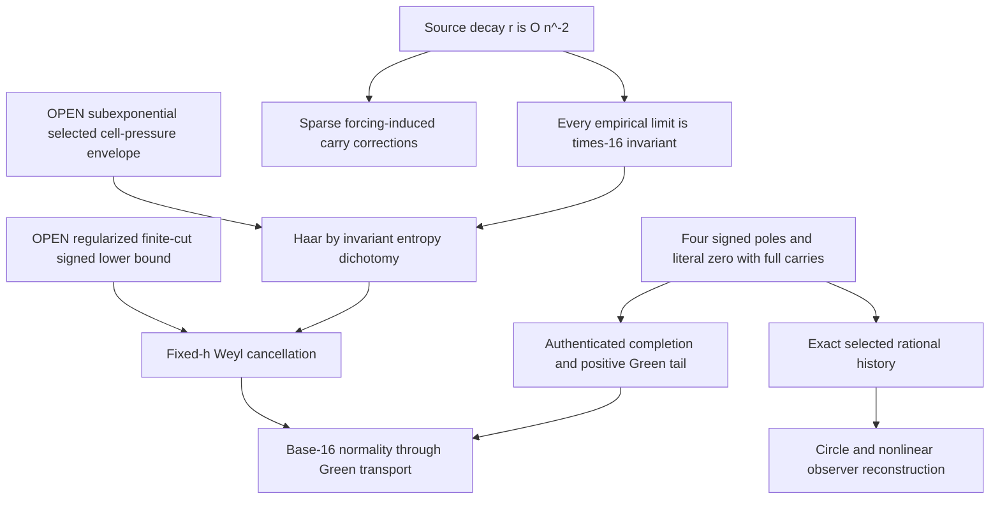

# Proof dependencies and forbidden jumps

Neither A nor O has an arrow to H or W. Both survive coherent same-forcing countermodels. The regularized finite-cut transport is a proved universal inequality; the selected lower bound C is not. The entropy theorem proves sufficiency of P; it does not prove P. Prime-Frobenius orientation and exact cyclotomic identification authenticate a source branch without controlling its chronological occupancy.

The separate RH graph is actual Euler weights plus completed Gamma/poles -> exact Weil quadratic form. A Volterra boundary bound controls only the prime term with an H1 cost. It has no arrow to completed positivity; modulation disproves the proposed uniform Gamma absorption of that cost. There is no supplied BBP-to-Weil intertwiner.
