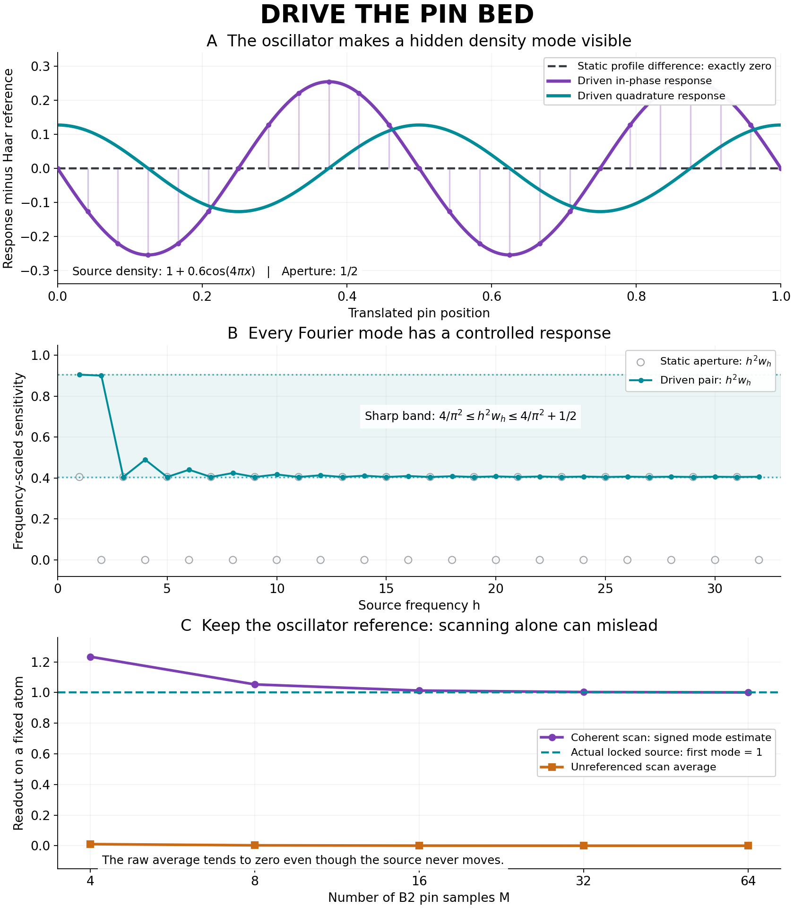

# Drive the pin bed: coherent oscillators, stable surfaces, and truth targets

**Research-only — 2026-11-07. Original BBP four signed poles and literal U0=0
preserved. Pi base-16 normality OPEN.**

This continues [PR541](https://github.com/femboy2112/SUCC/pull/541)'s continuous
pin surface and directly builds on [PR542](https://github.com/femboy2112/SUCC/pull/542)'s
finite two-tone window theorem. The new result is an explicitly invertible,
well-conditioned **continuous driven observer**, with source-bound phase-cycle
software and quantitative certificates for actual truth targets.

## Main results

1. **One extra coherent tone gives an explicit first-order inverse.** For every
   proper aperture 0<alpha<1, the static and tone-one full translated profiles
   recover a circle probability by
   `mu=alpha*((D-2*pi*i)R1-omega*D*R0)/(omega-1)`, omega=exp(-2*pi*i*alpha).
   Their combination cancels the shifted aperture boundary. Rational apertures
   are allowed. Realization requires channel coherence as well as positivity.
2. **Uniform conditioning and exact dynamics.** The pair is a uniform H^-1
   frame. At alpha=1/2, `4||eta||H^-1 <= D <= sqrt(16+2*pi²)||eta||H^-1`.
   The explicit affine surface update is natural and has sharp real-law ×16
   norm **341/sqrt(205)**, about 23.8165, attained by a genuine cosine-law pair.
3. **Useful target certificates.** At half width,
   `|mu(g)-nu(g)| <= ||g'||2 D(mu,nu)/4` for real H1 targets. Against Haar,
   every arc satisfies `|mu(I)-|I|| <= min(1,3*D(mu,Haar)^(2/3)/2^(5/3))`.
   The exponent 2/3 is optimal on all probability laws. This is a rigorous
   occupancy certificate, conditional on the measured discrepancy bound.
4. **A real four-phase protocol.** Nonnegative masks
   `1+epsilon*cos(2*pi*s-theta)` recover both quadratures. Exact finite software
   binds phase, protocol, source snapshot and source trace before decoding.
   One unknown constant complex gain self-calibrates from known mass.
5. **Finite coherent scans of the original B2 bed.** M rational pin samples
   recover a signed mode with sharp alias radius
   `(pi*h/M)^2*csc²(pi*h/M)-1 < 6*h²/M²`, for 0<|h|<=M/2.
   Combining authentic source transport adds at most `pi*|h|/(15*A²)`.
6. **Sequential access is separately specified.** A single collector at each
   moving-source time, with a fresh independent uniform reference and
   simultaneous quadratures, admits an unbiased lock-in estimator of the
   actual source Weyl mean, with explicit finite variance. A deterministic
   scan is not silently treated as this random-reference protocol.



The plotted floating-point curves illustrate the proved formulas. Exact or
rigorously enclosed values in the receipts carry the finite verification.

## Read the proofs and reproduce the work

- [Continuous theorems](CONTINUOUS_THEOREMS.md): inverse, range, sharp frame,
  naturality, exact ×16 constant, H1/interval targets and authentic source bounds.
- [Lock-in and controls](LOCKIN_AND_CONTROLS.md): self-calibration, sequential
  measurement, finite confidence bounds, clock erasure and instrument drift.
- [Coherent B2 scans](COHERENT_SCAN.md): sharp alias theorem, exact sampled
  source-to-pi certificates, fixed same-forcing wrong seed and interval oracle.
- [Protocol and relative truth](PROTOCOL_AND_TRUTH.md), [claim ledger](CLAIM_LEDGER.md),
  [source map](SOURCE_MAP.md), [audit](PROOF_AUDIT.md), [validation](VALIDATION.md),
  [prospective protocol](PREREGISTRATION.md), and [next theorem](NEXT.md).
- [Implementation](../../../observational_succ/driven_pinbed_observer.py) and
  [32 focused tests](../../../tests/test_driven_pinbed_observer.py).
- [Fresh source receipt](FINITE_RECEIPT.json),
  [independent lock-in receipt](INDEPENDENT_LOCKIN_RECEIPT.json),
  [independent scan receipt](INDEPENDENT_SCAN_RECEIPT.json),
  [independent frame receipt](INDEPENDENT_FRAME_RECEIPT.json), and
  [full-suite receipt: 12,210 tests pass](FULL_TEST_RECEIPT.json).

From the repository root:

```sh
python -m unittest discover -s tests -p 'test_driven_pinbed_observer.py' -v
python research/2026-11-07/driven_pinbed_observability/probe.py
python research/2026-11-07/driven_pinbed_observability/independent_lockin_oracle.py
python research/2026-11-07/driven_pinbed_observability/independent_scan_oracle.py
python research/2026-11-07/driven_pinbed_observability/independent_frame_oracle.py
PYTHONPATH="$PWD" python -m unittest discover -s tests -p 'test_*.py'
```

The module and exact checkers use the standard library and existing SUCC
modules. Only the optional figure renderer requires NumPy and Matplotlib.

## What changed in the proof frontier

The oscillator supplies a complementary measurement channel that cancels an
aperture blind boundary. We now have a stable continuous representation, an
exact finite acquisition protocol and quantitative occupancy/threshold targets.
These are proved observation and transport steps. The original source's
all-epoch signed cancellation is still an OPEN arithmetic estimate.

The driven rectangular bed has O(A^-2) **energy** transport but O(A^-1)
general **norm** transport from rational BBP to completed pi. PR541's B2 bed
retains its O(A^-2) norm bridge. These geometries answer different questions
with different resolution and noise costs; no global dominance is claimed.
