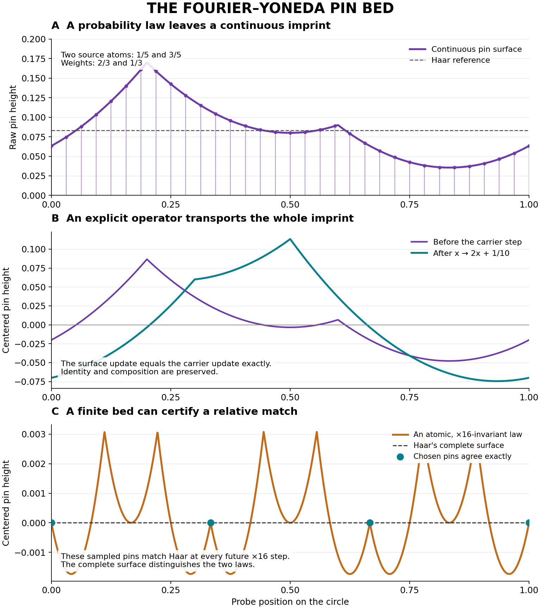

# The Fourier–Yoneda pin bed

**Research-only. Original zero-seeded BBP source preserved. Pi base-16 normality OPEN.**

The metal-pin idea now has a literal continuous mathematical surface, a recovery
formula, explicit lawful dynamics, and a constructive method for adding the pins
needed by future observations. The requested carrier-relative truth output is
first-class: **TRUE_COMPATIBLE** proves that a target-true model shares the same
completed imprint. If false models also share it, their witnesses remain visible.

## Results

1. **Realizable surface.** `F_mu=B2*mu`, with raw nonnegative heights F+1/12.
   Its inverse is `mu=Haar-(1/2)D²F`; positivity of that measure is the exact
   realization condition.
2. **Natural dynamics.** For x->bx+a, the explicit surface operator is
   `L_(b,a)F(t)=b sum_(j=0)^(b-1)F((t-a+j)/b)`. It preserves identity and
   composition and intertwines exactly with the carrier. Sharp L2 norm b².
3. **Sharp conditioning and repair.** General Fourier weights have one-step
   constant `sup_h sqrt(w_h/w_bh)`. Discounted future pullbacks construct a
   stable completion with a certified finite tail; a maximum envelope gives the
   least stable majorant. A characteristic golden aperture alone need not be
   Lipschitz for the dynamics. The precision price of reweighting is explicit.
4. **A concrete relative truth example.** A finite dynamically closed bed can
   certify a target while leaving an irrelevant hidden bit free. A separate
   atomic circle law matches Haar on every selected finite pin at all future
   ×16 steps, illustrating a valid relative equivalence with explicit scope.
5. **Original-source transport.** On every epoch [A,2A), the B2 surface of the
   exact rational BBP orbit differs from that of completed pi by at most
   `1/(30 sqrt(3) A²)` in L2. Exact quartic pair energy makes rational calibration
   possible. The source-selected energy decay remains unproved.



## Read and reproduce

- [Complete theorem dossier](THEOREMS.md): proofs, categorical typing, exact
  quantifiers, completion, controls, source transport and the open next edge.
- [Claim ledger](CLAIM_LEDGER.md), [source map](SOURCE_MAP.md),
  [prospective protocol](PREREGISTRATION.md), [validation](VALIDATION.md).
- Production research module:
  [`observational_succ/fourier_yoneda_pinbed.py`](../../../observational_succ/fourier_yoneda_pinbed.py).
- Tests: [`test_fourier_yoneda_pinbed.py`](../../../tests/test_fourier_yoneda_pinbed.py).
- [Exact original-source receipt](FINITE_RECEIPT.json),
  [independent surface receipt](INDEPENDENT_SURFACE_RECEIPT.json),
  [independent finite-affine receipt](INDEPENDENT_F2_RECEIPT.json).
- [Full-suite receipt](FULL_TEST_RECEIPT.json) and [raw log](FULL_TEST_LOG.txt):
  12,178 tests pass with the import setup and snapshot scope recorded in validation.

From the repository root:

```sh
python -m unittest discover -s tests -p 'test_fourier_yoneda_pinbed.py' -v
python research/2026-11-07/fourier_yoneda_pinbed/probe.py
python research/2026-11-07/fourier_yoneda_pinbed/independent_surface_oracle.py
python research/2026-11-07/fourier_yoneda_pinbed/independent_f2_oracle.py
```

The new module and exact oracles require only Python's standard library and
existing SUCC modules. Rendering the optional figure additionally uses NumPy
and Matplotlib. To run the repository's complete suite from an uninstalled
checkout, put the root on PYTHONPATH or install the package as documented by
the repository; one existing subprocess probe requires that import setup.

## Next theorem that would change the pi verdict

For the authentic r(n) and literal U0=0, prove the exact rational spatial energy

`E_A=-(1/(6A²)) sum_(A<=n,m<2A) B4({U_n-U_m})`

tends to zero for all sufficiently large integer A. The whole pin bed then
flattens to the Haar surface, and the proved source/target bridges imply
base-16 normality. This criterion is an equivalent reformulation, not a new
asymptotic estimate. The completed bed is an instrument for the missing proof.
