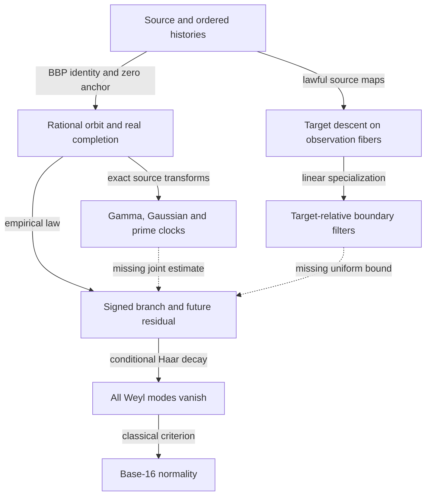

# Leah–Gamma twist: typed genealogy and recovered mechanisms

**Research reconstruction, 2026-11-12 (America/New_York).** Baseline main
`db9fb4b84672050efa79b13377f1e73364598a14`. This note records archival findings,
not new proofs of the historical statements. The accompanying
[GENEALOGY.json](GENEALOGY.json) records live PR metadata, checked ancestry,
typed edges, and the primary dossiers inspected. Historical theorem authority
is inherited only within its original hypotheses. π normality and R0 remain OPEN.

## Coverage and provenance

The reconstruction searched the 10,944-file checkout, its 603 remote branch
references, the mathematical-memory index/atlas/relation graph, and current
frontier/history. It inspected primary proofs or specified sections from the
source-history, gluing, geometry, BBP, Gamma, prime/cofactor, conditional-Haar,
restricted-exponent, RH/Hamiltonian, abc, and Borwein lines. It also read the
unmerged Goldbach signed-sieve and wave-resonance proofs at
`dbc7fed19189016f6ab27550f3e84940b632b09b`. This is **not** a claim to have read
all files, proof logs, or every historical version.

Thirty-two PR metadata records were retrieved through the connected GitHub
API and their heads checked with `git merge-base --is-ancestor` against the
baseline. Every checked historical head through #603 is an ancestor of main,
including #20–22, #24–25, #27–28, #309–310, #324, #337, #499–500, #528,
#533 and #565 whose GitHub PR flags say closed but not merged. Their content
entered through integration ancestry. That differs from the active heads:

| PR | Verified head | In baseline ancestry? |
|---|---|---|
| #604 | `220df67b4ee3f558de63f08cc76ed52b34138302` | No |
| #605 | `8fa0fe392f8c59f168a5d59a1f9c998c9e0de814` | No |
| #606 | `f133e37b2dc736a1200a6cb15184291b4557e0fd` | No |
| #607 | `18a32aa23e1861a67b9f8d904f625b41aac00c1a` | No |

In particular #604's live head is newer than the `ad1e34ba` named in its PR
body. A PR description is not a branch-head receipt. The sibling boundary
papers are investigated separately by this round's boundary work; their
unmerged statements are not silently promoted into main.

## The shape, rather than the chronology

The early program is an inquiry about **which target survives a lawful loss
of information**. Its arithmetic specialization is unusually concrete: the
source, rational state, real completion, carry, local prime residue, and
conditional digit law are different images of one selected history. Most
failed proof routes identify two images after one has discarded a distinction
needed by the final signed observable.

Solid edges are proved maps or implications with their declared domains.
Dashed edges are missing arithmetic estimates, not established theorems.

## Five consequential connections

### 1. Target-relative holography was present before the π campaign

**Original intuition:** several boundary observers on one carrier should be
able to recover a claim without rebuilding every hidden degree of freedom.

PR #28, head `4733d5e5534bf64f8f41d57e9da05ecc5bc42c61`, proves in
`research/2026-10-12/SHARED_CARRIER_BOUNDARY_DESCENT.md`, SC1:

\[
T=\widehat T\circ O\quad\Longleftrightarrow\quad
O(x)=O(y)\Rightarrow T(x)=T(y).
\]

The decoder is unique on the actual image `O(C)`, not on all formally
compatible reports. SC2's even-parity carrier `{000,011,101,110}` admits
every pair of reports in `(1,1,1)` but no common source producing the triple.
SC5–SC7 supply an actual positive example: harmonic interiors are recovered
by `u_I=-L_II^{-1}L_IB f_B`; their boundary energy is the Schur complement,
and nested elimination commutes. The harmonic law, rather than the word
boundary, supplies uniqueness.

**Connection:** the #605 row-span criterion is a linear target specialization
of this existing fiber theorem. It does not need a universal state decoder.
The current target can be one signed residual or one shell anti-locking
functional. That potentially lowers the required observation dimension.

**First conditional π step:** proving that the *actual accessible source
filters*, at their prescribed resolution, separate this target with bounded
inverse norm, and then deriving a nontrivial bound on their actual responses.
Separation alone determines a number; it does not make it small.

**Rent paid:** an old instrument and a precise admissibility test, not an
already-existing arithmetic saving. **Hostile witness:** the even-parity
carrier and a hidden component not meeting the harmonic boundary.

### 2. The anchor belongs to an open history, not its corrected loop

**Original intuition:** A/B ice climbers meet at E, but their reports need
compatible transport and retained provenance.

PR #22 (`f060d465a808877210a02bae4c37b73268513a5d`) constructs the category of
source-labelled legal histories. Equal endpoints can retain distinct arrows;
the endpoint-forgetting functor is generally not faithful. Restricted Yoneda
is faithful exactly when the available predecessor contexts separate the
arrows. PR #27 (`8110536ecc6851028d5eef2f3143815b8f9bac3c`) proves local
potential gluing iff every overlap-cycle holonomy vanishes; its nonabelian
version requires the **ordered** product. Merely comparing pairwise reports
does not supply that product.

The exact arithmetic descendant is
`research/2026-11-07/pinbed_yoneda_oscillators/ANCHORED_PATHS_VS_HOLONOMY.md`:

\[
e(hU_{n+d}(s))\overline{e(16^dhU_n(s))}
=e\!\left(h\sum_{j=1}^d16^{d-j}r(n+j)\right)
\]

for **every** seed. Correcting the right side makes every such loop one.
Thus loop-flatness authenticates the recurrence but erases the seed. The
literal-zero identity `16^{-n}U_n-P_n=0` is an open, origin-anchored datum.
The two-root completion `U_n+T_n=16^nx` moves the same anchor to its global
boundary value; it does not create a second independent source.

**First conditional π step:** an estimate of the anchored phase histories
uniform in time. No further coherence identity supplies this estimate.
**Rent paid:** a decisive no-go for corrected-loop-only proofs and a lawful
interface for ordered open paths. **Hostile witness:** `s=-x` has every
corrected loop and a constant completed phase.

### 3. The missing phase has an archived name: the signed fiber-null residual

**Original intuition:** inverse averaging should recover the information that
the virtual-path probability law loses when a particular source path is selected.

The #313 continuation, pinned origin
`79344c62c39c96755b742700b3d4d22fa60d86da`, is developed in
`research/2026-10-26/SEINFELD_INVERSE_AVERAGING_AND_REALIZATION.md`.
For finite `π:X→Y`, the uniform fiber lift `u` of `m=π_*p` gives

\[
p=u+z,\qquad \pi_*z=0,\qquad
\mathbb E_p f=\mathbb E_u f+\langle z,f\rangle.
\]

The pair `(m,z)` retains the complete law; marginals and energies omit the
signed final pairing. In its inverse-path filtration the exact selection
identity is

\[
\mathbb E_QF-\mathbb E_PF
=\sum_t\mathbb E_P[\Delta R_t\,\Delta M_t],
\quad R_t=\mathbb E_P[dQ/dP\mid\mathcal F_t],\quad
M_t=\mathbb E_P[F\mid\mathcal F_t].
\]

This is a classical martingale/disintegration identity, not a discovered
mixing law. A character on a uniform radix inverse tree is revealed at one
specific depth; it does not lose a fixed fraction at every level.

**Connection:** #565's `μ-Qμ` is precisely a signed fiber-null residual for
the first-digit/future map. Its exact `Q=C T_*` splitting and contraction of
`C` give

\[
W_1(\mu_N,\lambda)\le\frac{16}{15}W_1(\mu_N,Q\mu_N)+\frac1{15N}.
\]

The prime/cofactor contrast is another conditional disintegration of the
actual empirical law. It has the same abstract information-loss structure;
there is no assertion that prime fibers and future-digit fibers coincide.
The #306 cartesian base-change theorem specifies when signed pushforward
through such comparisons is valid. Realization-faithfulness alone is too weak.

**First conditional π step:** bound the actual signed selection/residual
pairing, rather than the two marginal energies. **Rent paid:** a complete
retained-information object already in the archive. **Hostile witnesses:**
all sixteen deterministic digit selectors have identical stratum energies
`(8,4,2,1)`; swapping the first two actual branch digits preserves both
marginals but changes the joint real character.

### 4. The Gamma coincidence that survives is a source counterterm

The original Farey/Gauss path fixes `λ=φ^{-1}`. The same Gauss probability
law has digit tail `(log 2) μ(A≥k)=log(1+1/k)`, giving
`H_N-log(N+1)→γ`. This defines a legitimate common-environment comparison,
not a canonical invariant of an unmarked circle. The Oily packet PGF
`(2-z)^{-2}` instead has fixed point `φ^{-2}`. In #310 its displayed Gamma
coefficient becomes zero when the logarithmic readout is centered at its own
mean. Equal numerical Ω values do not establish a map between these sources.

There is, however, a stronger exact bridge. #309's two quadratic atoms and
#499's genuine prime-Frobenius action recover an angular source and a radial
null-period source from the authentic taps:

\[
P=P_{\rm ang}+P_{\rm rad},\qquad
\frac{P_{\rm ang}(t)}{1-t^8/16}=\frac4{(t-1)^2+1},\qquad
\frac{P_{\rm rad}(t)}{1-t^8/16}=2\frac{d}{dt}\log F(t),
\quad F(0)=F(1)=1.
\]

The angular and radial forces have opposing leading terms
`+15/(32n)` and `-15/(32n)`. Their cancellation gives the original
`15/(64n²)+O(n^{-3})`. For the corresponding zero-seeded states
`U=Y+Z`, the already-proved bound `0<Z_n<1/(32n+16)` implies fixed-mode
Weyl-sum transfer `O_h(log N)` and selected triangular-energy transfer
`|J(U)-J(Y)|≤q²/(32A+16)`.

This is a **genuine stable source-preserving transform**, unlike importing
a separately normalized golden or Gamma law. It puts the simpler Gaussian
angular period and the original accelerated forcing into one exact diagram.

#498 then pinpoints a limitation: `30(1/p-log(1+1/p))-49/p³` isolates the
newborn **forcing** within width `<236/p⁴`, smaller than the forcing-cofactor
lattice spacing. The accumulated state's cofactor is exponentially larger;
the same interval does not isolate its selected phase. #459 shows why this
matters: Galois traces can decay exponentially while the chosen phase remains
unit magnitude. Its finite `p=257` window gives the converse useful witness:
the primary mean is `>0.49`, while the complete selected mean at `h=1` has
certified modulus `<1/16`. Cancellation genuinely lives in the joint cofactor.

**First conditional π step:** an all-scale inequality for that joint selected
phase after the stable angular/radial transform. **Rent paid:** exact source
reduction, paid transfer inequalities, and a finite signed interference
certificate. **Red herring:** the radial null period and Gamma positivity
hold before any chronological distribution theorem is established.

### 5. Reconstruction depth and statistical time are different limits

#218 already exhibited the defect: every finite radix truncation becomes
eventually zero, while the limit can be normal. Its exact polygon-to-orbit
transport costs `Lip(F)·ε·(b^N-1)/(N(b-1))`.
#324 improves source transport using the summable BBP tail, but explicitly
excludes unpaid digit seams and constructs a nonnormal number cancelling any
prescribed finite Fourier band. #528 reconstructs the fractional numerator
from the 2-adic state **plus the integer carry** and enough denominator bits;
the profinite state alone does not provide a continuous real phase map.
#533's frequency-ray argument gives a valid mesoscopic collision criterion,
yet the source-specific collision bound remains unproved.

The current #599/#602 saving–exponent analysis is therefore not a different
obstruction discovered by accident. It quantifies what a supposedly uniform
anti-locking law would have to exclude: exceptional closeness at denominators
selected by the radix. The exact restricted transference lemma sees the
base-prime valuation imbalance; ordinary irrationality bounds ignore it.
It still supplies no positive lower density of changes for π.

**First conditional π step:** a source-derived quantitative inequality that
survives the joint limit in time and observation resolution. **Rent paid:**
quantified transport and sharp falsifiers for illegal limit exchanges.
**Hostile witnesses:** rational truncations, fixed finite spectral-band
counterfeits, Kempner's exponent-two sparse digits, and same-forcing periodic
completions arbitrarily close on every predeclared finite horizon.

## What can legitimately be imported from the other programs?

| Archive | Actual result | Reusable service | Missing bridge to selected π |
|---|---|---|---|
| Borwein factorial hologram | Cardinal lift `I_N` with `(1-S_N)||c||²≤||I_Nc||²≤||c||²`, `1-S_N>1/12`; integer and half-integer samples erase N, Fourier germ recovers widths | Explicit stable reconstruction and an honest extra-port requirement | No bound on BBP signed temporal coefficients; constructing widths already knows primes |
| abc effective means | `S_t(X)=C_tX²+O_{t,δ}(X^{2-δ})`, `t<2/3`, `δ<(2-3t)/5`, via divisor expansion, primitive-slope separation and uniform tail control | Example of an actual arithmetic inequality overcoming a positive-moment method ceiling | No identification between the triple height and BBP carry/cofactor; positive triple averages do not estimate a selected phase |
| RH/Suzuki | Mixed derivative of a completed screw kernel is the signed Weil distribution; global positivity remains RH-equivalent and open | Completed-source bookkeeping and finite negative witnesses | A generic positive Gram has no proved equality with the signed completed pairing, and no π consequence |
| Intrinsic Hamiltonian/SUCC–FUCC | Actual dilation covariance `U_tV_pU_t*=p^{it}V_p`; ordered range-projection correlations recover `-ζ'/ζ` in `Re s>1` | A real example where operator order retains source frequencies | Gamma/pole completion and signed pairing remain open; no BBP statistical map |
| Unmerged Goldbach signed sieve | `q_z*s_z=p*p-c_z*c_z`, monotone lower operators, positive coarse signed mass; fixed cutoff fails | Exact polarization preserving sign and a model of scale-dependent localization debt | Different source, different target; its high-frequency/pointwise estimate is itself open |

The earliest abc file still says `t<1/2`; the later effective-mean manuscript
supersedes that limit with `t<2/3`. Reading only an early dossier would
misstate the live result. Conversely, coarse Goldbach positivity cannot be
promoted to every even target, or imported as BBP anti-locking.

## A usable answer to the “one object” question

The archive already contains a mathematically adequate **marked selected
history with its signed disintegration residual**. It can retain the zero
anchor, ordered source innovations, full prime/cofactor address and real
completion together. Taking an authenticated boundary response of this
object is legitimate when target descent and transport are proved. Neither
full retention nor a smaller boundary representation supplies a cancellation
law automatically.

The strongest surviving design requirement is therefore specific: derive an
inequality on the actual signed residual that vanishes under the forbidden
coherence pattern, while its zero-anchor source law forces a nonzero lower
bound. The historical material provides the residual, selector and transport;
the contradiction between those two inequalities is still missing.

The exact finite `p=257` joint cancellation is the best archived positive
discriminator for this idea. A useful next probe must predict a uniform
mechanism beyond that fitted window and fail on the coherent counterseed.
Simply repeating its numerics at larger primes would remain finite evidence.

## Authority

This genealogy is an archival synthesis, not an independent reproof of every
import. The primary sources and current corrections are load-bearing; graph
edges explicitly distinguish maps, inequalities, equivalent gates, missing
estimates and counterexamples. Same-model reconstruction and audit do not
constitute independent external mathematical verification.
