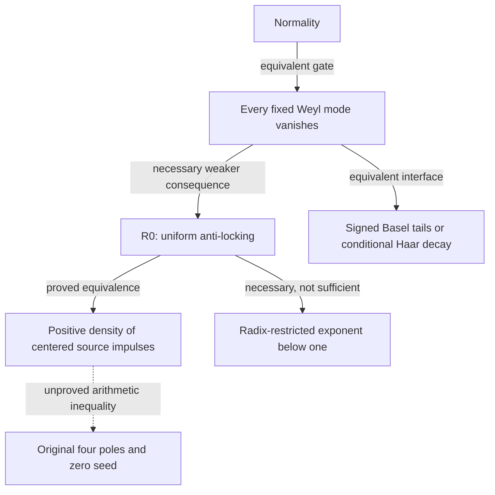

# Operation Leah–Gamma Twist: source-centered boundary currents

Research date: **2026-11-12, America/New_York**. Baseline main:
`db9fb4b84672050efa79b13377f1e73364598a14`. Dedicated research branch:
`research/leah-gamma-twist-2026-11-12`. **Unmerged research.**

**π normality, R0, R1, conditional Haar decay, Goldbach and RH remain OPEN.**
This round proves a modest stronger original-source denominator inequality,
a quantitative carry-only anti-locking interface, a sharp rate counterexample,
a continuous signed boundary filter, and a scoped Machin–Padé obstruction.
It does **not** prove a new all-shell statistical saving for π.

The main outcome is precise: the information-preserving object exists already
in the archive as a selected history with a signed disintegration residual.
The present work makes its R0 boundary response particularly elementary. The
missing arithmetic is positive density of its nonzero integer impulses. Neither
Gamma pole data nor better source reconstruction forces that density.

## A. The reconstructed shape

Read [GENEALOGY.md](GENEALOGY.md) and the typed
[GENEALOGY.json](GENEALOGY.json): 28 nodes, 25 typed edges, 32 live PR records,
26 pinned primary-source blobs. The full 10,944-file checkout and branch index
were searched; primary dossiers were read selectively across all requested
lineages. **Not every file, historical version or proof log was read.**
Personal-context retrieval supplied the original intuitions and historical
claims; repository proofs and governing corrections control mathematical use.

The five consequential connections are:

1. **#28 target descent → #605 target-relative tomography.** A target need only
   be constant on observation fibers. Full interior reconstruction is unnecessary.
2. **#22 ordered histories and #27 holonomy → original-zero authentication.**
   Corrected loops verify the forcing while erasing the seed; retain an open
   source-anchored path.
3. **#313 signed fiber-null residual → current conditional Haar and prime/cofactor
   contrasts.** These are different disintegrations of the same information-loss
   problem, not interchangeable fiber spaces. Their signed pairing is essential.
4. **Quadratic Gaussian atoms → angular/radial Gamma counterterm.** The authentic
   opposite `1/n` terms cancel to `15/(64n²)` with paid statistical transport.
   This is a stronger connection than a grading-dependent golden–Gamma scalar.
5. **Finite polygon/BBP observers → seed-resolution limits → restricted exponents.**
   Finite identification has long been solved more strongly than uniform temporal
   statistics. The two limits must stay separate.

All inspected historical heads through #603 belong to main's ancestry, even
where a closed PR's merge flag is false. Live #604–607 do not. Donor heads:
#604 `220df67b`, #605 `8fa0fe39`, #606 `f133e37b`, #607 `18a32aa2`.
They were read as sources, not merged. The genealogy records full SHAs.

The RH, abc, Borwein and Goldbach archives provide valid source bookkeeping,
polarization, stable transforms and genuine estimates in their own domains.
No source-preserving theorem transfers their conclusions into π cancellation.

## B. The precise mathematical wall and reverse dependency graph

Set `x=pi/16`, `U_0=0`, `U_n=16U_(n-1)+r(n)`, with the four signed poles
unchanged. Write `T_n=sum_(j>=1)16^(-j)r(n+j)` and `Y_n=U_n+T_n=16^n x`.
The canonical missing theorem is

\[
\forall h\in\mathbb Z\setminus\{0\}:\quad
\frac1N\sum_{n=0}^{N-1}e(hY_n)\longrightarrow0.
\]

R0 asks instead for `eta>0,B_0` with, for **every integer** `B>=B_0`,

\[
\mathcal A_B=\frac1B\sum_{B\le n<2B}(1-\cos(2\pi Y_n))\ge\eta.
\]

The dashed edge is deliberately drawn in the backward-research direction:
we need to **deduce D from E**. The other arrows point from the stronger
claim to a necessary or equivalent statement. No implication from the
restricted exponent back to R0 is claimed.

A still-weaker prospective goal is `A_B >> 1/log B` on every late shell,
via source-scale Green-profile separation (candidate 1 below).
The primary obstruction is a **proof-pathway gap**. The source is available
and uniquely authenticated; finite discriminators exist. There is no proof
of impossibility or independence. Demonstrated boundaries apply only to
specified observation families, wrong seeds, or approximation constructions.

## C. Leah–Gamma reconstruction: the same object from both boundaries

The source-rooted observer computes exact rationals and integers:

\[
J_n=\lfloor U_n+\tfrac12\rfloor,\quad
\epsilon_n=U_n-J_n,\quad a_{n+1}=J_{n+1}-16J_n.
\]

The global-rooted observer supplies the **authenticated** bounded Green tail.
Their common present-time comparison is the exact ordered boundary response

\[
\boxed{\epsilon_n+T_n=\sum_{j\ge1}16^{-j}a_{n+j}.}
\]

The zero seed also gives `x=sum_(j>=1)16^(-j)a_j`. This signed integer sequence
retains the complete arithmetic history needed by the target; it is not a
prime projection. Original floor carries and centered carries remain distinct.
An initial anchor is still needed: the rational seed `1/16` aliases all later
impulses.

The Gamma version is equally exact. Put

\[
H(z)=\frac{\Gamma(z+1/8)^4}
 {\Gamma(z+1/2)^2\Gamma(z+5/8)\Gamma(z+3/4)},\quad f(z)=H(z+1)/H(z),
\]
\[
R_{N,s}(z)=e^{8\,16^Nsz}\prod_{j=1}^N f(z+j-1)^{16^{N-j}}.
\]

Then `(log R_(N,s))'(0)/8=U_N(s)`. The weights retain chronology.
The seed is exactly a zero-free exponential factor. Divisors and principal
parts of logarithmic derivatives cannot see that factor. The full boundary
normalization can see it; authentication is not obstructed.

The [continuous filter](HOLOGRAPHIC.md) contracts the actual joint
carry/arrival packet without a discontinuous output seam:

\[
K_{q,h,r}(u)=e(-hr/16)P_{q,h}(16u+r),\quad
\|K-e(h\,\cdot)\|_\infty\le\frac{\pi^2h^2}{512q^2},
\quad\operatorname{Lip}(K)\le2\pi|h|.
\]

Here `P` is piecewise-linear interpolation of `e(ht/16)` on `q^-1 Z`.
Barycentric channel errors have operator norm one in their stated l1 norm.
Unscaled first-moment errors have a different, q-dependent conversion cost.
This buys stable source-preserving transport, not decay of the measured response.

Both observer roots use one source. Their agreement is not independent
corroboration or an ER=EPR identification. Fully identical forcing and zero
seed define only one orbit; an indistinguishable pair with different R0
behavior must relax a stated source or observation constraint.

## D. The three best surviving theorem candidates

Ranked by plausibility of an unconditional arithmetic improvement, not beauty.
All remain **OPEN**. No finite sample is used as a universal premise.

| Rank | Explicit prospective theorem | New ingredient and leverage | Hostile case / smallest decisive obligation |
|---|---|---|---|
| 1 | There exist `eta,delta>0,B_0` such that every `B>=B_0` has at least `eta B` clocks with `|n² epsilon_n+1/64|>=delta` | Original-zero centered residues must avoid the negative Green profile on positive density. Proved response bounds then give `A_B >> 1/log B`. Strictly weaker than R0: the logarithmic-pulse countercontrol satisfies this separation and fails R0. | Coherent seed and terminal rational controls fail it. Derive a zero-anchor-dependent lower count, initially at `delta=1/8`; a finite count alone is ambiguous. |
| 2 | There exist `c>0,B_0` such that every `B>=B_0` has `sum_(n=B)^(2B-1) a_(n+1)^2 >= cB` | Exactly R0, with a computable rational integer interface and no tail seam. Equivalent reformulation honestly declared; only a new source-dependent lower bound would advance it. | Same-forcing coherent seed has every impulse zero. Prove a density/renewal lemma using the original zero that cannot apply to this seed. |
| 3 | For some fixed integer `q>=1`, `eta>0,B_0`, every `B>=B_0` obeys `Re C_(B,q)(1)<=1-eta-pi²/(512q²)` for the actual barycentric joint response | Fixed-resolution signed boundary estimate; exact reconstruction plus vanishing source error yields R0. Again an interface equivalent to R0 when q is free, not a solved estimate. | Locked marginals, omitted forcing sign and coherent counterseed. Bound the signed contraction, preserving the actual old-prime cofactor, instead of bounding separate channel magnitudes. |

The third was tested in depth as the target-relative tomography route; the
first two are two strengths of the same integer-current route. An orthogonal
arithmetic attempt examined Gaussian/Machin Padé families. Its concrete
power-of-two-degree rescue was refuted, as described below. A genuinely
new Hermite–Padé form with favorable valuation and real error rates remains
a separate candidate, not a fourth invented framework.

Why candidate 1 is more than a renamed Fourier problem: it is an explicit
microscopic rational-residue exclusion, has a strictly weaker consequence,
and the exact response decomposes its proof into source-profile separation
and a paid exceptional-set estimate. Its missing source estimate is still
substantial; no assertion that it is easy is made.

## E. Best actual mathematical results

### A source-specific arithmetic improvement

For the literal original zero-seeded states, with `n<t<=2n`, `n->infinity`
and `t/n->5/4`, the [full pole-gap calculation](GAMMA_PRIME.md) proves

\[
\boxed{\liminf\frac{\log\operatorname{den}(U_t-U_n)}n
\ge\frac{1301}{252}-\log2.}
\]

This improves the archived coefficient by exactly `23/126` at this ratio.
It counts every eligible no-injection prime band, invokes the source-derived
macroscopic prime survival theorem, and charges the common exceptional
integer `16^(t-n)-1` only once. The denominator is reduced.

The same calculation proves a limitation: adding **all** these bands leaves
the worst-ratio envelope minimum `79/14-log4`, attained at `t/n=3/2`.
This is the ceiling of the declared band-counting bound, not an upper bound
on the true denominator or a general no-go for arithmetic.
The result improves a source-specific inequality but **does not control the
centered numerator**, hence supplies no R0 saving.

### A quantitative boundary instrument with proof

Write `K_B=sum_(n=B)^(2B-1)a_(n+1)^2`,
`delta_B=15/(4B)+225/(4096B³)`, `tau_B=pi/(32B²)`. Then

\[
\boxed{\frac8{289B}(K_B-17/4-\delta_B)-\tau_B
\le\mathcal A_B\le
\frac{2\pi^2}{225B}(K_B+15/4+\delta_B)+\tau_B.}
\]

Proof in three steps: (i) `a-r=16epsilon_n-epsilon_(n+1)` gives exact
finite energy bounds `225 sum epsilon²-15/4 <= sum(a-r)² <=289 sum epsilon²+17/4`;
(ii) `|a|<=8` and `r(n+1)<15/(64n²)` bound the replacement by integer energy
within `delta_B`; (iii) `8t²<=1-cos(2pi t)<=2pi²t²` and
`T_n<1/(64n²)` pay the completed-phase error `tau_B`.
No asymptotic statistical assumption occurs in these inequalities.

Outside at most `L(1+K_B)` clocks, one also has

\[
|n²\epsilon_n+1/64|
\le(2B²+1/16)16^{-L}+1/(30B).
\]

Consequently `A_B log B->0` forces the negative Green profile in shell
probability. The [hostile construction](HOSTILE.md) proves the logarithmic
rate cannot be discarded: a fixed changed seed has `A_B=Theta(1/log B)`
but `n²(epsilon_n+T_n)>=n/16` for every late n.

### A concrete arithmetic route eliminated

For the explicit [Machin–Padé approximants](GAUSSIAN_PADE.md) `b_n`,

\[
|\pi-b_n|\le\frac{16}{(2n+1)5^{2n+1}}+
\frac4{(2n+1)239^{2n+1}},\qquad
v_2(b_{2^k})\ge2^k-2k-4.
\]

For `k>=4`, common-denominator forms `A_n pi-B_n` therefore have
`v_2(A_n)-v_2(B_n)<0`, so the restricted-transference gain is exactly one.
The real logarithmic combination is `i*pi/2`, but its 2-adic counterpart
is `log_2(i)=0`. The proof controls the Padé denominator, so this is not
merely an unnormalized remainder observation. Standard p-adic logarithm
facts are the classical input; see the official MIT source in the dossier.
The theorem covers this power-of-two-degree schedule and fixed Machin
combinations. It does **not** rule out other schedules or genuine simultaneous
Hermite–Padé constructions.

All universal results above have written proofs plus exact controls. Same-model
constructors and adversaries provide methodological triangulation, not external
peer review or formal-kernel verification. The [claim ledger](CLAIMS.md) separates
these authorities and records the repairs.

## F. The smoking gun, and why it could mislead

The most promising archival coincidence is actual **finite cofactor interference**:
#459's source window `p=257,n=33..128` has primary mean `>0.49`, while the
full selected h=1 mean has rigorously certified modulus `<1/16`. The joint
source cancels where the isolated prime clock does not. Conversely, later
prime-window work has certified examples where the full cofactor increases
the amplitude. Therefore there is no monotone cofactor-improves-cancellation law.

The response/current representation retains exactly that joint information.
The new Green-shadow theorem says what must happen if it repeatedly fails to
escape: the actual rational state must imitate the bounded backward solution
on large source-resolved subsets. The zero boundary is the only remaining
place to force a contradiction with that imitation.

The strongest red-herring warning is exact: the coherent counterseed satisfies
the entire forcing, Gamma poles and backward profile. Even authenticated
rational finite terminal-root controls can imitate it for an arbitrarily
chosen horizon. Pole complexity, stable tomography and large denominators
cannot on their own exclude this behavior for the selected zero trajectory.

## G. The next decisive strike

**Target:** candidate 1, source-scale separation, before claiming R0.
Inputs: original four-pole rational recurrence, exact zero seed, nearest-integer
residual, and fixed `delta=1/8` initially. Prove a uniform `eta>0` such that

\[
\#\{B\le n<2B: |n²(U_n-\lfloor U_n+1/2\rfloor)+1/64|\ge1/8\}
\ge\eta B
\]

for all sufficiently large integer B. The finite protocol is in
[PROBE_PROTOCOL.md](PROBE_PROTOCOL.md); the theorem's quantifier is unchanged
by finite outcomes. The source-specific numerator/cofactor structure must
supply the count; prime denominator growth alone cannot.

Competing predictions: genuine source-scale escape gives positive density;
rapid coherent locking makes the density vanish; logarithmically spaced
impulses can keep the density positive while R0 still fails. This last rival
is why a successful theorem yields `1/log B`, not a fixed R0 saving.

- **Pass:** an all-shell proof using the zero anchor, independently audited,
  plus exact arithmetic/interval controls. It establishes the stated weaker saving.
- **Fail:** a certified counterexample to a proposed quantitative bound, an
  argument that also covers the coherent wrong seed, or an unpaid limit exchange.
- **Ambiguous:** more finite positive shells without the uniform proof mechanism.
- **Required independent evidence:** a separately derived source-residue estimate
  or formal verification of the load-bearing inequality; same-model agreement
  and another floating plot are insufficient.

A proof of candidate 2 would supersede this intermediate target immediately.
We did not stop merely because an equivalence was found: the prime-band,
Gamma, filter and Machin routes were pursued through the new inequality,
explicit rate control, and scoped obstructions documented above. Their
remaining gap is demonstrated at the level of actual maps and estimates.

## Reproduce and review

Use the [validation record](VALIDATION.md), [claim ledger](CLAIMS.md),
[exact finite shell receipts](RESULTS.json), [Gaussian receipts](GAUSSIAN_RESULTS.json),
and the audit notes. The new native module reuses the frozen source and existing
sound character enclosure. No source, imported theorem, workflow or historical
file was changed. No merge, tag or release is authorized by this dossier.
