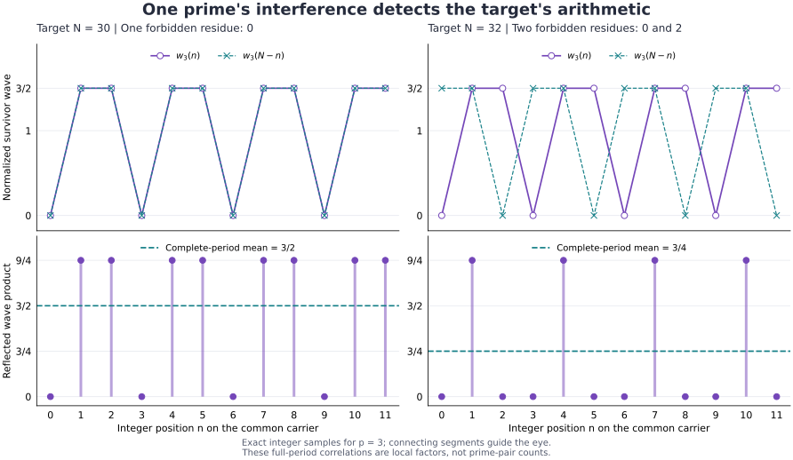

# Prime waves in a shared arithmetic carrier

Research continuation of [CARRIER_COUPLING.md](CARRIER_COUPLING.md), based on
published commit `b3ddf81c4e893866aac04903f682fb5aa01830e2`.

**Steelman.** A prime determines a reproducible pattern in a common carrier.
Keeping the carrier, the phase reference, and the ordinary arithmetic embedding
allows those patterns to be combined and their interference to be measured.
This note supplies that construction, including its categorical maps. The
water analogy guides the model; a physical fluid or wave equation is not an
assumption of the proofs.

**Status.** CLASSICAL FRAMEWORK / PROVED LOCAL in the stated domains. All
proofs below are elementary. No priority, physical realization, asymptotic
speedup, or formal-kernel certification claim is made. Goldbach remains OPEN.
Finite checks are recorded separately in the executable receipt; they do not
replace these proofs or a uniform prime-pair estimate.

## Hole contract and operational phase

The immediate target is an explicit wave representation of the existing
arithmetic category, with coherent dilation, divisibility, and additive
observation. The proposed next theorem is a source-derived lower bound for
the authentic sum fiber. The first target is constructed here; the second
is not settled by introducing waves.

Throughout, write $e(t)=\exp(2\pi i t)$ and use the same orientation and origin
for every wave. An additive frequency, a periodic divisor wave, and a
multiplicative prime coordinate are different specified observables:

| Observable | Formula | Information retained |
|---|---|---|
| Additive prime wave | $\chi_p(\alpha)=e(p\alpha)$ | Ordinary location / winding $p$ |
| Prime-period wave | $n\mapsto e(n/p)$ | The residue of $n$ modulo $p$ |
| Divisor resonance | $d_p(n)=p^{-1}\sum_{j=0}^{p-1}e(jn/p)$ | Whether $p$ divides $n$ |
| Prime-exponent character | $\eta_n(\boldsymbol\theta)=e(\sum_p v_p(n)\theta_p)$ | Complete multiplicative factorization |

Every sum defining $\eta_n$ is finite. All of these waves are computable from
their indicated arithmetic data. A single character has constant intensity
$|\chi_p|^2=1$: its distinguishing information is phase winding, not a
nonuniform probability density. A normalized intensity of a superposition is
an additional declared observation. No unique propagation law follows merely
from knowing a prime; a wave equation, kernel, or dynamics would be extra data.

## 1. An actual category and its coherent wave representation

Let $\mathcal G$ be the category of finite-support $\mathbb N_0$-graded,
finite-dimensional complex vector spaces $V=(V_n)$, with degree-preserving
linear maps. Write $E_n$ for a one-dimensional space concentrated in degree
$n$. Its additive convolution tensor is

$$
(V\otimes_+W)_r=\bigoplus_{a+b=r}V_a\otimes W_b,
\qquad \text{unit }E_0.
$$

Associativity and symmetry are the canonical rebracketings and swaps of the
finite sums and tensor factors. This tensor is the external sum construction;
it is not the product of two objects inside the slice over $\mathbb N$.

For each integer $m\ge1$, define the dilation endofunctor

$$
(D_mV)_r=
\begin{cases}V_{r/m}&m\mid r,\\0& m\nmid r.\end{cases}
$$

It sends $E_n$ to $E_{mn}$. The identifications $D_mD_k=D_{mk}$ and
$D_m(V\otimes_+W)\cong D_mV\otimes_+D_mW$ follow by matching indices;
the second uses $m(a+b)=ma+mb$. Thus each fixed dilation is a strong symmetric
monoidal functor. Put $S(V)=E_1\otimes_+V$. Then

$$D_mS\cong S^mD_m.$$

**WAV-01 — PROVED LOCAL (categorical wave extension).** Give the total vector
space of $V$ the circle action

$$\rho_V(\alpha)v_n=e(n\alpha)v_n.$$

Degree-preserving maps become intertwiners, and convolution tensor becomes the
ordinary tensor of representations, since $e(a\alpha)e(b\alpha)=e((a+b)\alpha)$.
Dilation becomes pullback along the covering $\alpha\mapsto m\alpha$:

$$\rho_{D_mV}(\alpha)=\rho_V(m\alpha).$$

These identities prove compatibility with identities, composition, tensor,
and dilation directly. The character is
$\operatorname{Tr}\rho_V(\alpha)=\sum_n\dim(V_n)e(n\alpha)$.

Divisibility arrows can be retained explicitly in the action category whose
morphisms $V\to W$ are pairs $(m,f)$ with $f:D_mV\to W$. Set

$$
(k,g)\circ(m,f)=(km,\;g\circ D_kf),\qquad
\operatorname{id}_V=(1,\operatorname{id}_V).
$$

Functoriality of $D_k$ and $D_kD_m=D_{km}$ prove associativity and the identity
laws. The distinguished arrows $(m,\operatorname{id}):E_n\to E_{mn}$ form
a copy of the divisibility category on positive labels. This is a specified
subcategory, not the full subcategory, which also has other linear maps.
On the wave side, the corresponding action category has arrows $(m,f)$
intertwining the pullback representation $\rho_V(m\alpha)$ with
$\rho_W(\alpha)$, and the same composition law. The wave functor extends
to these action categories by the proved dilation identity. A divisibility
arrow is not claimed to be an ordinary intertwiner between distinct weights
without that pullback.
We make no claim that arbitrary arrows with different dilation parameters
carry an unqualified monoidal tensor in this action category.

Primes retain the fixed-object characterization from [THEOREMS.md](THEOREMS.md).
The circle representation alone does not characterize primality: every $E_n$
has a one-dimensional character. Multiplicative structure supplies the prime
distinction; the wave representation supplies a common phase basis.

### Two multiplication laws must remain distinct

The additive character obeys

$$\chi_a\chi_b=\chi_{a+b},\qquad \chi_{ab}(\alpha)=\chi_b(a\alpha).$$

It does not obey $\chi_{ab}=\chi_a\chi_b$ in general: $a=2,b=3$ gives
$e(6\alpha)$ versus $e(5\alpha)$. By contrast, the prime-exponent character
satisfies $\eta_{ab}=\eta_a\eta_b$, because $v_p(ab)=v_p(a)+v_p(b)$.
The diagonal choice $\theta_p=\beta$ recovers $e(\Omega(n)\beta)$ from the
earlier cylinder. This is the classical Bohr prime-exponent framework [2].
Keeping the ordinary label $n$ together with its exponent vector preserves
the coupling between these two operations; forgetting the label does not.
The joint monomials $z^n\mathbf u^{v(n)}$ live in an ambient bigraded
polynomial algebra. Their span is not generally closed under ordinary
pointwise multiplication: a product records $(a+b,v(a)+v(b))$, which is
neither the label of $a+b$ nor of $ab$ in general.

## 2. Divisibility is a literal resonance projection

Use the Hilbert space $H=\ell^2(\mathbb N_{\ge1})$ with basis $e_n$.
The Fourier identification sends $e_n$ to $e(n\alpha)$ in the positive-frequency
subspace of $L^2(\mathbb T)$. Define bounded isometries and unitaries by

$$
S e_n=e_{n+1},\qquad V_m e_n=e_{mn},\qquad
U_\alpha e_n=e(n\alpha)e_n.
$$

Then $V_mV_k=V_{mk}$, $V_mS=S^mV_m$, and

$$U_\alpha V_m=V_mU_{m\alpha}.$$

Each equality holds on the orthonormal basis and hence on all of $H$.
In Fourier coordinates, $S$ multiplies by $e(\alpha)$ and $V_m$ dilates the
argument by $m$. The affine shift/dilation representation has classical
provenance in Cuntz [1]; the positive-label restriction here is explicit.

**WAV-02 — PROVED LOCAL (resonance–divisibility identity).** For every $m\ge1$,

$$
Q_m:=V_mV_m^*=\frac1m\sum_{j=0}^{m-1}U_{j/m},
\qquad Q_me_n=\mathbf1_{m\mid n}e_n.
$$

**Proof.** The adjoint sends $e_n$ to $e_{n/m}$ if $m\mid n$ and to zero
otherwise. The finite geometric sum $m^{-1}\sum_j e(jn/m)$ is respectively
one or zero under exactly the same condition. Both sides are bounded
operators, so the basis calculation proves the global equality. Consequently

$$Q_aQ_b=Q_{\operatorname{lcm}(a,b)},\qquad Q_m^*=Q_m=Q_m^2.$$

This gives a prime a completely specified periodic resonance pattern. At a
multiple of $p$, all $p$ phase samples align. At any other residue, their
coherent amplitude sum is zero. Averaging amplitudes is essential: averaging
the intensities of the individual unit-modulus characters gives one everywhere.

For a prime $p$, $Q_pV_m=V_m$ if $p\mid m$, and
$Q_pV_m=V_mQ_p$ otherwise. These are genuine arithmetic couplings, obtained
from $p\mid mn$, rather than independently assigned phases.

### Recovering the earlier multiplicative degree

For positive integers $n$,

$$v_p(n)=\sum_{k\ge1}\mathbf1_{p^k\mid n},\qquad
\Omega(n)=\sum_p\sum_{k\ge1}\mathbf1_{p^k\mid n}.$$

Thus on the finite-support positive-label core,

$$N_\Omega=\sum_p\sum_{k\ge1}Q_{p^k}.$$

The sum is locally finite on that core. Its self-adjoint diagonal extension
has domain $\{a:\sum_n\Omega(n)^2|a_n|^2<\infty\}$. We do not claim this is
a norm-convergent sum of bounded operators. Label zero is excluded here:
every positive integer divides zero, so the same local-finiteness argument
would fail there. This is why the additive tensor unit in $\mathcal G$ and
the positive Hilbert carrier are specified separately.

This also fixes how the new position circle couples to the earlier degree
circle. With $W_\beta e_n=e(\beta\Omega(n))e_n$, basis evaluation gives

$$U_\alpha W_\beta V_m
=e(\beta\Omega(m))V_mU_{m\alpha}W_\beta.$$

For prime $m=p$, the degree phase is exactly $e(\beta)$, while the position
phase still dilates by the particular prime $p$. Thus the shared grade-one
prime sector retains its distinct ordinary embeddings. This is a bounded
unitary/isometry identity, not a claim about an unbounded infinitesimal sum.

## 3. A finite bank of resonance filters gives an exact sieve

For a finite set of primes $p\le z$, define

$$A_z(n)=\prod_{p\le z}(1-d_p(n)),\qquad
E_z(n)=\sum_{p\le z}\mathbf1_{n=p}.$$

For $n\ge2$, $A_z(n)$ and $E_z(n)$ cannot both be one. The second term
restores the small primes that their own divisor filters remove.

**WAV-03 — PROVED LOCAL (adaptive finite prime projector).** For integer
$X\ge2$, $2\le n\le X$, and integer $z\ge\lfloor\sqrt X\rfloor$,

$$\mathbf1_{\mathbb P}(n)=A_z(n)+E_z(n).$$

**Proof.** A prime exceeding $z$ has no prime divisor at most $z$ and survives
$A_z$; a prime at most $z$ is restored by $E_z$. Every composite $n\le X$
has a prime divisor at most $\lfloor\sqrt n\rfloor\le z$ and is neither a survivor nor an
exception. This proves both directions. In operator notation, on the span
of $e_2,\ldots,e_{\lfloor X\rfloor}$ the same selector is

$$P_{\mathbb P,X}=\prod_{p\le z}(I-Q_p+E_{pp}),\qquad
E_{pp}=|e_p\rangle\langle e_p|.$$

All factors are commuting orthogonal projections. This is the ordinary finite
sieve expressed in the shared wave carrier. It does not establish an algorithmic
advantage over a marking sieve. Without the exception terms, primes below the
cutoff are deleted. Without increasing the cutoff, an omitted prime square
survives; with $z=5$, the label $49$ is one such survivor. The unit is outside
the claimed range. An uncorrected product over all primes eventually deletes
every fixed integer $n\ge2$, including primes.

The existing finite prime observer can construct each requested finite filter
bank. A cofinal sequence of increasing, corrected banks fixes each prime and
eventually deletes each composite, so its diagonal projections converge
strongly to the prime projection on the nonunit sector. At any finite cutoff
there are still omitted prime squares, so the operator-norm error is one.
Finite representation and indefinite productive execution are compatible;
neither means a completed infinite computation.

## 4. Local prime waves have an exact interference law

The nonconstant part of the divisor packet is the prime Ramanujan sum

$$c_p(n)=\sum_{a=1}^{p-1}e(an/p)=p\,d_p(n)-1.$$

It is $p-1$ on multiples of $p$, and $-1$ elsewhere. The normalized survivor
wave is

$$w_p(n)=1-\frac{c_p(n)}{p-1}
=\frac p{p-1}\mathbf1_{p\nmid n}.$$

Its mean over a complete residue period is one. These are classical
Ramanujan sums [3], with the normalization stated explicitly.

**WAV-04 — PROVED LOCAL (reflected local correlation).** For every integer $N$,

$$\frac1p\sum_{n\bmod p}c_p(n)c_p(N-n)=c_p(N),$$

and therefore

$$
\sigma_p(N):=\frac1p\sum_{n\bmod p}w_p(n)w_p(N-n)
=1+\frac{c_p(N)}{(p-1)^2}
=\begin{cases}
\dfrac p{p-1},&p\mid N,\\[4pt]
\dfrac{p(p-2)}{(p-1)^2},&p\nmid N.
\end{cases}
$$

**Proof.** Expand both finite character sums. Averaging $e((a-b)n/p)$
annuls every term except $a=b$, leaving $\sum_{a=1}^{p-1}e(aN/p)$.
The constant–nonconstant cross terms in the normalized product have zero
mean. The displayed formula follows. Equivalently, the forbidden residues
for $n$ are $0$ and $N$; they coincide exactly when $p\mid N$.

This is a genuine arithmetic interference effect: the same prime-period
wave is compared with its reflection about $N/2$ using a common phase
reference. For $p=2$, $\sigma_2(N)=2$ for even $N$ and zero for odd $N$.
That zero concerns the screened bulk; odd sums can still have an exceptional
prime pair $2+(N-2)$.

For prime 3 the factors are $\sigma_3(30)=3/2$ and $\sigma_3(32)=3/4$:
the target 30 exclusions coincide, while the target 32 exclusions occupy two
different residues. This exact example is illustrated below.

The figure uses exact rational values at integer labels. Connecting segments
are visual guides, and floating-point plotting does not carry a proof claim.

### Combining the local waves

Let $Q$ be squarefree, with prime divisors in a finite set, and put

$$g_Q(n)=\prod_{p\mid Q}w_p(n)
=\frac Q{\varphi(Q)}\mathbf1_{\gcd(n,Q)=1}.$$

**WAV-05 — PROVED LOCAL (finite CRT interference product).**

$$\frac1Q\sum_{n\bmod Q}g_Q(n)g_Q(N-n)=\prod_{p\mid Q}\sigma_p(N).$$

**Proof.** The Chinese remainder theorem identifies a uniformly counted
residue modulo $Q$ with its independently counted residues modulo each
prime factor. The summand is a product of functions of those separate
coordinates, so the finite sum factors into their local means. This is a
property of uniform counting on a full residue period, not an independence
assumption about actual primes in an interval.

For a squarefree divisor $d$, define
$c_d(n)=\sum_{a\bmod d,\,(a,d)=1}e(an/d)$, with $c_1=1$.
CRT also gives $c_{ab}=c_ac_b$ when $(a,b)=1$. Expanding the finite product
therefore yields the equivalent formulas

$$g_Q(n)=\sum_{d\mid Q}\frac{\mu(d)}{\varphi(d)}c_d(n),\qquad
\prod_{p\mid Q}\sigma_p(N)=\sum_{d\mid Q}\frac{c_d(N)}{\varphi(d)^2}.$$

The latter follows either from the local product or from character
orthogonality: different primitive denominators have no equal frequencies
modulo one. No infinite Fourier-series interchange occurs in this argument.

For fixed even $N\ge4$, along any increasing finite sets exhausting the
primes, the product converges to

$$\mathfrak S(N)=2C_2\prod_{\substack{p\mid N\\p>2}}\frac{p-1}{p-2},
\qquad C_2=\prod_{p>2}\left(1-\frac1{(p-1)^2}\right)>0.$$

Indeed, only finitely many factors divide $N$; the others have summable
deficits, bounded by the convergent sum over all integers. This is the
classical Goldbach singular-series factor [4]. It is a limit of local
densities, not an equality with the actual finite sum-fiber count.

## 5. Additive interference distinguishes sums from differences

For a finite arithmetic source $a_n$, define

$$F(\alpha)=\sum_n a_ne(n\alpha).$$

**WAV-06 — PROVED LOCAL (coherent sum observation).** Fourier orthogonality gives

$$\int_0^1 F(\alpha)^2e(-N\alpha)\,d\alpha
=\sum_{a+b=N}a_a a_b.$$

For $N\ge4$ and the prime indicator through $X\ge N-2$, this is the ordered prime-pair
count $R(N)$. Meanwhile

$$\int_0^1 |F(\alpha)|^2e(-h\alpha)\,d\alpha
=\sum_{a-b=h}a_a\overline{a_b}.$$

The square and the intensity measure different arithmetic relations.
Their distinction is not cosmetic: conjugation reverses the second phase.
For example, the existing joint field

$$\Psi_X(\alpha,\beta)=\sum_{n=2}^X e(n\alpha+\Omega(n)\beta)$$

satisfies

$$R(N)=\int_0^1\!\int_0^1\Psi_X(\alpha,\beta)^2
e(-N\alpha-2\beta)\,d\alpha\,d\beta.$$

The degree condition is $\Omega(a)+\Omega(b)=2$; both labels are nonunits,
so it selects exactly two primes. Opposite degree orientation would select
equal degrees and admit composite pairs. The previous cylinder therefore
embeds directly in this wave extension.

All sums and tensor linearizations used here are finite-support algebraic
ones. The unrestricted map $H\otimes H\to H$ sending $e_a\otimes e_b$ to
$e_{a+b}$ is unbounded: the normalized sum of the $N-1$ positive pairs with
sum $N$ has norm one and image norm $\sqrt{N-1}$. An infinite extension
requires a declared domain or damping, as in CAR-06; bounded categorical
Hilbert-space maps are not silently supplied by the finite formula.

### A convergent wave on an infinite cylinder

An explicit analytic extension of the same source is available if a literal
cylinder is useful. Choose angle $\theta\in\mathbb R/(2\pi\mathbb Z)$ and
height $t>0$, and define

$$\mathcal W(t,\theta)=\sum_{p\in\mathbb P}e^{-pt}e^{ip\theta}.$$

For every positive height the series is absolutely and uniformly convergent
in angle, bounded by the geometric series over all integers at least2.
On any region $t\ge t_0>0$, differentiated series of every fixed order also
converge uniformly, since $\sum_n n^k e^{-nt_0}<\infty$. Thus termwise
differentiation is justified and

$$\left(\partial_t^2+\partial_\theta^2\right)\mathcal W=0.$$

Each prime contributes a specified harmonic mode. This is a chosen harmonic
extension: height is a damping/resolution parameter, not elapsed physical
time or the prime observer's iteration counter. No unique physical radiation
law is inferred. The finite observer has a rigorous uniform tail bound,

$$\sup_\theta\left|\mathcal W(t,\theta)
-\sum_{p\le X}e^{-pt}e^{ip\theta}\right|
\le\frac{e^{-(X+1)t}}{1-e^{-t}},\qquad X\in\mathbb N,\ X\ge2.$$

Absolute convergence permits coefficient extraction without taking a
boundary limit. For every $N\ge4$ and every $t>0$,

$$\frac{e^{Nt}}{2\pi}\int_0^{2\pi}
\mathcal W(t,\theta)^2e^{-iN\theta}\,d\theta=R(N).$$

Only pairs with sumN survive; each has the same damping $e^{-Nt}$.
A finite cutoff $X\ge N-2$ already gives exactly this coefficient. The
factor $e^{Nt}$ would amplify an approximate measurement's error, so this
identity is not a precision or speedup claim. The cylinder supplies a
well-defined infinite field and finite approximations, while the remaining
positivity estimate is still source-specific.

## 6. Three discriminating controls

### Full intensity still loses some source information

Let $A=\{2,3,6,12,14,19\}$ and $B=\{2,3,10,13,15,19\}$.
Their positive difference multisets both contain each element of

$$D=\{1,2,3,4,5,6,7,8,9,10,11,12,13,16,17\}$$

once. Hence, for every real $\alpha$,

$$\left|\sum_{a\in A}e(a\alpha)\right|^2
=\left|\sum_{b\in B}e(b\alpha)\right|^2
=6+2\sum_{d\in D}\cos(2\pi d\alpha).$$

Yet $R_A(8)=2$, from $(2,6)$ and $(6,2)$, while $R_B(8)=0$.
The sets have the same minimum and maximum and are neither translates nor
reflections. This is a shifted classical homometric example [6].

**WAV-07 — REFUTED INFERENCE (intensity determines every sum fiber).** The
displayed equal-intensity sources give a decisive receipt. The scope is
arbitrary finite indicator sources; it is not an ambiguity theorem restricted
to sets already known to be exactly the actual primes. Retaining the complex
field $F$, rather than only $|F|^2$, retains its Fourier coefficients.

### Retaining a reference repairs the intensity loss

**WAV-10 — PROVED LOCAL (coherent finite reconstruction).** With a declared
common complex reference, intensity differences recover the field itself:

$$\operatorname{Re}F=\frac{|F+1|^2-|F-1|^2}{4},\qquad
\operatorname{Im}F=\frac{|F+i|^2-|F-i|^2}{4}.$$

Expanding the four squares proves the identities. The reference $1$ here
is a constant amplitude, or zero additive frequency; it is not the arithmetic
multiplicative unit's wave $e(\alpha)$. A physical realization of these
observations would be a separate claim.

For a source supported in $0,\ldots,X$ and an integer $M>X$, the recovered
complex samples determine every coefficient:

$$a_n=\frac1M\sum_{j=0}^{M-1}F(j/M)e(-nj/M),\qquad 0\le n\le X.$$

The finite geometric sum retains only indices congruent to $n$ modulo $M$,
and this window has no duplicates. Likewise $M>2X$ suffices to recover every
sum coefficient of $F^2$ with the same formula. At an undersampled clock,
indices differing by $M$ alias. This is an exact finite observation protocol,
not a claim that arbitrarily many coefficients fit in one fixed finite bank.

### A finite phase bank can miss the wrong arithmetic embedding

Define the involution $f$ by swapping $p\leftrightarrow31p$ for
$p\in\{7,11,13,17,19,23\}$ and fixing every other positive integer.
It fixes $1,2,3,5,30$ and satisfies $f(n)\equiv n\pmod{30}$.
Transport multiplication through $f$:

$$a\odot b=f(f^{-1}(a)f^{-1}(b)),\qquad
\Omega_f(n)=\Omega(f^{-1}(n)).$$

This is an isomorphic multiplicative source. For every $X\ge713$, each
swap stays within the window and within a single residue class modulo 30.
Thus the full histograms of $(n\bmod30,\Omega(n))$ and
$(n\bmod30,\Omega_f(n))$ agree. The joint fields agree at every
$\alpha=j/30$ and every $\beta$. The divisor projectors $Q_2,Q_3,Q_5$
are also unchanged under this transport, since their divisibility tests
depend only on the residue modulo 30.

Nevertheless ordinary $R(30)=6$, from $(7,23),(11,19),(13,17)$ and
their reverses; the transported prime labels have no such pairs, so
$R_f(30)=0$. Its only prime labels below 29 are $2,3,5$.

**WAV-08 — PROVED LOCAL (finite resonance ambiguity).** The preceding
equalities show that these finite phase observations cannot certify the
ordinary sum fiber. The authentic pointed braid detects the mismatch:

$$V_2^fS e_6=e_{434},\qquad S^2V_2^f e_6=e_{14},
\quad V_2^fe_1=e_2.$$

Here $V_2^fe_n=e_{f(2f^{-1}(n))}$. The small anchor survives while the
mixed additive/multiplicative relation fails. A coherent transport of
addition as well would preserve the correspondingly transported sum fiber.
This is not a counterexample to ordinary Goldbach.

### Positive full-period correlation need not produce an interval survivor

For $Q=30$ and $N=16$, the residues with both $n$ and $16-n$ coprime
to30 are $17,23,29$. Thus their full-period density is $1/10$, and
the normalized correlation is $(30/8)^2/10=45/32>0$.
There is no such residue in the actual interval $2\le n\le14$.
The actual prime pairs $(3,13),(5,11),(11,5),(13,3)$ instead use the
small-prime exceptions removed by this filter.

**WAV-09 — REFUTED INFERENCE (periodic positivity implies an interval pair).**
The exact residue receipt demonstrates both an interval discrepancy and the
need for the endpoint correction. For integer $z\ge\lfloor\sqrt{N-2}\rfloor$, the valid exact
identity is

$$R(N)=\sum_{n=2}^{N-2}
[A_z(n)+E_z(n)][A_z(N-n)+E_z(N-n)].$$

Replacing this interval sum by a positive product of period averages requires
a proved error estimate. The finite CRT identity does not provide one.

## 7. The earned next question

The carrier now supports individually specified prime resonances, coherent
composition, exact local interference, and the actual sum observation.
Knowing each prime determines every finite wave packet above. This yields
useful representations and exact computation, while a universal lower bound
still needs arithmetic control of the combined field.

**Next hole contract.** Choose a source-defined cutoff, weights, and
observation before consulting the target's prime pairs. Derive a main term
and an interval or Fourier-remainder bound for the actual source, including
the small-prime exceptions. Prove that the error is strictly smaller than
the positive contribution for all sufficiently large even targets, with an
explicit finite exceptional range. If the remaining claim is merely
“the degree2 coefficient is positive,” it is still the original target.

The cheapest falsifiers are now stronger: the proposed observation must
separate the homometric intensity sources if it claims full phase recovery;
it must reject the modulo 30 transported source if it claims source fidelity;
and it must handle the $N=16,Q=30$ interval control if it invokes local
density positivity. Passing these tests is necessary for the corresponding
claims, not sufficient for the all-target theorem. Helfgott's account [5]
explains why exact Fourier conversion leaves a substantive remainder problem.

## Claim ledger and reproducibility boundary

| ID | Earned claim | Scope / next falsifier |
|---|---|---|
| WAV-01 | Graded wave functor, coherent dilation, explicit action-category composition | Finite graded objects; no unspecified mixed-parameter tensor |
| WAV-02 | $Q_m=V_mV_m^*=m^{-1}\sum U_{j/m}$ and valuation recovery | Bounded projection equality; degree sum only on declared domain |
| WAV-03 | Corrected finite resonance bank equals the prime sieve | $2\le n\le X$, integer cutoff at least $\lfloor\sqrt X\rfloor$; omitted prime-square control |
| WAV-04 | Exact normalized reflected correlation $\sigma_p(N)$ | Full prime residue period and declared phase orientation |
| WAV-05 | Finite CRT/Ramanujan product and convergent local-density factor | Does not replace the actual interval by its periodic mean |
| WAV-06 | Coherent Fourier square counts sums; intensity counts differences | Finite source or declared convergent domain |
| WAV-07 | Full intensity alone does not determine all sum fibers | Explicit homometric arbitrary-source receipt |
| WAV-08 | A modulo 30 phase bank and small divisor projectors can miss a transported source | Source-specific mixed braid rejects it |
| WAV-09 | Positive local periodic correlation need not supply an interval survivor | $N=16,Q=30$ and endpoint correction |
| WAV-10 | Common-reference intensity differences and a sufficiently fine clock recover finite complex sources | Known phase reference; $M>X$ for degree $X$, $M>2X$ for its square |

Executable checks, hostile controls, and source hashes are separate from
these analytic derivations. A finite output range, a numerical plot, and
same-model audits do not promote the unresolved uniform estimate.

## Primary sources and provenance

1. Joachim Cuntz, *C-star algebras associated with the ax+b-semigroup over N*
   (2006 preprint), [arXiv:math/0611541](https://arxiv.org/abs/math/0611541),
   [PDF](https://arxiv.org/pdf/math/0611541), §2 and §3. The canonical
   shift/dilation representation and congruence range projections are
   antecedents; no quotient-algebra or KMS conclusion is imported here.
2. Hakan Hedenmalm, Peter Lindqvist, Kristian Seip, *A Hilbert space of
   Dirichlet series and systems of dilated functions in L2(0,1)*,
   [arXiv:math/9512211](https://arxiv.org/abs/math/9512211), §2.2. Prime-exponent
   coordinates are classical; a selected diagonal phase is not a random
   character theorem.
3. Srinivasa Ramanujan, *On certain trigonometrical sums and their applications
   in the theory of numbers* (1918), §§1–2,
   [primary-text transcription](https://ramanujan.sirinudi.org/Volumes/published/ram21.html).
   The retrieved source is a transcription of the original paper, not an
   archival facsimile. Our finite orthogonality calculations are written out.
4. Terence Tao, *254A, Notes 4: Some sieve theory* (2015),
   [author notes](https://terrytao.wordpress.com/2015/01/21/254a-notes-4-some-sieve-theory/),
   Legendre sieve and Exercise25. The singular series and sieve estimates
   are distinguished from a proved binary prime-pair asymptotic.
5. Harald Helfgott, *The Ternary Goldbach Problem*, MFO Snapshot3/2014,
   [PDF](https://publications.mfo.de/bitstream/handle/mfo/429/Snapshot-2014-003-Helfgott.pdf),
   printed pp4–6: convolution, Fourier analysis, and the binary remainder.
6. Juri Ranieri, Amina Chebira, Yue M. Lu, Martin Vetterli, *Phase Retrieval
   for Sparse Signals: Uniqueness Conditions* (2013),
   [arXiv:1308.3058](https://arxiv.org/abs/1308.3058), §IV-A,
   [HTML](https://arxiv.org/html/1308.3058v2). The shifted six-point example
   is used as a classical phase-loss control, not a new construction.

The user's prime-wave proposal is the design source. The formulas, choices
of carrier, and operational observations above are explicit model additions.
The research decompositions and hostile audits are same-model work, not
independent external refereeing. Primary sources constrain attribution;
direct proofs and reproducible countercontrols constrain the new application.
