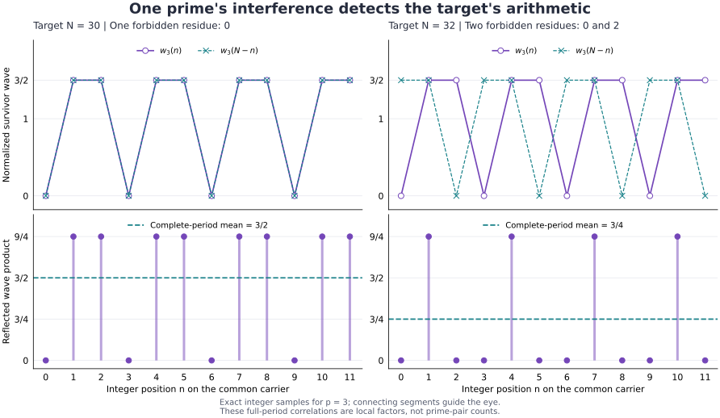

# Prime observers, arithmetic carriers, and wave interference

Research branch from Main XXIV `071ce1e0ee6ab8f8c07113e901131aa646d6b95d`,
2026-11-12. This package develops the requested prime fixed-point category,
finite beta-reducing observer, and circle/twist/back-and-forth continuation.
It also reconstructs and replays the preceding Prime Interferometer work.

The follow-up [CARRIER_COUPLING.md](CARRIER_COUPLING.md) makes the shared
carrier / local waves proposal precise: exact information accounting,
anchored arithmetic rigidity, a joint position-degree generating series,
and Scott-continuous finite-to-infinite semantics. Its exact finite controls
are reproducible with `python research/2026-11-12/prime_fixed_point_observer/carrier_probe.py`.

The next addition [PRIME_WAVES.md](PRIME_WAVES.md) supplies an actual wave
realization of the category: coherent additive characters and multiplicative
dilations, exact divisor-resonance projections, and reflected Ramanujan-wave
correlations. It preserves phase, small-prime exceptions, and the ordinary
arithmetic embedding. The main executable is `prime_waves.py`; exact controls
are in `wave_probe.py` and a separate `waves_independent_audit.py`.

**Goldbach, pi normality, and RH remain OPEN.** The new results are elementary
constructions, exact local proofs, finite certificates, and explicit hostile
models. There is no priority, asymptotic speedup, physical realization, or
formal-kernel acceptance claim.

## Main results

1. The divisibility-category functor `F(n)=n^(tau(n)-1)` has precisely 1 and
   the primes as fixed objects. Prime rounding gives actual adjoint
   retractions in the usual-order category; a prime-only retraction of the
   divisibility category is impossible.
2. A finite closed lambda program, using only ordinary arithmetic delta
   primitives, productively emits every prime. The actual evaluator observes
   its first30 outputs through113 and reports real beta/delta counts.
3. Proper factorization gives a prime kernel and an exact composite-sector
   contraction. The finite Goldbach resolvent trace has a proved error bound
   and an exact integer floor at an explicit cutoff.
4. **Literal commutator fixed points:** `[N_Omega,V_m]=Omega(m)V_m`. Inside
   the finite multiplication-shift algebra, the commutator derivation fixes
   exactly the prime-multiplier span.
5. The degree circle filters primes by Fourier mode1. An irrational twist
   fixes exactly the prime sector; a clockwise/counterclockwise Fejér filter
   has an explicit finite-window error bound. Finite clocks have retained
   alias controls and an adaptive logarithmic resolution schedule.
6. Two multiplicative wiggles transfer prime states through the unit or a
   semiprime. An inserted phase distinguishes those routes and gives a
   precise two-dimensional Pauli block. Filtering after every single step
   destroys the transfer.
7. A fixed-range prime-only additive walk cannot reach all primes. The
   infinitesimal additive degree shear is unbounded near powers of two,
   although each multiplicative commutator is bounded.
8. A finite relabeling preserves the complete one-register degree spectrum
   but changes the sum100 pair count from12 to0. The authentic SUCC/FUCC
   additive braid rejects it. Shared-center preservation also improves the
   earlier finite CRT/Haar certificate in a concrete strict example.
9. A prime determines a periodic divisor wave, with the exact operator
   identity `Q_p=V_p V_p*=mean_j U_(j/p)`. Reflected local interference gives
   `p/(p-1)` when `p|N`, and `p(p-2)/(p-1)^2` otherwise. CRT combines these
   into the classical local-density factors. Full-intensity homometry,
   a modulo 30 phase-bank counterfeit, and an interval-boundary control
   distinguish those proved identities from an all-target pair estimate.

## Read in this order

- [THEOREMS.md](THEOREMS.md): category, recursion, factor spectrum, Goldbach,
  Haar bounds, shared-center repair, and the transported source.
- [CYLINDER.md](CYLINDER.md): the follow-up twist/wiggle construction, literal
  prime commutator, Fejér filter, phase transport, and traversal boundaries.
- [PRIME_INTERFEROMETER.md](PRIME_INTERFEROMETER.md): preceding midpoint,
  split-algebra, singular-series, Haar and CRT work, freshly reconstructed.
- [CLAIM_LEDGER.md](CLAIM_LEDGER.md): status, evidence, and countercontrols.
- [SOURCE_MAP.md](SOURCE_MAP.md): exact repository base and classical sources.
- [VALIDATION.md](VALIDATION.md): actual execution, retained failures, and scope.
- [NEXT.md](NEXT.md): what remains missing and how to test the next proposal.
- [CARRIER_COUPLING.md](CARRIER_COUPLING.md): shared descriptions, coupling
  orientation, and the information lost by forgetting the arithmetic embedding.
- [PRIME_WAVES.md](PRIME_WAVES.md): exact prime-wave category, resonance,
  interference, phase-reference recovery, and the remaining remainder bound.



The plotted values are exact integer-position samples for prime 3. The lines
are drawing aids; the displayed full-period means are local correlations,
not prime-pair counts. The figure can be regenerated by `plot_prime_waves.py`.
The optional figure generator uses Matplotlib; the exact wave implementation
and its tests use the repository's existing Python/SymPy dependencies.

## Reproduce from the repository root

```bash
PYTHONPATH=. python -m unittest discover \
  -s research/2026-11-12/prime_fixed_point_observer -p 'test_*.py' -v

PYTHONPATH=. python research/2026-11-12/prime_fixed_point_observer/lambda_observer.py \
  --count 30 --max-steps 1000000

python research/2026-11-12/prime_fixed_point_observer/probe.py

python research/2026-11-12/prime_fixed_point_observer/cylinder.py

python research/2026-11-12/prime_fixed_point_observer/wave_probe.py

python research/2026-11-12/prime_fixed_point_observer/waves_independent_audit.py
```

The repo's test extras include SymPy, used for independent exact cyclotomic
polynomial checks. The observer itself uses the inherited standard-library
lambda kernel. `UNKNOWN` is budget exhaustion, not a mathematical failure.

The finite probe checks divisor labels through10000, every even target
through2048, and fresh larger targets2458,4096,8192,16384. Exact results,
source hashes, traces, and mutation controls are under `receipts/`.

## Integration boundary

All mathematical implementation changes are confined to this dossier; the
deterministic mathematics catalog is regenerated for discoverability. Existing
source contracts, imported theorems, frozen archives, BBP poles, source seed,
production modules, and existing native tests are not modified. The inherited
beta kernel is used as a dependency and hashed in the receipt.

The external primary papers are cited and paraphrased; their PDFs are not
redistributed. Work is offered as a draft research PR, without a merge or
release. The open prime-pair estimate is explicitly preserved.
