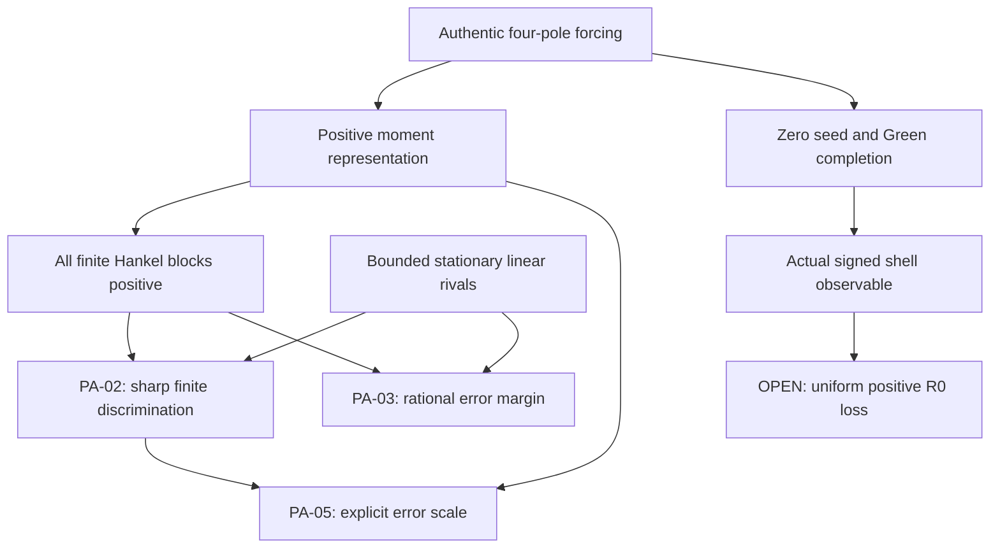

# Principia Observatoris — provenance and arithmetic integration audit

Research date: 2026-11-13, America/New_York. This is a **bounded content audit**,
not a claim to have independently proved every theorem in the repository.
Historical tests and external imports retain their original authority; reading a
receipt is not replaying it. The round does not change frozen sources or silently
integrate open research branches.

## 1. Actual repository snapshot

- Main XXV: `db9fb4b84672050efa79b13377f1e73364598a14`.
- Founding PR [#618](https://github.com/femboy2112/SUCC/pull/618):
  `ab31057590a59b2bfbd5dbcd7126b2aefc7a2b55`, branch
  `research/causal-relevance-proximity-2026-11-13`, base `main`, open draft.
- Principia work begins from that founding head, retaining its complete nine-section
  note at `research/2026-11-13/causal_relevance_proximity/RESEARCH_NOTE.md`.

The following heads were retrieved through the live GitHub PR metadata connector
and fetched locally for immutable `git show` reads. All were open when inspected.
Metadata identifies the snapshot; it does not validate the mathematical contents.

| PR | Exact head | Base / relevant contents inspected |
|---|---|---|
| [600](https://github.com/femboy2112/SUCC/pull/600) | `dbc7fed19189016f6ab27550f3e84940b632b09b` | Main; `wave_resonance/NEXT.md`, current signed all-even obligation; integrated earlier Scott material read on main |
| [601](https://github.com/femboy2112/SUCC/pull/601) | `774191e7679cd63c56bdb105541ce21c8ee27448` | Main; `prime_fixed_point_observer/NEXT.md`, source-observable transport and present/history distinction |
| [604](https://github.com/femboy2112/SUCC/pull/604) | `220df67b4ee3f558de63f08cc76ed52b34138302` | Main; `arity_0_5_observer_ladder/NEXT.md`, positive-type source map versus R0 |
| [605](https://github.com/femboy2112/SUCC/pull/605) | `8fa0fe392f8c59f168a5d59a1f9c998c9e0de814` | Main; ordered-realization definitions and OBR-01 closure proof; current file inventory |
| [606](https://github.com/femboy2112/SUCC/pull/606) | `f133e37b2dc736a1200a6cb15184291b4557e0fd` | Main; boundary-filter THEOREMS; instrument-relative barrier definitions, BI-01–04 |
| [607](https://github.com/femboy2112/SUCC/pull/607) | `18a32aa23e1861a67b9f8d904f625b41aac00c1a` | Main; complete HANKEL_THEOREMS and ARCHIVE_MAP |
| [608](https://github.com/femboy2112/SUCC/pull/608) | `7f11088bf5e3d216ca0f6ae57da1544e17c46d1c` | Main; claim ledger and source/current frontier |
| [609](https://github.com/femboy2112/SUCC/pull/609) | `117d06e126d8ae4fc6d41e3786a3aad350637be6` | Main; complete coupled-oracle README, CO-01–07 |
| [610](https://github.com/femboy2112/SUCC/pull/610) | `00897c94289fc94a491429d4054d548afe20b7c2` | Main; README and R0_INVERSE, including RI-8E proof |
| [611](https://github.com/femboy2112/SUCC/pull/611) | `7306e766c0bc212af1d93bb349358bebb579ff42` | Stacked on #608; complete README and SOURCE_TRANSPORT |
| [612](https://github.com/femboy2112/SUCC/pull/612) | `2128708b14d45493a2a8e48d967b098299b2556d` | Main; complete gauge-complete-normality README, GCN-01–05 |

The `git fetch` output showed the old local remote-tracking reference for #601
being replaced by its current remote head. No remote branch was rewritten by this
audit. Reads and comparisons use the exact SHA above, not that stale local ref.

**Integration collision:** #605 and #606 both add
`research/2026-11-12/holographic_boundary_filters/CLAIM_LEDGER.md` and `NEXT.md`
with different contents. Their mathematical contributions can be compared; their
trees cannot be assumed to merge as byte-identical duplicates. Principia links the
pinned dossiers and imports neither tree.

**Earlier integrated versus live heads:** Main XXV contains earlier selected
snapshots of #600/#601. Its governing corrections in
`docs/CLAIM_SUPPLEMENT_MAIN_XXV.md` apply to those snapshots. Later live donor
commits do not become integrated merely because a PR number already appears in
the main audit.

## 2. Existing foundation and the exact reuse boundary

The full main frontier and the cited short claim supplements were read. The large
CLAIM_LEDGER, ROADMAP and ARCHITECTURE were inspected at the current front matter,
named sections and targeted searches; this bearing does not claim complete
line-by-line coverage of those large documents. The root/other bearings separately
audit the user-requested foundational entrypoints.

| Existing source | What already exists | Principia consequence / no reinvention |
|---|---|---|
| `docs/CARRIER_RELATIVE_TARGETS.md` §§1–3 | Target factorization; exact finite observer algebra; destructive-probe counterexample | Knowledge must separate all-experiment identifiability, executable policy and source adequacy. These are inherited, not new axioms discovered here. |
| `docs/CLAIM_SUPPLEMENT_PRINCIPIA_ANCESTRAL.md`, PAP-01–05 | Hereditary predicates; selected-root endpoint exactness; smallest false endpoint; step/cost gap | Book I's lawful word quotient is stronger. An unrooted commuting relation square is insufficient. |
| `formal/FutureSafeForgetting.lean`; `observational_succ/future_safe_quotient.py` | Exact partial-action descent preserves complete lifted paths and charged costs | Existing formal authority is not transferred to new manuscript theorems without a new checker run. |
| `docs/CONTEXTUAL_ZERO_BACKBONE.md`; CZB-02/04/08/11 | Belief refinement, zero ideals, actual event journal, local-fact failure under motion | Fixed-history knowledge refinement and changing-current-state assertions need different types. |
| `docs/ARCHITECTURE.md`, operational Yoneda section; ledger O211–O226 | Legal-history categories; restricted-probe separation; nonfaithful endpoint functor; policy transport | Category existence, faithfulness, fullness and actual access are four distinct obligations. |
| `docs/CLAIM_SUPPLEMENT_BOUNDARY_PORT_GEOMETRY.md`, BPGS-01–12 | Exact port updates; intervention-identifiable hidden diamond; cubic visibility; action congruence | Causal relevance must include context/higher order, and geometry needs an independently declared source family. |
| `docs/CLAIM_SUPPLEMENT_OBSERVATION_PINNED_GEOMETRY.md`, OPIG-01/N2/N4 | Complete prime tower and Haar convention; delayed tower spoof; same topology/different metric | Finite observations do not imply the tower promise; topology does not determine metric calibration. |
| `research/2026-11-12/scott_relative_defect/` (integrated snapshot) | Refining arithmetic evidence and finitary closure | Pointwise finite classification and directed completion do not give a uniform all-target arithmetic theorem. |
| `research/2026-11-07/fourier_yoneda_pinbed/THEOREMS.md` (as cross-referenced by pinned #612) | Characteristic Bernoulli observer and exact rational energy | Completeness of an observer is already established; decay for the selected source is not. This bearing did not independently replay every pinbed proof. |
| `research/2026-10-24/PI_SOURCE_GENESIS_GREEN.md`, G1/G2/§5 | Positive moment forcing/Green source; all-order Hankel positivity; Gaussian/Padé theory | PA-01 is inherited. PA-02/03 assemble those facts into a sharp finite rival-discrimination contract. |
| `docs/PI_NORMALITY_FRONTIER.md` §§1–9 | Source, zero anchor, signed targets, strict rung hierarchy | R0 is the lowest recorded open signed rung; (CH) is not the weakest. |

The review also read `docs/PROOF_MECHANISMS.md` §12.4, which explicitly withdraws
the old “poles die in one step” argument: index-pole residues and circle states
are different source types. Principia preserves this correction. Its dependency
geometry cannot move a theorem between these carriers without an actual map.

**Additional PA-05 antecedent, located in the final novelty audit.**
[Pascal real kernels §2](../../2026-10-24/PI_PASCAL_REAL_KERNEL.md), PJT-10,
already proves the strict density sandwich and the all-Pascal-moment constants
$15/64,1/2$. The executable
[pi_pascal_kernel.py](../../../observational_succ/pi_pascal_kernel.py),
function forcing_pascal_beta_bounds, originates at
[8f2e6f852efafb4a0c871418c97ed819b1217d7d](https://github.com/femboy2112/SUCC/commit/8f2e6f852efafb4a0c871418c97ed819b1217d7d).
This bearing read the source function, the complete §2 proof, the synthesis
statement and the file's originating Git history. PA-05 reuses that comparison
for monic minimization and the compulsory realization residual. Neither the
constants nor the density sandwich is claimed new.

## 3. Scattered assumptions and incompatibilities requiring explicit adapters

1. **Total versus partial actions.** The carrier-relative matrix algebra uses
   total transitions; future-safe machines permit partial actions. Publicly
   observable enabledness is itself an instrument. A silent undefined action
   must not be treated as a free successful observation.
2. **Before/after readout.** Some machines record before a transition, others
   emit a joint outcome/update. They are interconvertible only after declaring
   the instrument map. A tuple's position is not a causal convention.
3. **State identity versus behavior versus target.** Complete target descent
   can hold while hidden-state identity fails. Full behavior can distinguish all
   initial states while no single-copy destructive policy identifies the target.
4. **Three incompatible ranks.** The rank-four signed index-pole representation,
   infinite positive Green/forcing Hankel rank, and completed phase-Hankel rank
   refer to different sequences and observation maps. None transfers merely
   because every formula contains the BBP source.
5. **Signed versus positive structures.** Gram positivity is a mathematical
   fact of a declared inner product. It is not a signed temporal cancellation
   estimate and does not identify the completed Weil form.
6. **Completion versus chronology.** Increasing a tail truncation depth shrinks
   a source enclosure. Increasing temporal sample length asks a different
   statistical question. Their convergence parameters cannot be interchanged.
7. **Source passport versus source adequacy.** Exact hashes, prime labels and
   frozen recurrences certify mathematical inputs. Their empirical applicability
   to an external physical carrier is a separate premise.
8. **Twin agreement versus independent evidence.** A common encoding or shared
   history may force model agreement. Present effects need transported current
   frames; historical comparisons need event/evolution provenance as well.

These are interface obligations, not wholesale findings that the existing
theory is inconsistent. Several are already explicitly guarded in the archive;
the consolidation keeps them in one foundational dependency map.

## 4. The arithmetic theorem dependency map

There is deliberately **no arrow** from Hankel positivity or finite
discrimination to the open signed loss. The sharp finite theorem closes the
edge “a bounded-order rival must have a priced finite failure,” not the edge
“the authentic source is equidistributed.”

**Novelty tax paid:** PA-02 is neither normality nor an equivalent reformulation.
It holds because the rational forcing is a positive moment sequence, applies at
every finite offset, quantifies over arbitrary complex bounded-order rivals,
and constructs a maximal-prefix counterfeit with its compulsory rational
failure. It is classical mathematics assembled into a new-to-round SUCC
instrument; academic novelty and exhaustive absence from the corpus are not
claimed. PA-03 adds an exact tolerance certificate. PA-05 reuses the existing
PJT-10 comparison of the actual forcing measure with a beta weight and computes
the latter's monic norm by an
elementary Rodrigues argument, and obtains strict two-sided rational bounds
for the compulsory error. For fixed order $d$, that error has size
$\Theta_d(N^{-2d-2})$ at offset $N$; this prices resolution independently of
the sharp observation count. PA-01, full target descent,
the Yoneda principle, and infinite Green rank are not recounted as discoveries.

## 5. Literature and authority

- Bailey, Borwein and Plouffe, *On the rapid computation of various
  polylogarithmic constants*, Mathematics of Computation 66 (1997), 903–913,
  Theorem 1: [author-hosted primary paper](https://www.davidhbailey.com/dhbpapers/digits.pdf).
  Freshly opened; identifies the four-pole π series. The new forcing
  discrimination proof uses rational integration and does not need π normality.
- [NIST DLMF §3.5(v)](https://dlmf.nist.gov/3.5#v), Gaussian quadrature:
  freshly opened official mathematical reference for the classical positive-node
  quadrature neighbor. PA-02 instead gives its own rational companion proof.
- #610 imports Zeilberger–Zudilin's irrationality measure in its logarithmic-loss
  proof. This bearing read that donor's derivation but did not re-prove the
  external irrationality theorem. The logarithmic loss is reported as an
  **attributed paper result**, not new verification of the whole donor.

New universal statements PA-02/03/05 have complete paper proofs in Book VI; finite
exact verification has its separate round receipt. Same-family mathematical
bearings are not independent peer review. No new Lean authority follows from
an existing Lean file, an exact Python run, or agreement among agents.

## 6. Verdict and next discriminating work

The proposed foundation is useful here because it distinguishes three results
that had been easy to conflate: an exactly identified source, an exact finite
surrogate that must eventually fail, and a universal statistic of the source.
PA-02/03 give the second a sharp finite certificate using the first. They do not
give the third. The live weakest signed target stays R0.

The next arithmetic theorem must force a source-selected uniform positive
shell loss, or an independently proved premise sufficient for it, and reject
the coherent changed-seed control for an explicit source-dependent reason.
If a proposed tool only improves tail transport, rank reconstruction, or fitted
source agreement, its value should be stated in those terms. Those are useful
foundation results, but their outputs do not entail the missing signed bound.

## 7. Fresh independent finite arithmetic replay

The arithmetic bearing ran the following command against the root's newly
written observational_succ/principia_observatoris.py. It uses the positive-pole
forcing decomposition, permutation determinants and cofactor inverses rather
than the production four-fraction forcing, LDL factorization and row-reduction
inverse. This is implementation triangulation by the same model family, not
external mathematical peer review. The universal authority remains PA-01–03's
paper proofs. No machine tolerance appears in these checks.

~~~sh
python - <<'PY'
from fractions import Fraction as F
from itertools import permutations
from observational_succ.principia_observatoris import (
    bbp_hankel_ldl, bbp_rank_predictor, bbp_rank_error_bound,
)

def direct_r(n):
    p = 8*n-7
    return F(6,p*(p+3))+F(4,p*(p+4))+F(5,p*(p+5))

def det(a):
    n = len(a)
    if n == 0:
        return F(1)
    out = F()
    for s in permutations(range(n)):
        v = F((-1)**sum(s[i]>s[j] for i in range(n) for j in range(i+1,n)))
        for i in range(n):
            v *= a[i][s[i]]
        out += v
    return out

def inv_cramer(a):
    n, D = len(a), det(a)
    return [[F((-1)**(i+j))*det([
        [a[r][c] for c in range(n) if c != i]
        for r in range(n) if r != j
    ])/D for j in range(n)] for i in range(n)]

cases = scalar_checks = 0
for N in [1,2,7,31]:
    for d in range(1,5):
        h = [[direct_r(N+i+j) for j in range(d+1)] for i in range(d+1)]
        g = [row[:d] for row in h[:d]]
        delta = det(h)/det(g)
        assert delta > 0
        receipt = bbp_hankel_ldl(N,d+1)
        assert receipt["diagonal"][-1] == delta
        model = bbp_rank_predictor(N,d)
        assert model["next_error"] == delta
        for k in range(2*d):
            assert model["model"].response((0,)*k)[0][0] == direct_r(N+k)
            scalar_checks += 1
        inv = inv_cramer(h)
        gamma = 1/((d+1)*max(sum(abs(x) for x in row) for row in inv))
        assert gamma == bbp_rank_error_bound(N,d)
        assert delta >= gamma
        for shift in [0,1,3]:
            y = [sum((F(j+1,d+1)*F(j+shift,d+shift+2)**k
                      for j in range(d)),F()) for k in range(2*d+1)]
            assert max(abs(direct_r(N+k)-y[k])
                       for k in range(2*d+1)) >= gamma
        cases += 1
print({
    "cases": cases, "matched_scalar_checks": scalar_checks,
    "diagonal_rival_checks": 3*cases,
    "method": "independent positive-pole decomposition + Leibniz determinant + cofactor inverse",
    "status": "PASS",
})
PY
~~~

Observed output, exit status 0:

~~~text
{'cases': 16, 'matched_scalar_checks': 80, 'diagonal_rival_checks': 48, 'method': 'independent positive-pole decomposition + Leibniz determinant + cofactor inverse', 'status': 'PASS'}
~~~

This run is separate from the root's required repository gates and hosted CI.
## 8. PA-05 exact scale and Rodrigues replay

The new standalone arithmetic scale probe, run after PA-05's derivation, checks
48 exact source matrices against the independent factorial/product beta formula:
$N\in\{1,2,7,31,127,509\}$ and $1\le d\le8$. It additionally expands the
Rodrigues derivative polynomial, divides by $1-u$, checks its leading
coefficient and orthogonality, and integrates its square by rational monomial
moments for all six offsets and $1\le d\le5$. This supplies 30 separately
constructed norm calculations and 90 vanishing inner-product checks.

It rejects zero-residual, swapped lower/upper bound, and omitted-factorial
mutants. The last is guaranteed to fail for $d\ge2$, giving 42 such checks.
All comparisons are exact rational inequalities. The run command is:

~~~sh
python research/2026-11-13/principia_observatoris/arithmetic_scale_probe.py --output research/2026-11-13/principia_observatoris/receipts/arithmetic_scale.json
~~~

Observed exit status 0; output:

~~~text
{"cases": 48, "independent_orthogonality_checks": 90, "independent_rodrigues_cases": 30, "output": "research/2026-11-13/principia_observatoris/receipts/arithmetic_scale.json", "rejected_mutations": {"omitted_degree_plus_one_factor": 42, "swapped_lower_bound": 48, "swapped_upper_bound": 48, "zero_residual": 48}, "status": "PASS"}
~~~

The receipt retains each rational source residual, beta norm, lower/upper
bound and ratio, plus native-module and probe hashes. No inference about
large-scale signed phase cancellation is made from these finite checks.
