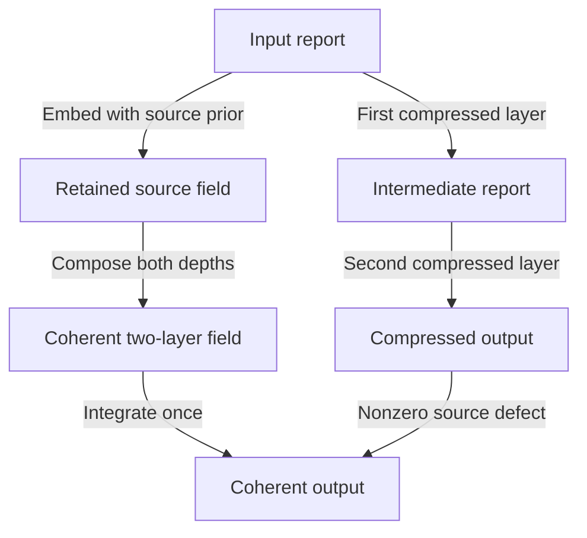

# Gamma builds coherent volumes — if the source survives the report

**Research continuation of [#633](https://github.com/femboy2112/SUCC/pull/633), pinned at `5258eec596ddc882a9063eb6bd01d4e955fe5971`.** Paper proofs, exact rational instruments, independent audit, and explicit classical antecedents. This is a draft research contribution.

The author's proposal was that Gamma spreads a value across a continuous carrier, applies a twist → state evolution → twist, then integrates the volume into an observer's report. The exact mathematical interpretation has three parts:

1. **Gamma normalizes the composition of ordered causal volumes.** At integer depth these are ordinary simplex volumes. The Beta identity makes the same composition lawful at positive real depth.
2. **Exponential conjugation gives the proposed three-operation form.** A tempered fractional integral is an ordinary fractional integral between an exponential weighting and its inverse, based at any chosen origin.
3. **Integration into a report has a source-memory cost.** The original Oily source gives a coherent Gamma-depth family while its source coordinate is retained. Discarding that coordinate before the next layer creates an exact, nonzero composition defect.

The first two mechanisms are classical and substantially present in earlier SUCC work. The new contribution is the source-specific interface, its exact defect and stable predictor, and the report-descent/alias classification connecting it to the preceding knowledge-volume round.

## 1. The exact volume and the two twists

The ordered region `a<t₁<…<t_m<b` has volume `(b−a)^m/m!`. Its causal kernel extends to

\[
 k_\alpha(t)=\mathbf1_{t>0}\frac{t^{\alpha-1}}{\Gamma(\alpha)},
 \qquad k_\alpha*k_\beta=k_{\alpha+\beta}.
\]

This is one precise answer to **what structure Gamma emerges from**: the normalization required for homogeneous causal-volume kernels to concatenate at real depth.

After exponential weighting and normalization, `g_α(t)=t^(α−1)e^(-t)/Γ(α)` is a probability kernel with the same composition law. Its depth-zero identity is the Dirac pulse `g₀=δ₀`, reached as a weak limit. This is a precise mathematical version of beginning at zero and opening a continuum of composable layers.

On a finite causal interval, define

\[
 (J_{a+}^{\alpha,\lambda}f)(y)
 =\frac1{\Gamma(\alpha)}\int_a^y
 (y-v)^{\alpha-1}e^{-\lambda(y-v)}f(v)\,dv.
\]

For `(C_λf)(y)=e^{λ(y−a)}f(y)`,

\[
 \boxed{J_{a+}^{\alpha,\lambda}
 =C_\lambda^{-1}I_{a+}^\alpha C_\lambda.}
\]

Read right to left: **weight → build the fractional volume → undo the weighting**. At zero tempering, applying the operator to 1 yields `(y−a)^α/Γ(α+1)`. This makes the shifted origin literal. For real positive `λ` the twists change amplitude; an imaginary rate is the phase case. The dummy variable in the scalar Euler integral is a separate coordinate.

The logarithmic representation also locates phase precisely:

\[
 \Gamma(c+i\omega)=\int_{\mathbb R}e^{cu-e^u}e^{i\omega u}\,du,
 \qquad c>0.
\]

The Fourier characters live on log scale. A collection of real monomials is not automatically an orthogonal or statistically independent basis.

Your phrase **“shifted onto s” also has an exact centering interpretation**. For real `s>0`, the normalized Gamma carrier has mean `s` and variance `s`. In the logarithmic chart, its density peaks at `u=log s`, corresponding to `t=s`; the density with respect to ordinary `dt` peaks at `s−1` when `s>1`. The volume changes width as its center moves. Concurrent [Gamma Genesis draft #634](https://github.com/femboy2112/SUCC/pull/634) develops this centering and the Mellin construction; this round adds the retained-source composition and observer-horizon interface.

## 2. Carry an actual source through the integral

For a specified contraction `K`,

\[
 F_\alpha(K)=\frac1{\Gamma(\alpha)}
 \int_0^\infty t^{\alpha-1}e^{-t}e^{t(K-I)}dt
 =(2I-K)^{-\alpha}.
\]

The positive weights of `K^n` are

\[
 w_n^{(\alpha)}=
 \frac{\Gamma(n+\alpha)}{\Gamma(\alpha)n!}2^{-n-\alpha},
 \qquad F_\alpha F_\beta=F_{\alpha+\beta}.
\]

The integral now acts on a whole source evolution, rather than merely producing a scalar constant. If `K` advances the source this is a weighted future observable; if `K` is a backward delay it is a causal filter. The time direction and the actually available report remain part of the operator contract.

## 3. The authentic Oily source reveals the missing coordinate

Retain the original source quantities

\[
 u=x-x^2/2,\quad v=x^2/2,\quad
 a_x=(1-u)(1-v),\quad
 R(x)=\frac{1-x}{4a_x},\quad
 \mu(dx)=\frac{16R(x)}\pi dx.
\]

The existing two-loop grade law is

\[
 G_x(z)=\frac{a_x}{(1-uz)(1-vz)}.
\]

Its declared fractional-depth extension `G_x(z)^α` composes exactly at each fixed `x`. At the endpoint `x=1` it is `(2−z)^(-2α)`, retaining the original two loops. The raw source weight is zero at that endpoint; the grade law there is its conditional limit.

If the observer retains only the integral

\[
 A_\alpha(z)=\mathbb E_\mu[G_X(z)^\alpha],
\]

then, for every `α,β>0` and `0≤z<1`,

\[
 A_{\alpha+\beta}(z)>A_\alpha(z)A_\beta(z).
\]

The right side independently redraws the hidden source between layers. At `z=0`, `α=β=1`, the exact contrast is

\[
 \boxed{A_2(0)-A_1(0)^2
 =\frac7{5\pi}-\frac4{\pi^2}
 =\frac{7\pi-20}{5\pi^2}>0.}
\]

In operator form, with retained evolution `S_α`, integration `Π`, and constant-source embedding `J`,

\[
 \overline S_{\alpha+\beta}-\overline S_\alpha\overline S_\beta
 =\Pi S_\alpha(I-J\Pi)S_\beta J.
\]

The middle term is the source-dependent contrast discarded by the report. This is the exact place where the proposed volume carries more reusable information than its one integrated output.



## 4. Infinite linear memory, stable finite understanding

Let `m_n=A_n(0)`. Every shifted Hankel matrix `(m_(r+i+j))` is strictly positive definite: its quadratic form is the integral of a nonzero polynomial in `a_x`, squared, against the positive source measure. Therefore no fixed finite autonomous linear state model generates the entire depth sequence.

Yet the authenticated source gives an exact shortcut:

\[
 \boxed{m_n=\frac{c_n}{2}m_1,\qquad
 c_n=4\int_0^1(1-x)a_x^{n-1}dx\in\mathbb Q.}
\]

The coefficients begin `2, 7/5, 2657/2520, 100679/120120`. A finite polynomial-integration program calculates each one. Moreover `4^(1−n)≤c_n/2≤1`, so absolute input error `ε` in `m₁` stays at most `ε` at every integer depth.

This is a concrete answer to the previous question about immediately specified future points: once the source law is justified, a finite program can compute them without simulating each intermediate layer. The theorem does not authenticate that law from one measured number, and it does not claim constant evaluation cost.

## 5. When does a Gamma report actually determine source evolution?

For a finite-dimensional source matrix `K` with spectrum in the unit disk and a linear report `P`, full Gamma-family descent is equivalent to raw source descent:

\[
 PK=QP
 \quad\Longleftrightarrow\quad
 \text{every }F_\alpha(K)\text{ factors through }P.
\]

One shape already suffices for `0<α<6`. At shape six, a precise alias becomes possible. On the positive six-cycle, the report

\[
 P=(1,1/2,-1/2,-1,-1/2,1/2)
\]

satisfies `P F₆=−P/27`, while source states 1 and 5 share current report `1/2` and have different next reports `−1/2` and `1`. The Gamma-averaged observable is predictable; the next source event is not determined by that report.

The complete admitted set of positive Gamma orders is exactly one of `{0}`, `dN₀`, or `[0,∞)`. In the discrete case `d≥6`; the cycle attains six. This complements #633's integer-horizon monoids, with a different observable and a continuous depth parameter.

## Deliverables and reproduction

| File | Purpose |
|---|---|
| [THEOREMS.md](THEOREMS.md) | Full definitions, proofs, domains, classical antecedents, counterexamples, and falsifiers |
| [CLAIM_LEDGER.json](CLAIM_LEDGER.json) | Claim-by-claim status and dependencies |
| [HOLE_CONTRACT.md](HOLE_CONTRACT.md) | Faithful reading, live frontier, rival predictions, resolution |
| [PROVENANCE.md](PROVENANCE.md) | Pinned source lineage and primary literature |
| [VALIDATION.md](VALIDATION.md) | Actual runs, exact/numerical distinction, and remaining limits |
| [NEXT.md](NEXT.md) | The next source-bound observer construction |
| [gamma_source_volume.py](../../../observational_succ/gamma_source_volume.py) | Exact source grades, moments, stable depth multipliers, Hankel certificates, retained/redrawn controls |
| [gamma_observer_descent.py](../../../observational_succ/gamma_observer_descent.py) | Exact integer Gamma operators and quotient/collision certificates |
| [independent_audit.py](independent_audit.py) | Separate symbolic and numerical reconstruction without either new production module |

Run from the repository root:

```sh
PYTHONPATH=. python -m unittest tests.test_gamma_source_volume tests.test_gamma_observer_descent -v
PYTHONPATH=. python research/2026-11-14/gamma_volume/independent_audit.py
```

The scalar, integral, and matrix calculations clarify the mathematical carrier. Identifying a newly received physical signal or the selected arithmetic carry orbit requires a source-specific observation map beyond these results.
