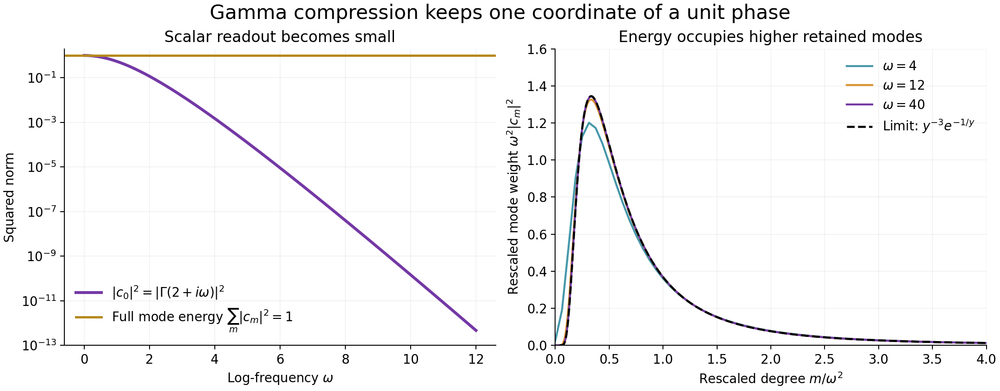

# Gamma phase disintegration

**A constructive answer to the Gamma/Fourier proposal.** Gamma integration is a
scalar projection of a coherent log-phase. Retaining its orthogonal modes gives
an exact realization and explicit reconstruction budgets. The original BBP
forcing also obeys a global zero-free Mellin theorem, and its Green residual
has a quantitatively controlled avoided resonance.

**Research-only draft, stacked on #651 at
`94c7252ac7db3c8b14229544087119bd9cc01933`. R0 and pi normality remain OPEN.**
The source, zero seed, main branch, archives and historical claims are preserved.

## Read the results

- [The synthesis and interpretation](THEOREMS.md) — scoped results,
  correction of the expectation-order wording, exact source connection, and
  the missing arithmetic bridge.
- [Forcing: global nonvanishing and phase recovery](FORCING_THEOREMS.md) —
  Gamma(1)/Gamma(2) sandwich, right-half-plane source factor, finite-band
  inverse, and rational-source zero-free boundary.
- [Laguerre: retained phase and sharp mode cost](LAGUERRE_THEOREMS.md) — exact
  coefficients, two-sided rational error bounds, infinite second degree moment,
  inverse-Gamma degree limit, and source-labelled orthogonal decomposition.
- [Green residual: avoided resonances](RESONANCE_THEOREMS.md) — complete real
  zero set of the limiting spectrum, uniform detuning remainder, and a tilt
  mutation that reverses the surviving imaginary coefficient.
- [Rate-tilt hierarchy and matched-moment control](TILT_HIERARCHY.md) — a
  chosen weighting cancels the first residue; the next reveals variance and
  skewness. An exact rational source matches both coefficients.
- [Claim ledger](CLAIM_LEDGER.json), [hole contract](HOLE_CONTRACT.md),
  [provenance and novelty](PROVENANCE.md), [validation](VALIDATION.md), and
  [next dependency cut](NEXT.md).

The full Gamma-phase expansion has squared norm one. Its scalar coefficient
can be tiny because the orthogonal energy occupies higher degrees. This is
an analytic observer statement, with no physical quantum or pi-normality claim.

## What is inherited

The exact positive Gamma(2) forcing and Green mixtures, their first moments,
fixed-frequency factorization, and the undetuned moving-frequency limit already
appear in the October 26 Oily source bridge. Parent #651 already supplies the
complex Poisson lift. They are dependencies, not new discoveries in this draft.

The new dossier sharpens global phase retention, mode reconstruction and degree
cost, frequency-detuned source response, and the limits of moment-based source
authentication. All classical basis/transform
identities are credited; no global mathematical-priority claim is made.

## Reproduce

Run `bash research/2026-11-15/gamma_phase_disintegration/REPRODUCE.sh` from the
repository root. `gamma_phase_probe.py` and its focused tests use the standard
library. Separate numerical audits require mpmath; the tilt audit also uses SymPy;
the figure uses NumPy and Matplotlib. Numerical quadrature is diagnostic. Written proofs and exact
rational inequalities supply the universal and finite-certificate authority.
