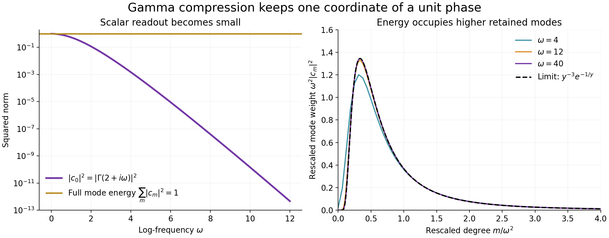

# Gamma phase disintegration — the synthesis

**Status:** paper-proved analytic/source statements with finite executable checks.
The literal four-pole BBP recurrence and zero seed are preserved. **R0 and pi
base-16 normality remain OPEN.** Date: 2026-11-15 (America/New_York).

This dossier develops Leah's proposal that Gamma integration organizes a
continuum of scale-dependent forms, combines their phases, and yields an object
with a constructive Fourier realization. Its strongest surviving version is
an exact separation of **coherent input, retained orthogonal modes, and scalar
projection**. Classical identities and prior SUCC results are credited below;
no claim of worldwide mathematical priority is made.

## GP-01 — Correct the operation before interpreting it

For positive real t and complex s,

\[
t^{s-1}=\exp((s-1)\log t).
\]

The expression `exp(log(t))*exp(s-1)` is generally different. With
`s=alpha+i*omega`, `alpha>0`,

\[
t^{s-1}e^{-t}=t^{\alpha-1}e^{-t}e^{i\omega\log t}.
\tag{1}
\]

Thus alpha chooses a positive weight and omega chooses a phase in logarithmic
scale. At real positive s there is no oscillatory phase in Euler's integrand.
The function `exp(-t)` has unit integral on the positive line; the positive
weight in (1) has mass `Gamma(alpha)` and requires that normalization.

For `G~Gamma(alpha,1)` and `u=log t`, Euler's integral gives

\[
\phi_\alpha(\omega)
=\frac{\Gamma(\alpha+i\omega)}{\Gamma(\alpha)}
=\mathbb E e^{i\omega\log G}
=\int_{\mathbb R}
  \frac{e^{\alpha u-e^u}}{\Gamma(\alpha)}e^{i\omega u}\,du.
\tag{2}
\]

This is a genuine Fourier transform. Dilation `t->ct` rotates the character by
`exp(i*omega*log c)`. The oscillatory family is not orthogonal in the Gamma
weight: its overlap is `phi_alpha(omega-nu)`, which is nonzero. Calling all
the powers an already normalized orthogonal basis would therefore be false.

Gamma has no zeros, so `phi_alpha(omega)` never vanishes at finite real omega.
It does become small at large frequency. The cancellations occur **in** the
integral; they are partial, and the integral still has an amplitude and phase.
The full Fourier family determines the log-density by Fourier inversion.
One scalar value is one linear measurement, not an invertible encoding of an
arbitrary unknown density. Classical sources: [DLMF 5.2](https://dlmf.nist.gov/5.2),
[5.8](https://dlmf.nist.gov/5.8), [5.11](https://dlmf.nist.gov/5.11), and
[1.14](https://dlmf.nist.gov/1.14).

The scale covariance is exact when the rate is retained. For
`G_lambda~Gamma(alpha,rate lambda)`, `lambda>0`,

\[
\mathbb E G_\lambda^{i\omega}
=\lambda^{-i\omega}\phi_\alpha(\omega).
\]

A common change of scale rotates the phase and preserves its modulus. The
weight `exp(-t)` itself fixes a rate; it is not scale invariant. Averaging over
different rates while discarding the rate label is another projection, with
its own possible loss of coherence. Equation (11) accounts for exactly that
additional operation in the authentic source.

### Repair the earlier expectation claim

Parent #651 uses a Bernoulli source click C with `E C=x=pi/16`. Its exact
real-line characteristic function is

\[
\mathbb E e^{i\theta C}=1-x+xe^{i\theta}.
\tag{3}
\]

At the integer circle frequencies `theta=2*pi*h*16^n`, this equals one, while
`exp(2*pi*i*h*16^n*E C)` is the desired arithmetic phase. Thus the bad move is
`exp(i theta E C) -> E exp(i theta C)`. The earlier informal sentence described
the direction backwards. Moreover, it loses the **integer-circle readout**,
not the whole real-line characteristic function: at theta=pi, (3) is `1-2x`.

Fractional-frequency access does not justify a nonlinear interchange. An
absolute error epsilon in the half-frequency value gives error at most
`pi*|h|*16^n*epsilon` in the reconstructed h-th arithmetic phase, by the circle
character's Lipschitz bound. This is a bound for that encoding, not every
possible algorithm. The
parent's exact rational history plus Poisson tail lift already supplies a legal
different construction; that result is inherited, not re-proved as a novelty here.

## GP-02 — A constructive realization of the compressed phase

In `L^2(Gamma(alpha,1))`, use the orthonormal Laguerre polynomials

\[
q_m(t)=\sqrt{\frac{m!}{(\alpha)_m}}L_m^{(\alpha-1)}(t).
\]

For every real omega the unit phase `f_omega(t)=t^(i*omega)` has the complete
expansion

\[
\boxed{
f_\omega=\sum_{m\ge0}c_mq_m,\qquad
c_m=\phi_\alpha(\omega)
 \frac{(-i\omega)_m}{\sqrt{m!(\alpha)_m}},\qquad
\sum_{m\ge0}|c_m|^2=1.}
\tag{4}
\]

Convergence is in the stated L2 space. The normalized Gamma value is exactly
`c_0`, the constant-mode projection. Consequently

\[
\|f_\omega-c_0\|_2^2=1-|c_0|^2.
\tag{5}
\]

This supplies a precise mathematical interpretation of the proposed higher
forms: finite polynomial observables build successive orthogonal degrees, and
the Fourier character has a constructive expansion across all of them. The
Gamma moment matrix has entries `(alpha)_(i+j)`; for alpha=2 they are
`(i+j+1)!`. Laguerre orthogonalization resolves that moment geometry. Like a
complete Haar expansion, the complete expansion preserves squared norm.

The scalar does not secretly store arbitrary discarded data. Formula (4)
constructs the coefficients here because the input phase family is specified.
For an unknown input, its other coefficients require their own observations.

Full proof: [LAGUERRE_THEOREMS.md §§2–3](LAGUERRE_THEOREMS.md). Finite polynomial
integration, completeness, and a separate hypergeometric coefficient-sum
identity are all given. Classical ingredients: [DLMF 18.3](https://dlmf.nist.gov/18.3),
[18.5](https://dlmf.nist.gov/18.5), [18.18](https://dlmf.nist.gov/18.18), and
[15.4](https://dlmf.nist.gov/15.4).

## GP-03 — The native Gamma(2) mode budget is sharp

The authentic source selects shape two through its first-order endpoint zero.
That mixture is inherited from the October 26 source bridge. At alpha=2,

\[
c_m=\Gamma(2+i\omega)
 \frac{(-i\omega)_m}{\sqrt{m!(m+1)!}},\qquad
\sum_m m|c_m|^2=\omega^2.
\tag{6}
\]

For `M>=1`, put `C_omega=omega^2(1+omega^2)` and
`E_M=sum_(m>M)|c_m|^2`. Then

\[
\boxed{
\frac{C_\omega\max(0,1-\omega^2/M)}{2(M+1)(M+2)}
\le E_M\le
\min\left\{1,\frac{\omega^2}{M+1},
              \frac{C_\omega}{2M(M+1)}\right\}.}
\tag{7}
\]

These are rational certificates when omega is rational. They certify squared
L2 error; norm error is its square root. For fixed nonzero omega,
`E_M~C_omega/(2M^2)`, and the second degree moment diverges. The null frequency
has only `c_0=1` and is treated separately.

There is also a large-frequency limit, not merely an upper estimate. If the
formal degree variable D has probabilities `Pr(D=m)=|c_m|^2`, then

\[
\boxed{
\frac{D}{\omega^2}\Rightarrow V,\quad
f_V(y)=y^{-3}e^{-1/y}\;(y>0),\quad
\Pr(V\le L)=(1+1/L)e^{-1/L}.}
\tag{8}
\]

Thus the minimal cutoff retaining any fixed fraction strictly between zero and
one is asymptotic to a positive constant times `omega^2`. This is a theorem
about this orthogonal representation, not a universal algorithmic lower bound.

Example: at omega=10, degrees 0 through 711 give the rigorous squared-error
upper bound `2525/253116 < 1/100`. The floating diagnostic gives approximately
`0.00907959`. The scalar coefficient alone has squared norm about
`1.44124e-10`. Its smallness is compatible with a full phase of norm one.

Full derivation and quantile proof: [LAGUERRE_THEOREMS.md §§4–5](LAGUERRE_THEOREMS.md).
The figure is generated by `make_figure.py`; its floating values are labelled
diagnostic, while (7) supplies the rigorous finite error budget.

## GP-04 — Keep the original BBP source labels through compression

Let B have the inherited probability law

\[
\int f(B)d\mu=\sum_{j\ge1}16^{-j}
 \sum_{(d,v)=(3,2),(4,1),(5,1)}v\int_0^d f(8j-7+u)\,du.
\tag{9}
\]

Its mass is one. For the original Green tail and `a=8n`, `n>=1`,

\[
T_n=\mathbb E_\mu(a+B)^{-2},\quad
d\nu_a=\frac{(a+B)^{-2}}{T_n}d\mu,\quad
Y=\frac{aG}{a+B},\quad G\sim\Gamma(2,1),\ G\perp B\sim\nu_a.
\tag{10}
\]

The moments `E B=7/2` and `E B^2=55/3`, and the resulting exact Mellin
factorization, are inherited. Put

\[
v(B)=\left(\frac a{a+B}\right)^{i\omega},\quad
\Psi_a(\omega)=\mathbb E_{\nu_a}v(B),\quad
\Phi=\Gamma(2+i\omega),\quad F(B,G)=v(B)G^{i\omega}.
\]

The decomposition

\[
F=(F-\Phi v)+\Phi(v-\Psi_a)+\Phi\Psi_a
\]

is orthogonal, yielding

\[
\boxed{1=(1-|\Phi|^2)
 +|\Phi|^2(1-|\Psi_a|^2)+|\Phi\Psi_a|^2.}
\tag{11}
\]

The first term is omitted Gamma-coordinate variation, the second omitted
source-label variation, and the third the fully averaged scalar. Retaining B
and truncating only Gamma degree incurs exactly the budget (7). This is the
constructive source-labelled realization; the four source poles remain visible.

The laws nu_a change with n. These identities specify each marginal; they do
not authorize independent resampling across arithmetic times or supply the
authentic temporal joining. The recurrence's literal zero seed remains an
additional datum, not part of B's law.

## GP-05 — The forcing signal is globally retained

For the **forcing**, write `b=8n-7>0`,

\[
q(t)=4-2e^{-3t}-e^{-4t}-e^{-5t},\quad
R_b=\frac4b-\frac2{b+3}-\frac1{b+4}-\frac1{b+5}.
\]

Give X density `e^(-bt)q(t)/R_b`, and put
`Phi_b^force(omega)=E(bX)^(i*omega)`. The signed-channel formula and positive
Gamma mixture jointly prove, for every `b>0` and real omega,

\[
\boxed{
\Re\frac{\Phi_b^{\rm force}(\omega)}{\Gamma(1+i\omega)}\ge1,
\qquad |\Gamma(1+i\omega)|\le|\Phi_b^{\rm force}(\omega)|
\le|\Gamma(2+i\omega)|.}
\tag{12}
\]

Thus there is no finite real log-frequency at which the forcing transform is
completely annihilated. The proof tracks the actual signed poles in a disk
strictly inside the right half-plane. It supplies a global continuous phase,
an injective logarithmic convolution operator, and a finite-band inverse norm
bounded by `sqrt(sinh(pi*Omega)/(pi*Omega))`. The full inverse is unbounded.

Its Mellin transform `M_b(z)=E(bX)^z` is analytic for `Re z>-2` and nonzero for
`Re z>-1`; for rational b, including every actual source time, it is also nonzero
on `Re z=-1`. An elementary coprimality argument among the adjacent rates
proves the boundary statement. A one-gap mutation has actual boundary zeros.

Full proofs and precise operator domain: [FORCING_THEOREMS.md](FORCING_THEOREMS.md).
This forcing theorem is not asserted for the coherent Green mixture.

## GP-06 — The Green residual has an avoided resonance

The original rate law decomposes as `B=K+V`, with V uniform on `[0,1]` and
independent integer K. Its exact limiting moving-frequency spectrum has real
zeros precisely at `c=2*pi*k`, nonzero integer k. Fix one such c and a finite
detuning interval `|d|<=D`. For `a=8n`,

\[
\boxed{
\Psi_a(ac+d)=\frac1a\left(\frac dc-\frac72-\frac ic\right)
 +O_{k,D}(a^{-2}),}
\tag{13}
\]

uniformly over that entire interval. [RESONANCE_THEOREMS.md](RESONANCE_THEOREMS.md)
gives an explicit fourth-moment remainder and a computable eventual cutoff
beyond which `|Psi_a(ac+d)|>=1/(2|c|a)`.

Real detuning `d=(7/2)c` cancels the real first-order term. The imaginary term
survives. Dropping the source's inverse-square tilt changes that residual from
`-i/c` to `+i/c`: the higher-order phase distinguishes observers whose leading
limiting cancellation is identical. This is a source-transform result, not an
estimate for the chronological arithmetic phase.

## GP-06B — Cancel one residue, expose the next

Allow a declared observer change
`dnu_(a,beta) proportional to (1+B/a)^(-beta) dmu`, beta>=0. Define
`Psi_(a,beta)` by the same log-character under this law. For c=2*pi*k!=0,

\[
 a\Psi_{a,\beta}(ac+d)\longrightarrow
 \frac dc-\mathbb EB+\frac{i(1-\beta)}c.
\tag{14}
\]

The authentic source uses beta=2. Choosing beta=1 and the fixed real detuning
`d=c*E B` cancels this entire coefficient, but the next one is

\[
\boxed{a^2\Psi_{a,1}(ac+c\mathbb EB)\longrightarrow
\operatorname{Var}(B)-\frac{ic}{2}\kappa_3(B)
=\frac{73}{12}-21ic.}
\tag{15}
\]

[TILT_HIERARCHY.md](TILT_HIERARCHY.md) proves uniform first-order and explicit
second-order remainder bounds under finite fourth and sixth moments. Beta=1
changes the original tail observer; beta=0 is an untilted rate law, not a
positive Gamma(shape zero) density.

A hostile control sets `B=K+V`, V independent uniform, with K=2,3,11 having
probabilities 2/3,1/4,1/12. It matches the original first three moments exactly,
and hence both (14) and (15), yet `E B^(-2)=35/264`. Its corresponding
zero-seeded completed radix orbit has harmonic h=33 locked to one for n>=1.
This changes the forcing: it refutes inference from these two coefficients
to unique source selection or normality, not the authentic four-pole target.

## GP-07 — Boundary and the next actual proof obligation

Every source law above survives the same-forcing seed change `s=-pi/16`, which
makes the completed circle orbit identically zero. This rules out any
seed-insensitive inference from the auxiliary laws to normality. It does not
refute a theorem explicitly using the original source **and** zero seed.

A second control changes the source: `R_0(t)=1-t` has the same leading Gamma
endpoint hierarchy and positive Hankel geometry, but `integral R_0=1/2` and its
base-16 orbit locks. Smooth changes supported away from the endpoint can
preserve all endpoint jets while making the integral rational. Their hypotheses
are deliberately different from the literal four-pole contract.

The actual target remains

\[
W_B(h)=\frac1B\sum_{n=B}^{2B-1}e(h[U_n+T_n]),\quad
U_0=0,\quad U_n=16U_{n-1}+r(n).
\]

For fixed h, the exact inequality

\[
\left|W_B(h)-\frac1B\sum_{n=B}^{2B-1}e(hU_n)\right|
\le2\pi|h|T_B
\]

follows from monotonicity of T and the Lipschitz bound on the circle character.
Hence the next signed estimate must control the authentic ordered rational
phases, or prove an actual transport to them. Requiring
`limsup Re B^-1 sum e(U_n)<1` is an **equivalent R0 target**, not a new weaker
theorem. The mode realization makes a representation edge constructive; it
does not establish this missing signed estimate.

Two frequency axes remain distinct throughout: omega is source log-frequency;
h is an integer circle harmonic. No unproved substitution `omega=16^n` or
independence across n is made. The earned advance is a set of exact phase
retention, reconstruction, and source-resonance theorems with calibrated
failure controls.
