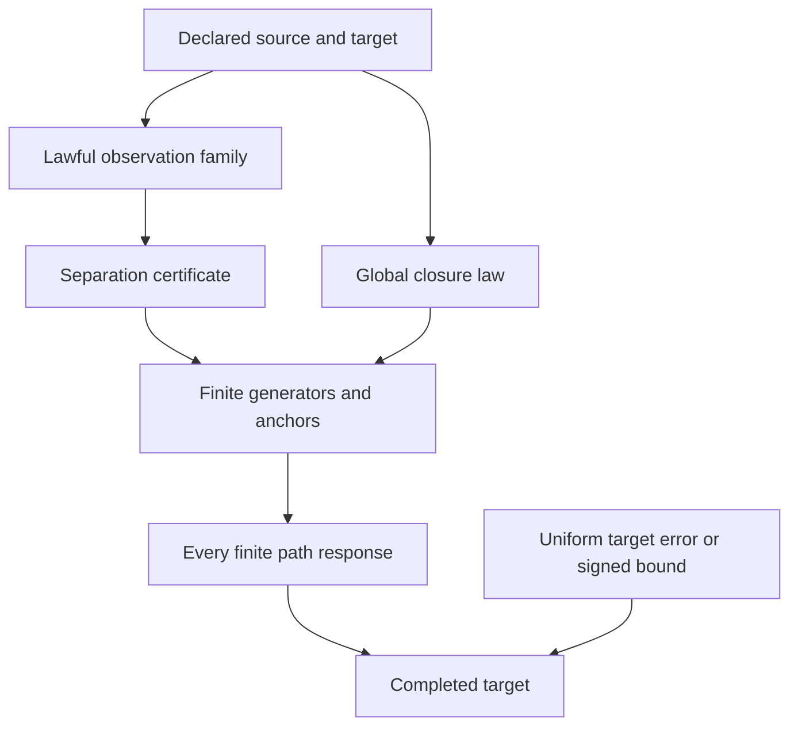

# Causal generator reconstruction

**Date:** 2026-11-19. **Base:** Main XXVI,
`81be6b897ae980b801a3b9de9e22ef81e8360bfb`.

Leah's question is whether a small lawful family of coherent observations can
identify a generating rule, compose its paths, and recover a specified global
structure. This dossier gives that question explicit mathematical objects,
proved finite models, an original-source acquisition theorem, error bounds, and
counterexamples that locate the remaining infinite-observable problem.

The result is a **conditional reconstruction program with concrete theorems**.
The strongest new source-specific statement is sharp: within the declared BBP
four-pole coefficient-and-seed family, **any five distinct exact unwrapped state
readings determine all five parameters**, even when the observation times are
irregular or chosen along a Fibonacci schedule. Four readings cannot do this on
an open parameter family, even with arbitrary deterministic adaptive clocks.

This is not a pi-normality proof. It does identify exactly what the finite
observer has learned and which signed analytic estimate remains unpaid.

## Results worth opening first

1. **[Five-state acquisition](SOURCE_ACQUISITION.md), SA-02/03.** A positive
   block-Cauchy determinant proves arbitrary-time reconstruction and a matching
   transcript-kernel argument proves the adaptive lower bound. Source parameters
   and the literal seed are both recovered; wrapped aliases are rejected.
2. **[Knowledge volume and precision](SOURCE_ACQUISITION.md#sa-04-exact-knowledge-fibers-and-paid-precision),
   SA-04.** Exact compatible fibers give their volume and sharp directional
   uncertainty. For consecutive late clocks the volume is
   `Theta(N^16 / 16^N)` at fixed raw precision, while the worst parameter error
   grows as `Theta(N^7)`. Small volume alone is therefore an inadequate accuracy
   certificate.
3. **[Minimal predictive realization](REALIZATION.md), CGR-R03/05.** An
   accessible Hankel bank plus a globally justified rank bound reconstructs all
   word responses and the minimal linear generator up to similarity. A global
   Jacobian identity **plus an anchor** supplies one route to functional closure.
4. **[Causal phase comparisons](PATH_GEOMETRY.md), PG-01/02.** On a known rooted
   graph, `E-V+1` independent phase comparisons recover a connection up to vertex
   gauge. Both compared paths run forward; access, shared references, elapsed
   time and total traversals are counted separately.
5. **[Completion and compression](COMPLETE_SIGNED.md), CS-03/05.** A transported
   Poisson identity reduces a target mean to boundary, signed residual and
   readout-error budgets. A finite Hankel-Gram inequality proves that fixed-rank
   stationary linear models have a quantitative approximation floor. Conditional
   on normality, their optimal mean-square phase error tends to one, even when
   refitted at every horizon.

The general synthesis and complete reconstruction theorem appear in
**[THEOREM.md](THEOREM.md)**. The formula-to-infinite-sum passage is actually
proved on its convergence domain; the separate chronological signed limit is
not hidden inside that passage.

## The central architecture



The three obligations in the proposal remain separate:

| Obligation | A paid instance here | A decisive failure when omitted |
|---|---|---|
| Separation | Five raw BBP readings; an invertible Hankel basis with its global model promise; chord phases on known support | A four-reading kernel; a wrapped seed alias; a missing chord |
| Generative closure | An authenticated source recurrence; invariant response functions; a Jacobian identity on the whole domain plus anchors | A delayed hidden transition; a translation missed by derivatives alone |
| Completion and signed transport | A geometric resolvent remainder; the explicit BBP endpoint tail; a target-projected telescoping certificate | An undamped divergent sum; a stationary phase; a signed residual with no uniform bound |

These are interfaces between proofs. The first two do not automatically produce
the third. A global model premise is something the source or a separate theorem
must establish, not an output of seeing a finite rank plateau.

## What “minimal” now means

| Model and target | Quantity minimized or bounded | Proven conclusion | Resource or premise still paid separately |
|---|---|---|---|
| Fibonacci response with global order at most two | Two linear states; four successive scalar reports suffice | Every term and the formal generating function `1/(1-z-z^2)` | Global order premise; convergence domain |
| BBP coefficient-and-seed identification | Five raw scalar readings, sharp | All five parameters, every finite source state, a certified endpoint approximation | Exact unwrapped precision, trusted family, elapsed clock |
| Known rooted phase graph | `E-V+1` local phase coordinates | All edge phases modulo vertex gauge | Replay or calibrated records, individual edge access, moduli |
| Irrational completed radix phase | One nonlinear coordinate suffices; no finite stationary linear realization exists | `z -> z^16` generates the orbit exactly | Exact seed and precision; statistical properties |
| Normal radix phase, conditional class | Fixed stationary linear state budget `d` | Best long-horizon phase MSE tends to one | This is conditional on normality; growing or nonlinear models differ |
| A signed target mean | Boundary plus target-projected signed residual | An explicit sufficient completion certificate | Actual source-specific vanishing bounds remain open |

This reconciles finite description with infinite linear rank. A nonlinear
generator can be small while its linearly closed response space is infinite.
The correct state budget depends on the operations the observer is permitted
to use and the target it must preserve.

## Relation to the recent SUCC work

The sibling [PR #668](https://github.com/femboy2112/SUCC/pull/668), pinned at
`15154b8b63969faa76ad2b161aad54f41cae1c63`, already reconstructs the four
forcing coefficients from four innovations and adds an unwrapped seed anchor.
It also provides frame agreement, local-field knowledge volume, integral row
closure, and terminal signed transport. This dossier counts **actual state
readings** without assuming intermediate innovations were already observed,
allows arbitrary gaps, and supplies the sharp lower bound and real precision
geometry. It cites the sibling work without silently importing its unmerged
code into this branch.

The repository already proves predictive quotient descent, finite realization
under a rank promise, delayed-spike failure, irrational phase infinite Hankel
rank, and BBP forcing-rank obstructions. Those are credited as inherited. The
new finite compression inequality and explicit acquisition interface are proved
here; no worldwide novelty claim is made. See [PROVENANCE.md](PROVENANCE.md).

## What remains open for the selected source

The source is still exactly

$$
U_0=0,\qquad U_n=16U_{n-1}+\frac4{8n-7}-\frac2{8n-4}
 -\frac1{8n-3}-\frac1{8n-2}.
$$

The inherited tail identifies the completed orbit
`Y_n = U_n + T_n = 16^n pi/16`. The remaining question is a bound on its
**signed chronological** shell means

$$
W_B(h)=\frac1B\sum_{n=B}^{2B-1}\exp(2\pi i hY_n).
$$

Neither source recovery, finite-dimensional parameter space, nor knowledge of
the endpoint proves that these means tend to zero. The same forcing with seed
`-pi/16` has completed phase constantly one. Any source-blind cancellation
claim is defeated by that exact control. The actual zero seed must enter the
missing inequality.

The next actionable probe is specified in [NEXT.md](NEXT.md): a source-derived
dictionary with sublinear boundary terms and a uniformly small **signed
projected** residual. Its explicit failure conditions prevent it from becoming
a renaming of the unknown Weyl sum.

## Navigation and reproducibility

| File | Purpose |
|---|---|
| [HOLE_CONTRACT.md](HOLE_CONTRACT.md) | Registered target, hypotheses and controls before implementation |
| [THEOREM.md](THEOREM.md) | Unified theorem, proofs, target-relative exactness and distinctions |
| [SOURCE_ACQUISITION.md](SOURCE_ACQUISITION.md) | Sharp BBP acquisition and precision theorems |
| [SOURCE_AUDIT.md](SOURCE_AUDIT.md) | Independent symbolic construction and held-out exact comparisons |
| [REALIZATION.md](REALIZATION.md) | Noncommutative Hankel reconstruction, minimality, anchors and countermodels |
| [PATH_GEOMETRY.md](PATH_GEOMETRY.md) | Directed comparisons, gauge, Jacobian products, resolvent and zeta |
| [COMPLETE_SIGNED.md](COMPLETE_SIGNED.md) | Error transport, signed certificate and compression floor |
| [CLAIMS.json](CLAIMS.json) | Domain, hypotheses, quantifiers, proof, controls and status per claim |
| [PROVENANCE.md](PROVENANCE.md) | Pinned source map and classical/new-to-this-dossier distinction |
| [VALIDATION.md](VALIDATION.md) | Actual commands, results, limits and raw receipts |
| [NEXT.md](NEXT.md) | The next verdict-changing experiment and arithmetic obligation |

The four `test_*.py` files exercise the four corresponding exact-arithmetic
modules. `source_independent_audit.py` uses a separate SymPy construction and
held-out schedules; it does not import the Fraction acquisition implementation.
Run the focused suite from the repository root:

```sh
PYTHONPATH=. python -m unittest discover \
  -s research/2026-11-19/causal_generator_reconstruction -p 'test_*.py' -v
```

Paper proofs carry the quantified conclusions. Finite tests calibrate the
implementations and kill specified mutants. Same-model delegated proof audits
are additional checks, not independent external peer review or formal-kernel
verification.
